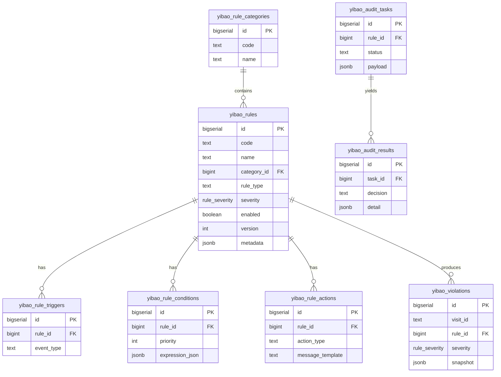

# 智慧医保临床实时质控系统 - 数据库设计说明 V1.1

本说明覆盖当前 Supabase(PostgreSQL) 数据模型（统一规则域 + 业务/审计），对应迁移脚本：
- migrations/001_reset_and_create_unified_rules.sql
- migrations/002_seed_minimal_rules.sql

## 1. 命名约定
- 统一使用 `public` schema，表前缀 `yibao_`。
- 主键 `id`（bigserial）或自然键（如 drug_code）。
- 统一启用 RLS（Row Level Security）：
  - `service_role`: 全权限（读/写/删）
  - `authenticated`: 只读（select）
  - `anon`: 禁止访问
- 时间字段 `created_at`、`updated_at` 为 `timestamptz`，`updated_at` 由触发器维护。

## 2. 核心域模型（规则平台）

### 2.1 枚举
- `rule_severity` enum: `info | warn | block`（规则命中严重级）

### 2.2 分类表
- 表：`yibao_rule_categories`
  - `id` bigserial PK
  - `code` text uniq（如 `batch_1`）
  - `name` text（中文名称）
  - `created_at` `updated_at`

### 2.3 规则主表
- 表：`yibao_rules`
  - `id` bigserial PK
  - `code` text uniq（如 `DRUG_AGE_001`）
  - `name` text（规则名）
  - `category_id` FK → `yibao_rule_categories(id)`
  - `rule_type` text（如 `drug_age | drug_gender | visit_type | hospital_level | duration | surgery_pricing`）
  - `severity` `rule_severity`（默认 `warn`）
  - `enabled` boolean（启用）
  - `version` int（版本）
  - `metadata` jsonb（附加信息，来源、备注等）
  - `created_at` `updated_at`
- 触发器：`trg_yibao_rules_updated_at`（更新时刷新 `updated_at`）
- 索引：`idx_yibao_rules_type_enabled(rule_type, enabled)`

### 2.4 触发事件
- 表：`yibao_rule_triggers`
  - `id` bigserial PK
  - `rule_id` FK → `yibao_rules(id)` on delete cascade
  - `event_type` text（如 `order.drug.submit`）
- 索引：`idx_yibao_rule_triggers_event(event_type)`

### 2.5 条件（JSON 表达）
- 表：`yibao_rule_conditions`
  - `id` bigserial PK
  - `rule_id` FK → `yibao_rules(id)` on delete cascade
  - `priority` int（越小优先）
  - `expression_json` jsonb（条件树）
- 索引：`idx_yibao_rule_conditions_gin USING GIN(expression_json jsonb_path_ops)`

JSON 表达规范（简版）：
- 原子子句：`{ "fact":"patient.age", "op":">", "value":14 }`
- 组合：
  - `{"all":[ ... ]}` 所有子表达式为真
  - `{"any":[ ... ]}` 任一子表达式为真
- 支持操作符：`==, !=, >, >=, <, <=, in, not_in`
- `fact` 为点分路径，如 `patient.age`、`visit.type`、`order.drug_code`

### 2.6 动作（命中处理）
- 表：`yibao_rule_actions`
  - `id` bigserial PK
  - `rule_id` FK → `yibao_rules(id)` on delete cascade
  - `action_type` text（`intercept | warn | notify`）
  - `message_template` text（消息模板，支持 `{patient.age}` 占位）

## 3. 主数据

### 3.1 药品
- 表：`yibao_drugs`
  - `drug_code` text PK（国家码/院内码）
  - `name` text
  - `atc_code` text（可选）
  - `specs` jsonb（规格）
  - `metadata` jsonb

### 3.2 医疗服务项目
- 表：`yibao_medical_services`
  - `service_code` text PK
  - `name` text
  - `category` text
  - `metadata` jsonb

## 4. 线上违规 & 离线审计

### 4.1 违规命中记录
- 表：`yibao_violations`
  - `id` bigserial PK
  - `visit_id` text（就诊ID）
  - `rule_id` FK → `yibao_rules(id)`
  - `severity` `rule_severity`
  - `snapshot` jsonb（命中时上下文快照：patient/visit/order 等）
  - `created_at`

### 4.2 审计任务
- 表：`yibao_audit_tasks`
  - `id` bigserial PK
  - `rule_id` FK → `yibao_rules(id)`（可选）
  - `status` text（`pending|running|done|failed` 由业务约定）
  - `payload` jsonb（待审数据包）
  - `created_at`

### 4.3 审计结果
- 表：`yibao_audit_results`
  - `id` bigserial PK
  - `task_id` FK → `yibao_audit_tasks(id)` on delete cascade
  - `decision` text（`pass|fail|unclear`）
  - `detail` jsonb（说明/证据）
  - `created_at`

### 4.4 统计视图
- 视图：`yibao_rule_statistics(rule_type, hits)`（命中量按类型聚合）

## 5. RLS 策略（摘要）
- 所有表启用 RLS。
- 策略：
  - `read_auth`: `SELECT` 允许 `auth.role() IN ('authenticated','service_role')`
  - `write_service`: `ALL` 仅 `service_role`
- 建议：前端仅走 `select`；任何写操作（如写 `yibao_violations`）通过 Edge Function（服务器端密钥）。

## 6. 常用查询示例

### 6.1 读取启用的某事件规则（PostgREST）
```
GET /rest/v1/yibao_rule_triggers?event_type=eq.order.drug.submit&select=rule_id,rule:yibao_rules(*)
```

### 6.2 查询某规则的条件/动作
```
GET /rest/v1/yibao_rule_conditions?rule_id=eq.<id>&order=priority.asc
GET /rest/v1/yibao_rule_actions?rule_id=eq.<id>
```

### 6.3 记录一次违规
```
POST /rest/v1/yibao_violations
{
  "visit_id": "V001",
  "rule_id": 123,
  "severity": "block",
  "snapshot": { "patient": {"age": 18}, "order": {"drug_code": "DEMO201"} }
}
```
> 推荐通过 Edge Function 写入（避免暴露写权限）。

## 7. 示例：条件 JSON 模板
- 年龄 + 药品：
```
{
  "all": [
    { "fact": "patient.age", "op": ">", "value": 14 },
    { "fact": "order.drug_code", "op": "in", "value": ["ABC001","ABC002"] }
  ]
}
```
- 就诊方式限制：
```
{
  "all": [
    { "fact": "visit.type", "op": "!=", "value": "INPATIENT" },
    { "fact": "order.drug_code", "op": "in", "value": ["XYZ001"] }
  ]
}
```

## 8. ER 图（Mermaid）


## 9. 数据初始化（示例）
- `002_seed_minimal_rules.sql` 写入：
  - 分类：`batch_1`、`batch_2`、`batch_4`
  - 规则示例：`DRUG_AGE_DEMO`、`DRUG_GENDER_DEMO`、`DRUG_VISIT_DEMO`

## 10. 后续演进建议
- 为 `rule_type` 建字典表（可选）以约束枚举值。
- 按省市/医院维度增加作用域字段（tenant_id / hospital_id）。
- 为高频 `fact` 增加物化视图或预计算以降本提速。
- 条件表达可扩展支持 `between`、`exists`、`not_exists` 等操作符。

以上。
