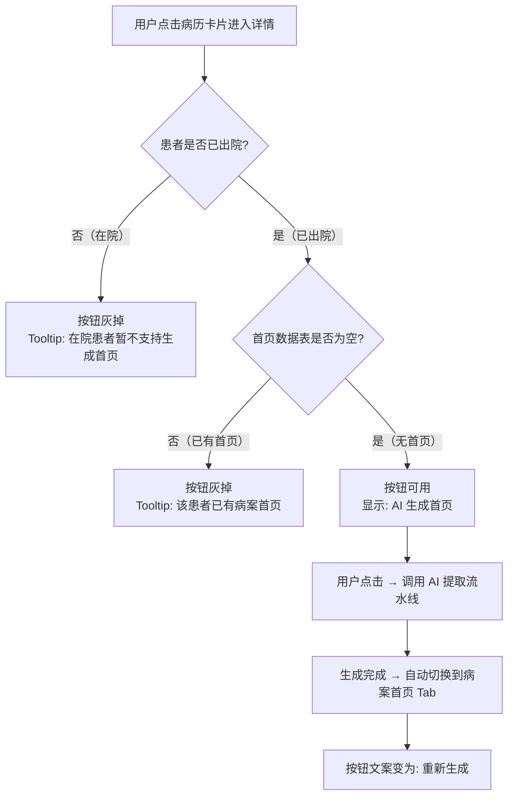
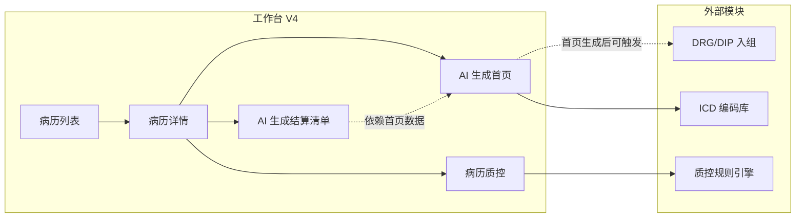

# PRD - 病案工作台 V4（WorkstationV4）

## 文档信息

| 项目     | 内容                                                                                                                                 |
| -------- | ------------------------------------------------------------------------------------------------------------------------------------ |
| 文档版本 | v1.0                                                                                                                                 |
| 创建日期 | 2026-03-17                                                                                                                           |
| 文档状态 | 已确认                                                                                                                               |
| 关联文档 | [CLINICAL_WORKSTATION_DEMO_PRD.md](./CLINICAL_WORKSTATION_DEMO_PRD.md)、[PRD-病案首页自动生成功能.md](./PRD-病案首页自动生成功能.md) |

---

## 1. 产品概述

### 1.1 背景

病案工作台是 MedQC 系统的核心工作界面，面向 **病案编码员** 和 **质控人员**。V4 版本将早期的 Demo 演示工作站升级为面向生产环境的统一操作界面，整合了四大核心功能模块。

### 1.2 目标

构建一站式病案质控工作台，让编码员/质控人员可以在一个页面内完成：**浏览病历 → 质控审查 → 生成首页 → 生成结算清单 → DRG 预入组** 的完整闭环。

### 1.3 目标用户

| 用户角色       | 核心场景                          |
| -------------- | --------------------------------- |
| **病案编码员** | 出院病历的首页编码、结算清单生成  |
| **质控人员**   | 在院/终末病历的质控审查与缺陷管理 |
| **科室医生**   | 查阅质控反馈、修正病历缺陷        |

---

## 2. 功能模块与适用范围

> [!IMPORTANT]
> 以下是工作台四大功能模块的**适用范围矩阵**，这是整个工作台的核心业务逻辑。

### 2.1 功能适用范围矩阵

| 功能模块                   | 在院病历 | 终末病历（已出院） | 前置条件                     |
| -------------------------- | :------: | :----------------: | ---------------------------- |
| **①&nbsp;病历质控**        |    ✅    |         ✅         | 有病历文书即可               |
| **②&nbsp;DRG 预入组**      |    ✅    |         ✅         | 有诊断和手术信息             |
| **③&nbsp;AI 生成病案首页** |    ❌    |         ✅         | 已出院 **且** 首页数据表为空 |
| **④&nbsp;AI 生成结算清单** |    ❌    |         ✅         | 已出院 **且** 结算清单未生成 |

### 2.2 功能模块详解

#### ① 病历质控（适用：在院 + 终末）

- **定义**：对病历文书进行规则质控和 AI 语义质控，发现书写缺陷
- **触发方式**：选择病历后自动执行，或手动点击"质控分析"
- **输出**：缺陷列表（严重程度、扣分、证据、整改建议）
- **不区分在院/出院**：无论住院状态如何，只要有病历文书就可以质控

#### ② DRG 预入组（适用：在院 + 终末）

- **定义**：基于诊断和手术信息，预测 DRG 分组结果，提供费用预警
- **在院场景**：帮助医生在患者住院期间预判分组和费用走向
- **终末场景**：辅助编码员确认编码对分组结果的影响
- **不区分在院/出院**：在院时是"预测"，出院时是"验证"

#### ③ AI 生成病案首页（仅适用：终末且首页为空）

- **定义**：基于全病历文书，用 AI 自动提取并生成病案首页草稿
- **前置条件**：
  1. 患者 **已出院**（有出院记录）
  2. 首页数据表 **为空**（`case_front_page` 无该患者记录或记录为空）
- **不适用场景**：
  - ❌ 在院患者 — 病历信息不完整（无出院记录），生成无意义
  - ❌ 已有首页的出院患者 — 首页已存在，无需重复生成
- **前端交互规则**：
  - 按钮 `AI 生成首页` 仅在满足前置条件时显示/可点击
  - 不满足时灰掉按钮并显示 tooltip 说明原因

#### ④ AI 生成结算清单（仅适用：终末且清单未生成）

- **定义**：基于首页数据和费用明细，生成医保结算待遇清单
- **前置条件**：
  1. 患者 **已出院**
  2. 结算清单 **未生成**
- **依赖关系**：通常依赖首页数据（先有首页，再生成清单）
- **前端交互规则**：同首页生成，条件不满足时按钮灰掉

---

## 3. 页面结构

### 3.1 整体布局

```
┌──────────────────────────────────────────────────────┐
│                    顶部导航栏                          │
├────────┬─────────────────────────────────────────────┤
│        │  控制台（搜索 + 科室筛选 + 刷新）             │
│ 科室   │  完成率进度条                                │
│ 导航   ├─────────────────────────────────────────────┤
│ 侧栏   │                                             │
│        │  病历卡片网格                                 │
│        │  ┌──────┐ ┌──────┐ ┌──────┐ ┌──────┐       │
│        │  │ 卡片1 │ │ 卡片2 │ │ 卡片3 │ │ 卡片4 │       │
│        │  └──────┘ └──────┘ └──────┘ └──────┘       │
│        │                                             │
└────────┴─────────────────────────────────────────────┘
```

### 3.2 详情页布局（点击卡片后）

```
┌──────────────────────────────────────────────────────┐
│ ← 返回列表  [头像] 张三  [待处理]  V-ZS-001 · 心内科  │
│                        [← →] [ICD查询] [AI生成首页]   │
├──────────┬───────────────────────────────────────────┤
│ 患者信息  │  [病历详情]  [病案首页]  [结算清单]          │
│ ────────│─────────────────────────────────────────── │
│ 性别/年龄 │                                           │
│ 医保类型  │  病历正文 / 首页表格 / 清单表格              │
│ 床号     │                                            │
│ 主诊断   │                                            │
│ ────────│                                            │
│ 住院时间轴│                                            │
│ ────────│                                            │
│ 病历文书树│                                            │
│ · 入院记录│                                            │
│ · 病程记录│                                            │
│ · 手术记录│                                            │
│ · 出院记录│                                            │
└──────────┴───────────────────────────────────────────┘
```

---

## 4. 列表页筛选逻辑

### 4.1 筛选控件

| 控件     | 类型     | 选项              | 说明               |
| -------- | -------- | ----------------- | ------------------ |
| 搜索框   | 文本输入 | —                 | 按姓名或病案号搜索 |
| 科室筛选 | 左侧导航 | 全部科室 + 各科室 | 按科室过滤         |
| 刷新按钮 | 按钮     | —                 | 重新加载数据       |

> [!NOTE]
> V4 已移除"全部状态"筛选下拉框和胶囊状态过滤栏，简化操作流程。目前所有病案以统一列表展示，用户通过搜索和科室导航快速定位目标病历。

### 4.2 卡片信息展示

每张病历卡片展示以下信息：

- 患者姓名、性别/年龄
- 状态徽章（已完成 / 有缺陷 / 处理中 / 待处理）
- 入院/出院日期、住院时长
- 主治医师、床号

---

## 5. 详情页功能逻辑

### 5.1 顶部 Header

| 元素                 | 说明                        |
| -------------------- | --------------------------- |
| 返回按钮             | 返回列表页                  |
| 头像 + 姓名          | 显示患者姓名末字的头像圈    |
| 状态 Pill            | 待处理/处理中/有缺陷/已完成 |
| 病案号 · 科室 · 医生 | 一行紧凑展示                |
| 翻页控件             | 上一例/下一例 (Alt+←/→)     |
| ICD 查询按钮         | 打开 ICD 编码搜索抽屉       |
| **AI 生成首页按钮**  | **条件显示**（见 §2.2③）    |

### 5.2 左侧面板

- 患者属性 Grid（性别/年龄、医保类型、床号、主诊断）
- 住院时间轴（入院→出院进度条 + 总天数）
- 病历文书树（动态从 API 加载，显示文书类型 + 字数）

### 5.3 右侧 Tab 内容区

| Tab          | 内容                                         | 适用范围         |
| ------------ | -------------------------------------------- | ---------------- |
| **病历详情** | EMRViewer 渲染病历文书正文，支持缺陷高亮     | 所有病历         |
| **病案首页** | FrontpageSheet A4 表格展示 AI 生成的首页草稿 | 终末且首页为空   |
| **结算清单** | SettlementSheet 展示结算待遇清单             | 终末且清单未生成 |

---

## 6. AI 生成首页 — 按钮可用性规则（核心）

### 6.1 判断流程



### 6.2 前端判断字段

```typescript
// 判断是否显示/启用"AI 生成首页"按钮
const canGenerateFrontpage = computed(() => {
  if (!selectedRecord.value) return false

  // 条件1：已出院（有出院日期）
  const isDischarged = !!selectedRecord.value.dischargeDate

  // 条件2：首页数据为空（尚未生成）
  const hasNoFrontpage = !frontpageDraft.value

  return isDischarged && hasNoFrontpage
})
```

### 6.3 结算清单同理

```typescript
const canGenerateSettlement = computed(() => {
  if (!selectedRecord.value) return false
  const isDischarged = !!selectedRecord.value.dischargeDate
  const hasNoSettlement = !settlementData.value
  return isDischarged && hasNoSettlement
})
```

---

## 7. 数据来源与状态定义

### 7.1 病历状态枚举

| 状态值        | 显示文案 | 含义                         |
| ------------- | -------- | ---------------------------- |
| `pending`     | 待处理   | 新入库，尚未质控             |
| `processing`  | 处理中   | 质控正在执行中               |
| `completed`   | 已完成   | 质控通过，无缺陷             |
| `has_defects` | 有缺陷   | 质控发现问题，需修正         |
| `warning`     | 有缺陷   | 同 has_defects（兼容旧数据） |

### 7.2 住院状态判断

```
已出院 = dischargeDate 不为空 且 dischargeDate ≤ 当前日期
在院   = dischargeDate 为空 或 dischargeDate > 当前日期
```

### 7.3 首页生成状态判断

```
首页为空 = case_front_page 表中无该 visit_id 的记录
         OR 记录存在但核心字段（诊断、手术）为空
首页已有 = case_front_page 表中有该 visit_id 的完整记录
```

---

## 8. 与其他模块的关系



### 关键依赖链

```
病历文书 → 病历质控（可独立执行）
病历文书 → AI 生成首页（需已出院 + 首页为空）
首页数据 → AI 生成结算清单（需首页数据存在）
首页数据 → DRG/DIP 入组（需诊断和手术编码）
```

---

## 9. 技术实现要点

### 9.1 前端路由

| 路由              | 页面                  | 说明                      |
| ----------------- | --------------------- | ------------------------- |
| `/workstation-v4` | WorkstationV4View.vue | 工作台主页面（列表+详情） |

### 9.2 核心 API

| API                                     | 方法 | 用途                       |
| --------------------------------------- | ---- | -------------------------- |
| `/api/v1/emr/{id}/documents`            | GET  | 获取病历文书列表           |
| `/api/v1/emr/{id}/render`               | GET  | 渲染文书内容（含缺陷标注） |
| `/api/v1/qc/analyze`                    | POST | 执行质控分析               |
| `/api/v1/frontpage/auto-generate-draft` | POST | AI 生成首页草稿            |
| `/api/v1/settlement/generate`           | POST | AI 生成结算清单            |
| `/api/v1/icd/search`                    | GET  | ICD 编码搜索               |

### 9.3 关键组件

| 组件            | 路径                                            | 职责                    |
| --------------- | ----------------------------------------------- | ----------------------- |
| EMRViewer       | `components/qc/EMRViewer.vue`                   | 病历文书渲染 + 缺陷高亮 |
| FrontpageSheet  | `workstation-v2/components/FrontpageSheet.vue`  | 病案首页 A4 表格        |
| SettlementSheet | `workstation-v2/components/SettlementSheet.vue` | 结算清单表格            |
| QCResultTab     | `workstation-v2/components/QCResultTab.vue`     | 质控结果面板            |
| ICDSearchPanel  | `workstation-v2/components/ICDSearchPanel.vue`  | ICD 编码搜索            |

---

## 10. 后续迭代方向

| 版本 | 功能                                             | 优先级 |
| ---- | ------------------------------------------------ | ------ |
| V4.1 | AI 生成首页按钮的条件可用性（本 PRD 描述的逻辑） | P0     |
| V4.1 | 结算清单生成的条件可用性                         | P0     |
| V4.2 | 批量质控 — 一键对列表中所有待处理病历执行质控    | P1     |
| V4.2 | 质控结果统计看板 — 科室维度的缺陷分布            | P1     |
| V4.3 | DRG 预入组集成到详情页                           | P2     |
| V4.3 | 首页编辑模式 — 医生可在线修正 AI 生成的首页字段  | P2     |

---

_本文档基于 2026-03-17 的产品讨论整理，明确了各功能模块的适用范围和前置条件。后续 Agent 在开发时应严格遵守 §2.1 的功能适用范围矩阵。_
