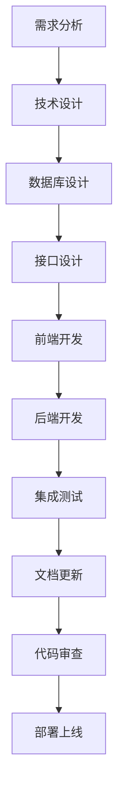

# Augment AI 医疗质控系统工作规则

## 📋 总则

本规则集专门针对医疗病案质控系统项目制定，旨在确保Augment AI助手在开发、维护和扩展系统时保持一致性、专业性和高质量标准。

## 🏥 项目特定规则

### 1. 医疗数据处理规则

#### 1.1 数据敏感性原则
- **强制要求**: 所有涉及患者信息的代码必须包含隐私保护注释
- **数据脱敏**: 示例数据必须使用虚构信息，不得使用真实患者数据
- **访问控制**: 实现数据访问时必须考虑RLS（行级安全）策略

```typescript
// ✅ 正确示例
interface PatientInfo {
  id: string
  name: string // 注意：患者姓名为敏感信息，需要访问权限控制
  age: number
  // 其他字段...
}

// ❌ 错误示例 - 缺少隐私保护说明
interface PatientData {
  name: string
  idNumber: string // 身份证号等敏感信息未标注
}
```

#### 1.2 医疗术语规范
- **术语一致性**: 使用标准医疗术语，保持中英文对照
- **编码规范**: 遵循ICD-10、DRG等医疗编码标准
- **字段命名**: 医疗相关字段使用医学标准命名

```typescript
// ✅ 标准医疗术语映射
const MEDICAL_TERMS = {
  admission_diagnosis: '入院诊断',
  discharge_diagnosis: '出院诊断',
  primary_diagnosis: '主要诊断',
  secondary_diagnosis: '次要诊断',
  complication: '并发症',
  comorbidity: '合并症'
} as const
```

### 2. 质控规则管理规范

#### 2.1 规则编码标准
- **编码格式**: 必须使用 `数字.数字.数字` 格式（如：1.1.1）
- **分类前缀**: 第一位数字表示规则大类
  - 1.x.x: 完整性规则
  - 2.x.x: 一致性规则  
  - 3.x.x: 合理性规则
  - 4.x.x: 及时性规则

#### 2.2 规则配置验证
- **必须验证**: 每个规则配置都必须通过 `RulesValidator` 验证
- **错误处理**: 验证失败时必须提供具体的错误信息和修复建议

```typescript
// ✅ 规则创建标准流程
const createRule = async (ruleData: QCRuleInsert) => {
  // 1. 数据验证
  const validation = RulesValidator.validateRule(ruleData)
  if (!validation.isValid) {
    throw new Error(`规则验证失败: ${validation.errors.join(', ')}`)
  }
  
  // 2. 业务逻辑检查
  const existingRule = await RulesService.getRuleByCode(ruleData.rule_code)
  if (existingRule) {
    throw new Error(`规则编码 ${ruleData.rule_code} 已存在`)
  }
  
  // 3. 创建规则
  return await RulesService.createRule(ruleData)
}
```

## 💻 技术栈规则

### 3. Vue 3 + TypeScript 开发规范

#### 3.1 组件开发标准
- **组合式API**: 优先使用 Composition API，避免选项式API
- **TypeScript**: 所有组件必须使用TypeScript，严格类型检查
- **响应式数据**: 使用 `ref`、`reactive` 时必须明确数据类型

```vue
<!-- ✅ 标准组件结构 -->
<template>
  <div class="page-container">
    <!-- 模板内容 -->
  </div>
</template>

<script setup lang="ts">
import { ref, reactive, computed, onMounted } from 'vue'
import type { QCRule } from '@/types/database'

// 响应式数据定义
const loading = ref<boolean>(false)
const rules = ref<QCRule[]>([])
const formData = reactive<QCRuleInsert>({
  rule_code: '',
  name: '',
  // 其他字段...
})

// 计算属性
const filteredRules = computed(() => {
  return rules.value.filter(rule => rule.is_active)
})

// 生命周期
onMounted(() => {
  loadRules()
})
</script>
```

#### 3.2 Ant Design Vue 使用规范
- **组件前缀**: 统一使用 `a-` 前缀
- **主题一致性**: 遵循项目设计系统，使用统一的颜色和尺寸
- **国际化**: 支持中文界面，使用合适的日期格式和数字格式

```vue
<!-- ✅ Ant Design 组件使用示例 -->
<a-table
  :columns="columns"
  :data-source="dataSource"
  :loading="loading"
  :pagination="pagination"
  row-key="id"
  size="middle"
>
  <template #bodyCell="{ column, record }">
    <template v-if="column.key === 'status'">
      <a-tag :color="getStatusColor(record.status)">
        {{ getStatusLabel(record.status) }}
      </a-tag>
    </template>
  </template>
</a-table>
```

### 4. Supabase 数据库操作规则

#### 4.1 数据库查询规范
- **错误处理**: 所有数据库操作必须包含错误处理
- **类型安全**: 使用TypeScript类型定义确保查询安全
- **性能优化**: 合理使用索引，避免全表扫描

```typescript
// ✅ 标准数据库操作模式
export class RulesService {
  static async getAllRules(): Promise<QCRule[]> {
    try {
      const { data, error } = await supabase
        .from('qc_rules')
        .select('*')
        .order('rule_code', { ascending: true })
      
      if (error) {
        throw new Error(`获取规则失败: ${error.message}`)
      }
      
      return data || []
    } catch (error) {
      console.error('数据库查询错误:', error)
      throw error
    }
  }
}
```

#### 4.2 数据验证规则
- **输入验证**: 所有用户输入必须经过验证
- **SQL注入防护**: 使用参数化查询，避免字符串拼接
- **数据完整性**: 确保外键约束和业务规则一致性

## 🎨 代码质量规则

### 5. 文件组织和命名规范

#### 5.1 目录结构标准
```
src/
├── components/          # 通用组件
├── views/              # 页面组件
│   └── rules/          # 规则管理相关页面
├── services/           # 业务服务层
├── utils/              # 工具函数
├── config/             # 配置文件
├── types/              # 类型定义
└── assets/             # 静态资源
```

#### 5.2 命名规范
- **文件名**: 使用 kebab-case（如：`rules-service.ts`）
- **组件名**: 使用 PascalCase（如：`RulesView.vue`）
- **变量名**: 使用 camelCase（如：`rulesList`）
- **常量名**: 使用 UPPER_SNAKE_CASE（如：`RULE_CATEGORIES`）

#### 5.3 代码注释标准
```typescript
/**
 * 质控规则服务类
 * 提供规则的CRUD操作和业务逻辑处理
 */
export class RulesService {
  /**
   * 获取所有激活的规则
   * @returns Promise<QCRule[]> 激活的规则列表
   * @throws Error 当数据库查询失败时抛出错误
   */
  static async getActiveRules(): Promise<QCRule[]> {
    // 实现代码...
  }
}
```

### 6. 用户交互规则

#### 6.1 界面一致性标准
- **布局结构**: 使用统一的页面布局模式
- **操作反馈**: 所有用户操作必须有明确的反馈
- **错误提示**: 使用友好的中文错误信息

```typescript
// ✅ 标准操作反馈模式
const handleSave = async () => {
  try {
    loading.value = true
    await RulesService.createRule(formData)
    message.success('规则创建成功')
    modalVisible.value = false
    loadRules() // 刷新列表
  } catch (error) {
    console.error('创建规则失败:', error)
    message.error(error instanceof Error ? error.message : '创建规则失败')
  } finally {
    loading.value = false
  }
}
```

#### 6.2 表单验证规范
- **实时验证**: 提供实时的字段验证反馈
- **中文提示**: 使用清晰的中文验证提示信息
- **业务规则**: 结合医疗业务规则进行验证

```typescript
// ✅ 表单验证规则示例
const formRules = {
  rule_code: [
    { required: true, message: '请输入规则编码' },
    { pattern: /^\d+(\.\d+)*$/, message: '规则编码格式不正确，如: 1.1.1' }
  ],
  name: [
    { required: true, message: '请输入规则名称' },
    { min: 2, max: 100, message: '规则名称长度在2-100个字符' }
  ]
}
```

## 📚 文档和维护规则

### 7. 文档编写标准

#### 7.1 文档结构要求
- **标题层级**: 使用标准的Markdown标题层级
- **代码示例**: 提供完整的、可运行的代码示例
- **更新日期**: 每个文档必须包含最后更新日期

#### 7.2 API文档规范
```typescript
/**
 * @api {POST} /api/rules 创建质控规则
 * @apiName CreateRule
 * @apiGroup Rules
 * 
 * @apiParam {String} rule_code 规则编码，格式：数字.数字.数字
 * @apiParam {String} name 规则名称，2-100个字符
 * @apiParam {String} description 规则描述，10-500个字符
 * 
 * @apiSuccess {Object} rule 创建的规则对象
 * @apiError {String} message 错误信息
 */
```

### 8. 版本管理和部署规则

#### 8.1 Git提交规范
```bash
# ✅ 标准提交格式
feat(rules): 添加规则批量操作功能
fix(database): 修复权重值约束问题
docs(rules): 更新规则系统文档
refactor(services): 重构规则服务层代码
```

#### 8.2 脚本命名规范
- **初始化脚本**: `init-*.ts`
- **设置脚本**: `setup-*.ts`
- **测试脚本**: `test-*.ts`
- **工具脚本**: `*-tool.ts`

## ⚠️ 违规处理

### 9. 代码审查检查点

#### 9.1 必检项目
- [ ] 是否包含适当的错误处理
- [ ] 是否遵循TypeScript类型安全
- [ ] 是否包含必要的注释和文档
- [ ] 是否符合医疗数据处理规范
- [ ] 是否通过所有验证规则

#### 9.2 违规等级
- **严重违规**: 涉及数据安全、隐私泄露
- **重要违规**: 代码质量、性能问题
- **轻微违规**: 命名规范、注释缺失

## 🔄 规则更新机制

### 10. 规则维护流程

1. **定期审查**: 每月审查规则的适用性
2. **版本控制**: 规则变更必须记录版本历史
3. **团队同步**: 规则更新后及时同步团队
4. **文档更新**: 规则变更后同步更新相关文档

## 🛠️ 实施指南

### 11. 开发工作流程

#### 11.1 新功能开发标准流程


#### 11.2 Bug修复流程
1. **问题定位**: 使用浏览器开发工具和控制台日志
2. **根因分析**: 分析问题的根本原因，避免症状修复
3. **影响评估**: 评估修复对其他功能的影响
4. **测试验证**: 确保修复不引入新问题

### 12. 性能优化规则

#### 12.1 前端性能标准
- **组件懒加载**: 大型组件使用动态导入
- **数据分页**: 列表数据必须实现分页，单页不超过50条
- **缓存策略**: 合理使用Vue的计算属性缓存

```typescript
// ✅ 组件懒加载示例
const RulesView = defineAsyncComponent(() => import('@/views/rules/RulesView.vue'))

// ✅ 分页配置标准
const pagination = reactive({
  current: 1,
  pageSize: 20, // 标准页面大小
  total: 0,
  showSizeChanger: true,
  showQuickJumper: true,
  showTotal: (total: number, range: [number, number]) =>
    `第 ${range[0]}-${range[1]} 条，共 ${total} 条`
})
```

#### 12.2 数据库性能规则
- **查询优化**: 避免N+1查询，使用适当的JOIN
- **索引使用**: 确保查询字段有适当的索引
- **批量操作**: 大量数据操作使用批量接口

### 13. 安全规则

#### 13.1 数据访问安全
```typescript
// ✅ 安全的数据访问模式
export class SecureRulesService {
  static async getRulesByUser(userId: string): Promise<QCRule[]> {
    // 1. 验证用户权限
    const hasPermission = await this.checkUserPermission(userId, 'rules:read')
    if (!hasPermission) {
      throw new Error('用户无权限访问规则数据')
    }

    // 2. 使用RLS策略的查询
    const { data, error } = await supabase
      .from('qc_rules')
      .select('*')
      .eq('created_by', userId) // 只能访问自己创建的规则

    if (error) throw error
    return data || []
  }
}
```

#### 13.2 输入验证安全
- **XSS防护**: 所有用户输入必须进行HTML转义
- **SQL注入防护**: 使用参数化查询
- **文件上传安全**: 验证文件类型和大小

### 14. 测试规则

#### 14.1 单元测试标准
```typescript
// ✅ 规则验证器测试示例
describe('RulesValidator', () => {
  describe('validateRuleCode', () => {
    it('应该接受正确格式的规则编码', () => {
      const result = RulesValidator.validateRuleCode('1.1.1')
      expect(result.isValid).toBe(true)
      expect(result.errors).toHaveLength(0)
    })

    it('应该拒绝错误格式的规则编码', () => {
      const result = RulesValidator.validateRuleCode('invalid-code')
      expect(result.isValid).toBe(false)
      expect(result.errors).toContain('规则编码格式不正确')
    })
  })
})
```

#### 14.2 集成测试要求
- **API测试**: 测试所有服务层接口
- **数据库测试**: 验证数据完整性约束
- **用户界面测试**: 测试关键用户操作流程

### 15. 监控和日志规则

#### 15.1 日志记录标准
```typescript
// ✅ 标准日志记录模式
const logger = {
  info: (message: string, data?: any) => {
    console.log(`[INFO] ${new Date().toISOString()} - ${message}`, data)
  },
  error: (message: string, error?: Error) => {
    console.error(`[ERROR] ${new Date().toISOString()} - ${message}`, error)
  },
  warn: (message: string, data?: any) => {
    console.warn(`[WARN] ${new Date().toISOString()} - ${message}`, data)
  }
}

// 使用示例
try {
  const rules = await RulesService.getAllRules()
  logger.info('成功获取规则列表', { count: rules.length })
} catch (error) {
  logger.error('获取规则列表失败', error)
}
```

#### 15.2 性能监控
- **响应时间**: 监控API响应时间，超过2秒需要优化
- **错误率**: 监控错误率，超过5%需要立即处理
- **资源使用**: 监控内存和CPU使用情况

## 📋 检查清单

### 16. 代码提交前检查清单

#### 16.1 功能检查
- [ ] 功能是否按需求正确实现
- [ ] 是否处理了所有边界情况
- [ ] 是否包含适当的错误处理
- [ ] 是否通过了所有测试用例

#### 16.2 代码质量检查
- [ ] 是否遵循命名规范
- [ ] 是否包含必要的注释
- [ ] 是否符合TypeScript类型要求
- [ ] 是否遵循项目代码风格

#### 16.3 安全检查
- [ ] 是否包含输入验证
- [ ] 是否正确处理敏感数据
- [ ] 是否遵循权限控制规则
- [ ] 是否避免了常见安全漏洞

#### 16.4 性能检查
- [ ] 是否优化了数据库查询
- [ ] 是否实现了适当的缓存
- [ ] 是否避免了不必要的重渲染
- [ ] 是否符合性能标准

### 17. 发布前检查清单

#### 17.1 功能验证
- [ ] 所有新功能正常工作
- [ ] 现有功能未受影响
- [ ] 数据迁移脚本正确执行
- [ ] 配置文件正确更新

#### 17.2 文档更新
- [ ] API文档已更新
- [ ] 用户手册已更新
- [ ] 变更日志已记录
- [ ] 部署说明已更新

## 🎯 质量目标

### 18. 代码质量指标

#### 18.1 可维护性指标
- **代码复杂度**: 单个函数圈复杂度不超过10
- **文件长度**: 单个文件不超过500行
- **函数长度**: 单个函数不超过50行
- **注释覆盖率**: 公共API必须有完整注释

#### 18.2 可靠性指标
- **测试覆盖率**: 核心业务逻辑测试覆盖率不低于80%
- **错误处理**: 所有外部调用必须有错误处理
- **数据验证**: 所有用户输入必须验证
- **回滚机制**: 关键操作必须支持回滚

### 19. 用户体验指标

#### 19.1 性能指标
- **页面加载时间**: 首屏加载时间不超过3秒
- **操作响应时间**: 用户操作响应时间不超过1秒
- **数据查询时间**: 数据库查询时间不超过2秒
- **文件上传速度**: 支持大文件分片上传

#### 19.2 可用性指标
- **界面一致性**: 使用统一的设计语言
- **操作便捷性**: 常用操作不超过3次点击
- **错误提示**: 提供清晰的错误信息和解决建议
- **帮助文档**: 提供完整的操作指南

## 🔄 持续改进

### 20. 规则演进机制

#### 20.1 规则评估周期
- **月度评估**: 每月评估规则执行情况
- **季度优化**: 每季度优化规则内容
- **年度审查**: 每年全面审查规则体系
- **即时调整**: 发现问题立即调整

#### 20.2 反馈收集机制
- **开发者反馈**: 收集开发过程中的问题和建议
- **用户反馈**: 收集用户使用过程中的体验反馈
- **性能监控**: 通过监控数据发现潜在问题
- **代码审查**: 通过代码审查发现规则盲点

---

**规则版本**: v1.0
**生效日期**: 2025-07-20
**适用范围**: 医疗病案质控系统项目
**维护者**: Augment AI Team
**下次审查**: 2025-08-20
