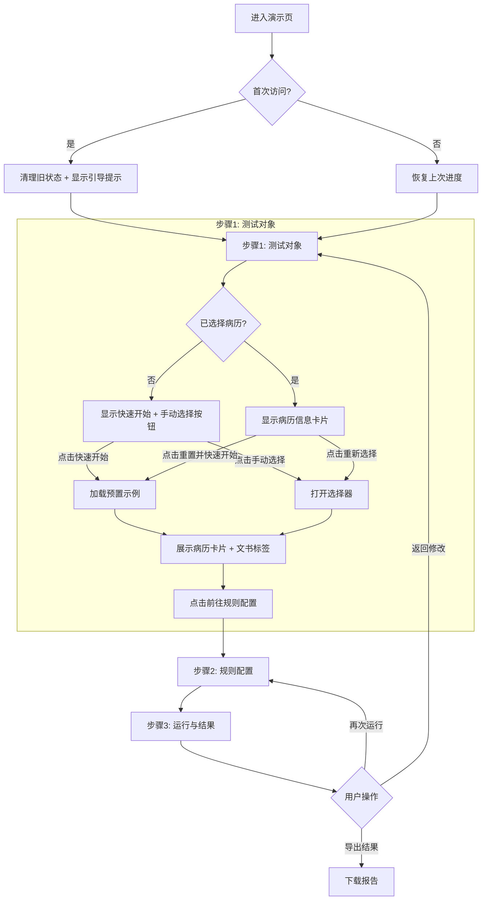

# LLM质控演示页 - 测试病历使用流程 PRD

**文档类型**: 产品需求文档 (PRD)  
**版本**: v1.0  
**创建日期**: 2025-10-15  
**适用范围**: LLMQCDemoEnhanced 页面 (`/dashboard/llm-qc-demo-enhanced`)  
**关联文档**: 
- [测试病历管理功能 PRD](./Medical-Records-Management-PRD.md) - 后台管理模块完整PRD
- [LLM质控演示功能模块设计方案](./LLM质控演示功能模块设计方案.md) - 演示模块整体设计
- [病历信息卡片组件整合分析](./MEDICAL_RECORD_CARD_INTEGRATION_ANALYSIS.md) - 组件复用分析

---

## 📋 文档目的

本文档专门描述**在 LLM 质控演示页面中如何使用测试病历**的产品流程与交互规范，作为《测试病历管理功能 PRD》的演示场景子集。

**核心目标**:
- 让首次访问用户无需学习成本，通过"快速开始"一键体验完整质控流程
- 为高级用户提供"手动选择"病历与文书的灵活性
- 确保演示页面布局清晰、操作路径明确、状态持久化可靠

---

## 🎯 产品定位与用户价值

### 1.1 产品定位
LLM质控演示页是面向**质控管理员、医务人员、系统演示者**的功能演示与验证工具，通过预置测试病历快速展示质控规则的应用效果。

### 1.2 核心用户价值
| 用户角色 | 核心诉求 | 价值交付 |
|---------|---------|---------|
| **质控管理员** | 快速验证新规则在典型病历上的效果 | 一键加载预置示例 → 配置规则 → 查看结果 |
| **医务人员** | 了解质控系统如何评估病历质量 | 清晰的病历信息展示 + 直观的违规列表 |
| **系统演示者** | 向客户/领导展示系统能力 | 流畅的演示流程 + 专业的结果呈现 |

### 1.3 与后台管理模块的区别
| 维度 | 后台管理模块 | 演示页面 |
|------|------------|---------|
| **目标** | 管理测试病历库（CRUD） | 快速演示质控流程 |
| **用户** | 质控管理员 | 质控管理员 + 演示者 + 医务人员 |
| **操作** | 新建/编辑/删除/批量导入 | 选择/加载/查看 |
| **数据** | 完整的病历数据模型 | 最小展示字段集 |
| **交互** | 表格 + 表单 + 筛选 | 卡片 + 按钮 + 步骤导航 |

---

## 🔄 用户旅程与核心流程

### 2.1 整体流程图



### 2.2 关键路径说明

#### 路径 1: 快速开始（推荐路径）
1. 用户进入演示页 → 看到"快速开始（加载预置示例）"主按钮
2. 点击按钮 → 自动加载默认预置病历与文书
3. 显示病历信息卡片 → 自动跳转到"规则配置"步骤
4. 用户配置规则 → 开始分析 → 查看结果

**预期时长**: 30秒完成首次演示

#### 路径 2: 手动选择（高级路径）
1. 用户进入演示页 → 点击"手动选择病历与文书"
2. 打开选择器 → 选择病历 + 选择文书 → 确认
3. 显示病历信息卡片 → 点击"前往规则配置"
4. 用户配置规则 → 开始分析 → 查看结果

**预期时长**: 1-2分钟完成自定义演示

#### 路径 3: 重置并快速开始（快捷路径）
1. 用户已有选择 → 想快速切换到默认示例
2. 点击"重置并快速开始" → 清理当前状态 + 加载预置示例
3. 自动跳转到"规则配置"步骤

**预期时长**: 10秒完成重置

---

## 🎨 页面布局与交互设计

### 3.1 步骤1: 测试对象 - 未选择状态

```
┌─────────────────────────────────────────────────────────────┐
│ 🏥 LLM质控演示系统                              [更多 ▼]     │
├─────────────────────────────────────────────────────────────┤
│ ℹ️ 快速开始提示（仅首次访问显示）                              │
│ 点击"快速开始"加载预置示例，或"手动选择"自定义病历与文书        │
├─────────────────────────────────────────────────────────────┤
│                                                             │
│   ┌───────────────────────────────────────────────────┐    │
│   │  ⚡ 快速开始（加载预置示例）                        │    │
│   │  [主按钮 - 大尺寸 - 蓝色]                          │    │
│   └───────────────────────────────────────────────────┘    │
│                                                             │
│   ┌───────────────────────────────────────────────────┐    │
│   │  🔍 手动选择病历与文书                             │    │
│   │  [次按钮 - 大尺寸 - 默认色]                        │    │
│   └───────────────────────────────────────────────────┘    │
│                                                             │
└─────────────────────────────────────────────────────────────┘
```

**设计要点**:
- ✅ 首屏只有两个主要操作，视觉焦点集中
- ✅ 引导提示仅首次访问显示（localStorage 标记）
- ✅ 按钮尺寸大、文案清晰、图标辅助理解
- ✅ 无干扰元素（统计/日志/性能监控已折叠到底部）

### 3.2 步骤1: 测试对象 - 已选择状态

```
┌─────────────────────────────────────────────────────────────┐
│ 🏥 LLM质控演示系统                              [更多 ▼]     │
├─────────────────────────────────────────────────────────────┤
│ 📋 病历信息                                    [首次病程记录] │
│ ┌─────────────────────────────────────────────────────────┐ │
│ │ 患者姓名: 李明          │ 年龄/性别: 58岁 / 男           │ │
│ │ 科室: 心内科            │ 住院号: 2025001234            │ │
│ │ 床号: 15床              │ 入院时间: 2025-10-11 09:30    │ │
│ │ 记录时间: 2025-10-11    │ 初步诊断: 急性冠脉综合征(ACS) │ │
│ └─────────────────────────────────────────────────────────┘ │
├─────────────────────────────────────────────────────────────┤
│   [🔄 重新选择病历与文书]  [⚡ 重置并快速开始]               │
│   [➡️ 前往规则配置]                                          │
└─────────────────────────────────────────────────────────────┘
```

**设计要点**:
- ✅ 病历信息卡片使用 `a-descriptions` 组件，紧凑展示9项关键字段
- ✅ 文书类型以蓝色标签显示在卡片右上角
- ✅ 提供三个操作：重新选择、重置并快速开始、前往规则配置
- ✅ "前往规则配置"为主操作（primary 样式）

### 3.3 步骤2: 规则配置

```
┌─────────────────────────────────────────────────────────────┐
│ 🏥 LLM质控演示系统                              [更多 ▼]     │
├─────────────────────────────────────────────────────────────┤
│ [← 返回测试对象]                      [开始质控分析 →]       │
├─────────────────────────────────────────────────────────────┤
│ 📐 质控规则配置                                              │
│ ┌─────────────────────────────────────────────────────────┐ │
│ │ [规则选择器 - 保持现有功能]                              │ │
│ └─────────────────────────────────────────────────────────┘ │
└─────────────────────────────────────────────────────────────┘
```

**设计要点**:
- ✅ 保持现有规则配置能力不变
- ✅ 顶部提供"返回测试对象"和"开始质控分析"两端对齐按钮
- ✅ 条件引导提示仅在非"测试对象"步骤显示

### 3.4 步骤3: 运行与结果

```
┌─────────────────────────────────────────────────────────────┐
│ 🏥 LLM质控演示系统                              [更多 ▼]     │
├─────────────────────────────────────────────────────────────┤
│ 📊 质控结果总览                                              │
│ ┌─────────────────────────────────────────────────────────┐ │
│ │ [QCResultSummary 组件]                                  │ │
│ │ 得分: 85 | 等级: B | 合规率: 78% | 违规数: 5            │ │
│ └─────────────────────────────────────────────────────────┘ │
├─────────────────────────────────────────────────────────────┤
│ 📋 违规详情列表                                              │
│ ┌─────────────────────────────────────────────────────────┐ │
│ │ [ViolationsList 组件]                                   │ │
│ │ 可筛选、可折叠的违规项列表                                │ │
│ └─────────────────────────────────────────────────────────┘ │
├─────────────────────────────────────────────────────────────┤
│ 🔽 折叠区（默认收起）                                         │
│ ┌─────────────────────────────────────────────────────────┐ │
│ │ ▶ 统计与进度                                            │ │
│ │ ▶ 演示日志                                              │ │
│ │ ▶ 性能监控                                              │ │
│ └─────────────────────────────────────────────────────────┘ │
└─────────────────────────────────────────────────────────────┘
```

**设计要点**:
- ✅ 结果优先：先看总览（Summary），再看违规列表（Violations）
- ✅ 折叠区默认关闭，不干扰主流程
- ✅ 无结果时显示空态提示："尚未产出结果，点击'开始分析'或返回前一步补充条件"

---

## 📊 数据模型与接口契约

### 4.1 预置示例数据结构

```typescript
interface PresetExample {
  key: string                // 唯一标识（UI用）
  title: string              // 示例标题，如"首次病程记录 - 李明（急性冠脉综合征）"
  type: string               // 文书类型，如"首次病程记录"
  description?: string       // 示例描述（可选）
  
  // 以下字段由 Store 内部管理，不暴露给 UI
  recordData: MedicalRecord  // 完整病历数据
  documentData: Document     // 完整文书数据
}
```

**默认预置示例**（内置于 qcDemo.ts）:
```typescript
const PRESET_FIRST_COURSE_RECORD: PresetExample = {
  key: 'first-course-acs',
  title: '首次病程记录 - 李明（急性冠脉综合征）',
  type: '首次病程记录',
  description: '心内科典型病例，用于演示完整性、及时性、规范性质控规则',
  recordData: { /* 完整病历数据 */ },
  documentData: { /* 完整文书数据 */ }
}
```

### 4.2 病历信息展示字段（最小集）

```typescript
interface RecordInfo {
  patientName: string        // 患者姓名
  age: number                // 年龄
  gender: '男' | '女' | '未知' // 性别
  department: string         // 科室
  admissionNumber?: string   // 住院号
  bedNumber?: string         // 床号
  admissionTime?: string     // 入院时间
  recordTime?: string        // 记录时间
  diagnosis?: string         // 初步诊断
}
```

**数据来源**:
- 快速开始：从预置示例的 `recordData` 提取
- 手动选择：从用户选择的 `testRecord` 提取

**适配层**（qcDemo.ts 中的 computed）:
```typescript
const currentRecordInfo = computed(() => {
  if (!testRecord.value) return null
  
  return {
    patientName: testRecord.value.patient_name,
    age: testRecord.value.patient_age,
    gender: testRecord.value.patient_gender === 'M' ? '男' : 
            testRecord.value.patient_gender === 'F' ? '女' : '未知',
    department: testRecord.value.department,
    admissionNumber: testRecord.value.admission_number,
    bedNumber: testRecord.value.bed_number,
    admissionTime: testRecord.value.admission_date,
    recordTime: testRecord.value.record_time,
    diagnosis: testRecord.value.diagnosis
  }
})
```

### 4.3 文书信息展示字段

```typescript
interface DocumentInfo {
  type?: string   // 文书类型（优先显示）
  title?: string  // 文书标题（备用）
}
```

**适配层**:
```typescript
const currentDocumentInfo = computed(() => {
  if (!selectedDocument.value) return null
  
  return {
    type: selectedDocument.value.type,
    title: selectedDocument.value.title
  }
})
```

---

## 🔧 技术实现要点

### 5.1 状态持久化策略

**localStorage 键值设计**:
```typescript
const STORAGE_KEYS = {
  DEMO_STATE: 'qc-demo-state',           // 演示状态（步骤、选择、结果）
  LAYOUT_VERSION: 'llm_qc_demo_layout_v2_seen',  // 布局版本标记
  FIRST_VISIT: 'llm_qc_demo_first_visit'  // 首次访问标记
}
```

**首次访问逻辑**:
```typescript
onMounted(async () => {
  const FIRST_VISIT_KEY = 'llm_qc_demo_layout_v2_seen'
  
  if (!localStorage.getItem(FIRST_VISIT_KEY)) {
    // 清理旧状态
    await demoStore.clearSavedState?.()
    await demoStore.resetDemoState?.()
    
    // 标记已访问
    localStorage.setItem(FIRST_VISIT_KEY, '1')
    
    // 回到步骤1
    await demoStore.jumpToStep?.('target')
    
    // 显示引导提示
    message.info('欢迎使用：点击"快速开始"或"手动选择"开始体验', 4)
  }
})
```

**状态恢复逻辑**:
- 页面刷新时，从 localStorage 恢复上次的步骤、选择、结果
- 支持 URL 参数 `?clear=true` 强制清理状态

### 5.2 预置示例加载流程

```typescript
// qcDemo.ts Store
async function loadPresetExample(exampleKey?: string) {
  const examples = getPresetExamples()
  const example = exampleKey 
    ? examples.find(e => e.key === exampleKey)
    : examples[0]  // 默认加载第一个
  
  if (!example) {
    throw new Error('预置示例不存在')
  }
  
  // 加载病历数据
  testRecord.value = example.recordData
  
  // 加载文书数据
  selectedDocument.value = example.documentData
  selectedDocumentList.value = [example.documentData]
  
  // 自动跳转到规则配置步骤
  currentStep.value = 'rules'
  
  return example
}
```

### 5.3 组件集成清单

| 组件 | 路径 | 用途 | 状态 |
|------|------|------|------|
| **MedicalRecordInfoCard** | `src/components/demo/MedicalRecordInfoCard.vue` | 病历信息卡片 | ✅ 已创建 |
| **QCResultSummary** | `src/components/demo/QCResultSummary.vue` | 结果总览 | ✅ 已集成 |
| **ViolationsList** | `src/components/demo/ViolationsList.vue` | 违规列表 | ✅ 已集成 |
| **RecordDocumentPicker** | `src/components/demo/RecordDocumentPicker.vue` | 病历文书选择器 | ✅ 已存在 |

---

## ✅ 验收标准

### 6.1 功能验收

| 验收项 | 验收标准 | 优先级 |
|--------|---------|--------|
| **首次访问体验** | 进入页面自动清理旧状态，显示引导提示，仅显示"快速开始/手动选择"按钮 | P0 |
| **快速开始流程** | 点击"快速开始" → 加载预置示例 → 显示病历卡片 → 自动跳转到规则配置 | P0 |
| **手动选择流程** | 点击"手动选择" → 打开选择器 → 选择病历+文书 → 显示病历卡片 → 可前往规则配置 | P0 |
| **病历信息展示** | 病历卡片正确显示9项关键字段 + 文书类型标签 | P0 |
| **重置功能** | 点击"重置并快速开始" → 清理状态 → 加载预置示例 → 跳转到规则配置 | P1 |
| **结果展示** | 分析完成后，先显示 QCResultSummary，再显示 ViolationsList | P0 |
| **空态提示** | 无结果时显示："尚未产出结果，点击'开始分析'或返回前一步补充条件" | P1 |
| **状态持久化** | 刷新页面后恢复上次的步骤、选择、结果 | P0 |
| **折叠区** | 统计/日志/性能监控默认收起，不干扰主流程 | P0 |

### 6.2 交互验收

| 验收项 | 验收标准 | 优先级 |
|--------|---------|--------|
| **按钮响应** | 点击主操作按钮 ≤ 300ms 给出可见反馈（loading/跳转） | P0 |
| **错误提示** | 连接失败/接口报错有明确文案且可重试 | P0 |
| **成功提示** | 加载预置示例后显示："✅ 已加载预置示例：首次病程记录 - 李明（急性冠脉综合征）" | P1 |
| **引导提示** | 首次访问显示引导提示，后续访问不再显示 | P1 |

### 6.3 性能验收

| 验收项 | 验收标准 | 优先级 |
|--------|---------|--------|
| **首屏渲染** | 首屏渲染时间 ≤ 1s（不含接口） | P0 |
| **预置示例加载** | 点击"快速开始" → 显示病历卡片 ≤ 500ms | P0 |
| **状态恢复** | 刷新页面 → 恢复上次状态 ≤ 300ms | P1 |

---

## 📅 实施计划

### Phase 1: 核心流程（已完成 ✅）
- [x] 创建 MedicalRecordInfoCard 组件
- [x] 在 qcDemo.ts 添加预置示例加载功能
- [x] 在 LLMQCDemoEnhanced 集成快速开始按钮
- [x] 集成 QCResultSummary 和 ViolationsList

### Phase 2: 布局优化（已完成 ✅）
- [x] 移除顶部冗余控制条
- [x] 折叠统计/日志/性能监控到底部
- [x] 精简状态栏（仅失败/加载时显示）
- [x] 压缩标题与进度区间距

### Phase 3: 数据适配与类型修正（进行中 🚧）
- [ ] 移除 `as any` 类型断言
- [ ] 统一数据适配层（currentRecordInfo/currentDocumentInfo）
- [ ] 补充空态提示组件
- [ ] 修正 TypeScript 类型错误

### Phase 4: 体验优化（待开始 📋）
- [ ] 添加首次访问引导动画
- [ ] 优化按钮文案与图标
- [ ] 添加操作埋点
- [ ] 性能监控与优化

---

## 📝 附录

### A. 预置示例库扩展指南

**当前预置示例**:
- 首次病程记录 - 李明（急性冠脉综合征）

**扩展方式**:
1. 在 `qcDemo.ts` 的 `PRESET_EXAMPLES` 对象中添加新示例
2. 确保包含完整的 `recordData` 和 `documentData`
3. 更新 `getPresetExamples()` 返回值

**示例代码**:
```typescript
const PRESET_DISCHARGE_SUMMARY: PresetExample = {
  key: 'discharge-summary-diabetes',
  title: '出院记录 - 王芳（2型糖尿病）',
  type: '出院记录',
  description: '内分泌科典型病例，用于演示诊疗规范性质控规则',
  recordData: { /* ... */ },
  documentData: { /* ... */ }
}
```

### B. 常见问题 FAQ

**Q1: 为什么不复用 RecordDetail.vue 组件？**  
A: RecordDetail.vue 功能过于复杂（包含质控评分、操作时间线等），样式风格与演示页不一致（Slate 主题 vs Ant Design 默认主题），且数据结构不匹配。创建轻量级的 MedicalRecordInfoCard 更符合演示页需求。

**Q2: 预置示例数据从哪里来？**  
A: 预置示例数据硬编码在 `qcDemo.ts` 的 `PRESET_FIRST_COURSE_RECORD` 常量中，包含完整的病历与文书数据。未来可扩展为从后端API加载。

**Q3: 如何清除演示状态？**  
A: 三种方式：
1. 访问 `?clear=true` URL 参数
2. 点击"更多"菜单 → "清除保存状态"
3. 点击"重置并快速开始"按钮

---

**文档维护者**: MedQC 开发团队  
**最后更新**: 2025-10-15  
**下次审查**: 2025-10-22

