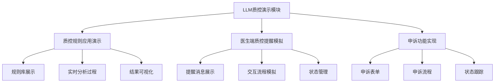
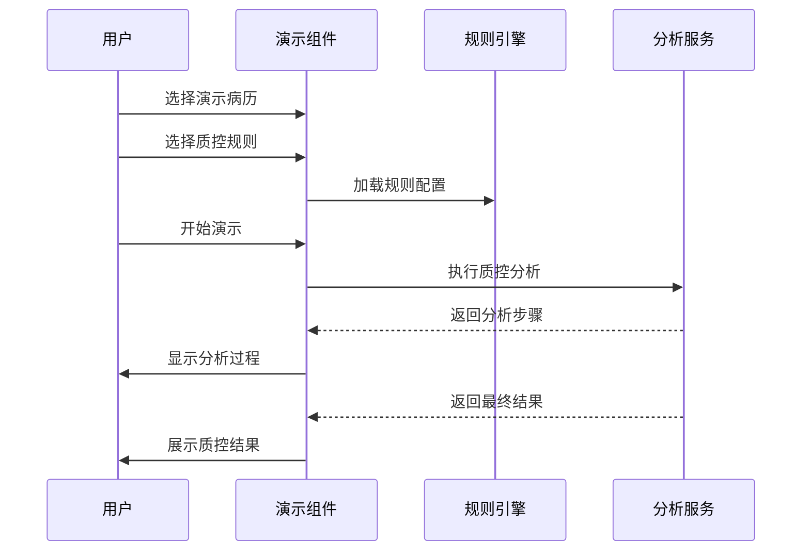
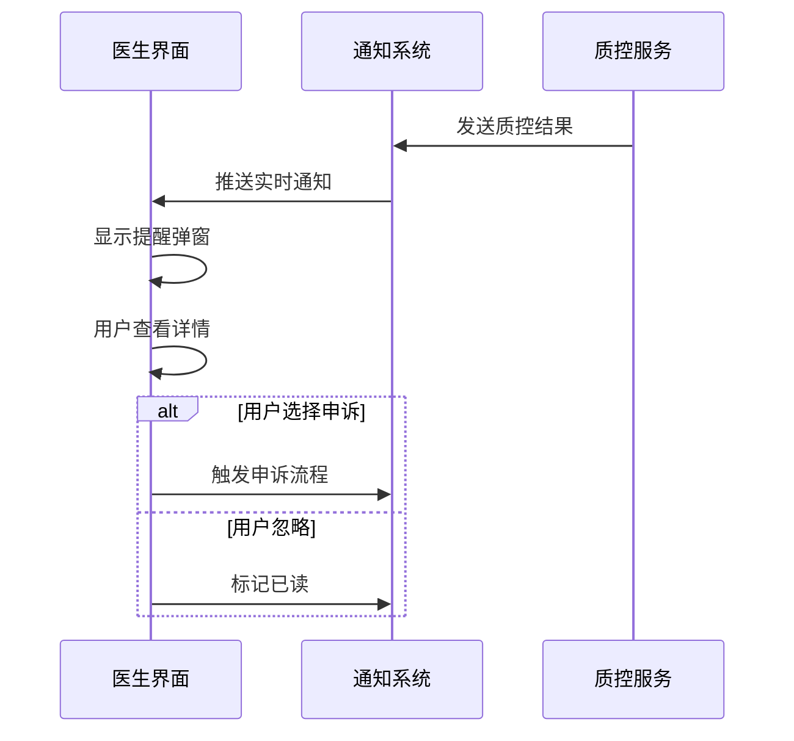
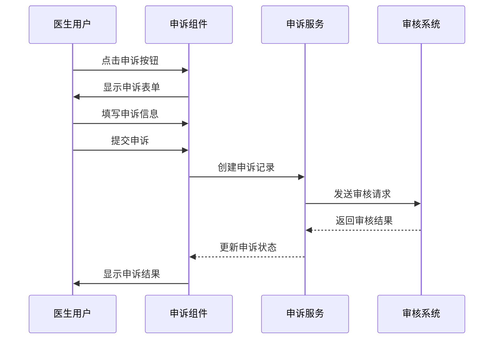

# 🏥 MedQC "LLM质控演示"功能模块设计方案

## 📋 项目概述

本文档详细描述了 MedQC 系统中"LLM质控演示"功能模块的完整设计方案，包括质控规则应用演示、医生端质控提醒模拟和申诉功能实现。

**创建时间：** 2025-09-12  
**版本：** v1.0  
**状态：** 设计阶段

## 🎯 功能需求

### 核心功能
1. **质控规则应用演示** - 展示系统如何将已配置的质控规则库应用到测试病历上，并实时显示质控分析过程和结果
2. **医生端质控提醒模拟** - 模拟医生工作站接收质控提醒的场景，包括提醒消息的展示方式和交互流程
3. **申诉功能实现** - 在质控提醒消息框中集成申诉功能，允许医生对质控结果进行申诉操作

### 技术要求
- 基于现有 Vue 3 + TypeScript + FastAPI 技术栈
- 复用现有组件和服务
- 提供完整的用户交互流程
- 支持实时演示和状态管理

## 🔍 现有代码库分析

### 可复用组件

#### 1. 消息通知组件
- **`NotificationCenter.vue`** - 完整的消息中心，支持筛选、标记已读等功能
- **`RealTimeQCAlert.vue`** - 实时质控预警组件，支持浮动通知和历史记录
- **复用价值：** 具备良好的扩展性，可以集成申诉功能

#### 2. 质控相关组件
- **`QCResultDisplay.vue`** - 质控结果展示组件，包含评分圆环和详细结果
- **`QCAnalysisPanel.vue`** - 质控分析面板，支持实时分析状态显示
- **`LLMQCDemo.vue`** - 已有的演示页面框架
- **复用价值：** 提供完整的质控结果展示和分析功能

#### 3. 后端API架构
- **完整的质控API** (`/api/qc/*`)
- **数据模型定义** (`QCResult`, `QCIssue`, `QCRule`)
- **服务层架构** (`QCService`)
- **复用价值：** 提供稳定的后端支持，可直接扩展

## 🏗️ 整体架构设计



## 📦 组件架构设计

### 1. 主演示组件 `LLMQCDemoEnhanced.vue`

**功能职责：**
- 统一管理演示流程
- 协调各子组件交互
- 维护演示状态

**核心状态：**
```typescript
interface DemoState {
  // 演示状态
  currentStep: 'rules' | 'analysis' | 'notification' | 'appeal'
  isRunning: boolean
  
  // 质控数据
  selectedRules: QCRule[]
  testRecord: MedicalRecord
  analysisResult: QCResult | null
  
  // 通知数据
  notifications: QCNotification[]
  activeNotification: QCNotification | null
  
  // 申诉数据
  appeals: Appeal[]
  currentAppeal: Appeal | null
}
```

### 2. 质控规则应用演示组件 `QCRulesDemoPanel.vue`

**功能特性：**
- 规则库可视化展示
- 规则选择和配置
- 实时分析过程动画
- 分析结果详细展示

**核心方法：**
```typescript
// 初始化演示环境
async initializeDemo(): Promise<void>

// 执行质控分析演示
async runQCAnalysis(rules: QCRule[], record: MedicalRecord): Promise<QCResult>

// 显示分析过程
showAnalysisProcess(steps: AnalysisStep[]): void

// 展示结果
displayResults(result: QCResult): void
```

### 3. 医生端质控提醒组件 `DoctorQCNotificationDemo.vue`

**功能特性：**
- 模拟医生工作站界面
- 实时质控提醒弹窗
- 多种提醒样式（警告、错误、建议）
- 提醒历史记录

**核心方法：**
```typescript
// 模拟接收质控提醒
simulateQCNotification(qcResult: QCResult): void

// 显示提醒弹窗
showNotificationModal(notification: QCNotification): void

// 处理提醒交互
handleNotificationAction(action: 'dismiss' | 'view' | 'appeal'): void
```

### 4. 申诉功能组件 `QCAppealPanel.vue`

**功能特性：**
- 申诉表单界面
- 申诉理由选择
- 附件上传支持
- 申诉状态跟踪

**核心方法：**
```typescript
// 创建申诉
createAppeal(appealData: AppealRequest): Promise<Appeal>

// 提交申诉
submitAppeal(appeal: Appeal): Promise<void>

// 跟踪申诉状态
trackAppealStatus(appealId: string): Promise<AppealStatus>
```

## 📊 数据模型设计

### 扩展现有QC模型

```typescript
// 质控通知模型
interface QCNotification {
  id: string
  type: 'warning' | 'error' | 'info' | 'success'
  title: string
  message: string
  qcResult: QCResult
  timestamp: Date
  isRead: boolean
  canAppeal: boolean
  appealId?: string
}

// 申诉模型
interface Appeal {
  id: string
  qcResultId: string
  notificationId: string
  reason: AppealReason
  description: string
  attachments: File[]
  status: 'pending' | 'reviewing' | 'approved' | 'rejected'
  submittedAt: Date
  reviewedAt?: Date
  reviewerComment?: string
}

// 申诉理由枚举
enum AppealReason {
  RULE_MISAPPLICATION = 'rule_misapplication',
  DATA_INACCURACY = 'data_inaccuracy',
  CONTEXT_MISSING = 'context_missing',
  TECHNICAL_ERROR = 'technical_error',
  OTHER = 'other'
}

// 演示步骤模型
interface DemoStep {
  id: string
  name: string
  description: string
  duration: number
  component: string
  data: any
}
```

## 🔄 用户交互流程设计

### 1. 质控规则应用演示流程



### 2. 医生端质控提醒流程



### 3. 申诉功能流程



## 🛠️ 技术实现方案

### 前端技术选型
- **组件库：** 继续使用 Ant Design Vue
- **状态管理：** Pinia stores
- **动画效果：** Vue Transition + CSS3
- **图表展示：** ECharts (已集成)
- **实时通信：** WebSocket (可选)

### 后端API扩展

```python
# 新增申诉相关API
@router.post("/api/qc/appeal")
async def create_appeal(appeal_data: AppealRequest) -> Appeal

@router.get("/api/qc/appeal/{appeal_id}")
async def get_appeal(appeal_id: str) -> Appeal

@router.put("/api/qc/appeal/{appeal_id}/status")
async def update_appeal_status(appeal_id: str, status: AppealStatus) -> Appeal

# 新增演示相关API
@router.post("/api/demo/qc/simulate")
async def simulate_qc_process(demo_config: DemoConfig) -> DemoResult

@router.get("/api/demo/qc/steps")
async def get_demo_steps() -> List[DemoStep]
```

### 状态管理设计

```typescript
// Pinia Store
export const useQCDemoStore = defineStore('qcDemo', {
  state: (): QCDemoState => ({
    // 演示状态
    isRunning: false,
    currentStep: null,
    
    // 数据状态
    selectedRules: [],
    testRecord: null,
    analysisResult: null,
    notifications: [],
    appeals: [],
    
    // UI状态
    showNotificationModal: false,
    showAppealModal: false,
  }),
  
  actions: {
    async startDemo(config: DemoConfig) {
      // 启动演示逻辑
    },
    
    async simulateQCAnalysis(rules: QCRule[], record: MedicalRecord) {
      // 模拟质控分析
    },
    
    async createAppeal(appealData: AppealRequest) {
      // 创建申诉
    }
  }
})
```

## 📅 实现步骤建议

### Phase 1: 基础框架搭建 (1-2天)
1. 创建主演示页面组件
2. 设计数据模型和接口
3. 搭建基础的状态管理

### Phase 2: 质控规则演示 (2-3天)
1. 实现规则库展示组件
2. 开发分析过程可视化
3. 集成现有的QCResultDisplay组件

### Phase 3: 医生端通知模拟 (2-3天)
1. 扩展现有NotificationCenter组件
2. 实现实时通知弹窗
3. 开发通知交互逻辑

### Phase 4: 申诉功能实现 (3-4天)
1. 设计申诉表单界面
2. 实现申诉提交和跟踪
3. 集成到通知系统中

### Phase 5: 整合和优化 (1-2天)
1. 整合所有功能模块
2. 优化用户体验
3. 添加演示引导和说明

## ⚡ 关键技术考虑

### 性能优化
- 使用虚拟滚动处理大量规则数据
- 实现组件懒加载
- 优化动画性能

### 用户体验
- 提供演示引导和帮助
- 支持演示过程的暂停和重播
- 响应式设计适配不同屏幕

### 扩展性
- 模块化设计便于功能扩展
- 配置化的演示流程
- 支持自定义规则和场景

## 📝 总结

本设计方案充分利用了现有代码库的组件和架构，通过扩展和整合的方式实现完整的LLM质控演示功能。方案具有以下优势：

1. **高复用性** - 最大化利用现有组件
2. **模块化设计** - 便于维护和扩展
3. **完整的用户体验** - 涵盖演示、通知、申诉全流程
4. **技术可行性** - 基于成熟的技术栈

---

**文档维护者：** MedQC 开发团队  
**最后更新：** 2025-09-12  
**下次审查：** 2025-09-19
