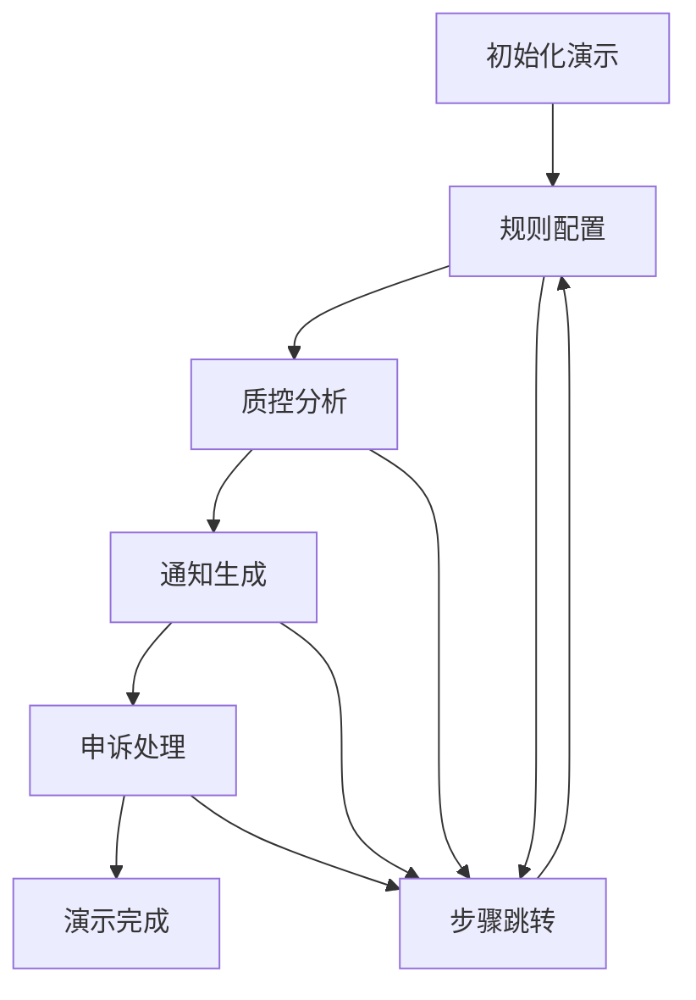
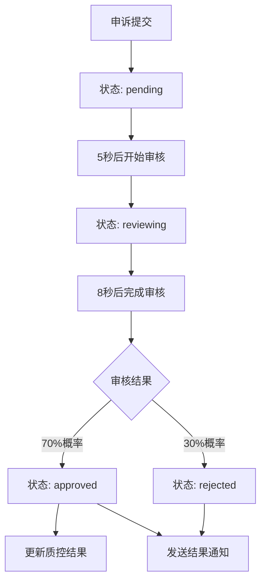
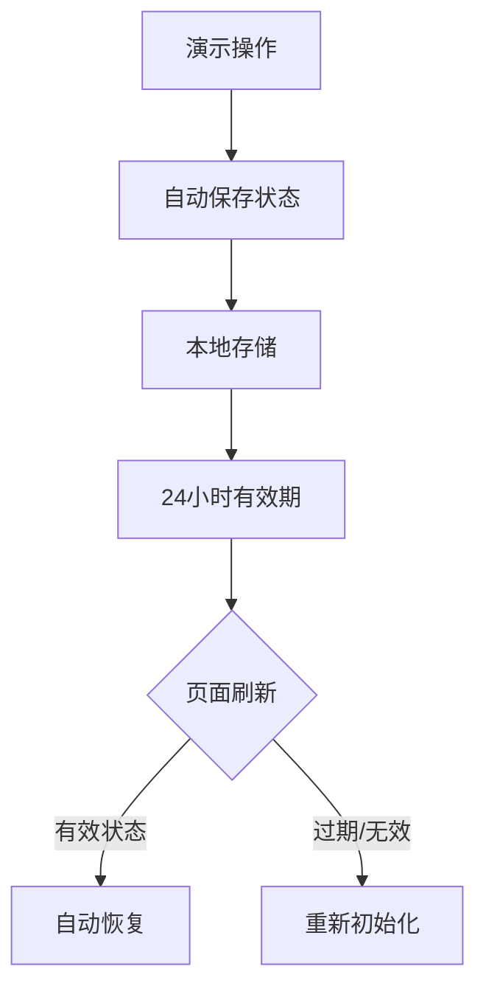

# LLM质控演示系统技术文档

## 🏗️ 系统架构

### 技术栈
- **前端框架**: Vue 3 + Composition API
- **类型系统**: TypeScript
- **UI组件库**: Ant Design Vue
- **状态管理**: Pinia
- **构建工具**: Vite
- **样式预处理**: SCSS/Less
- **路由管理**: Vue Router

### 项目结构
```
apps/medqc-web/src/
├── views/demo/
│   └── LLMQCDemoEnhanced.vue          # 主演示页面
├── components/demo/
│   ├── QCRulesDemoPanel.vue           # 规则演示面板
│   ├── QCAnalysisDemoPanel.vue        # 分析演示面板
│   ├── QCNotificationDemoPanel.vue    # 通知演示面板
│   ├── QCAppealDemoPanel.vue          # 申诉演示面板
│   ├── QCNotificationModal.vue       # 通知详情模态框
│   └── QCAppealModal.vue              # 申诉提交模态框
├── stores/
│   └── qcDemo.ts                      # 演示状态管理
├── types/
│   └── quality-control.ts             # 类型定义
└── docs/
    ├── LLM质控演示功能模块设计方案.md
    ├── LLM质控演示系统使用指南.md
    └── LLM质控演示系统技术文档.md
```

## 🔧 核心组件设计

### 1. 主演示组件 (LLMQCDemoEnhanced.vue)
**职责**: 演示流程控制和组件协调
**核心功能**:
- 演示步骤管理和切换
- 子组件集成和事件处理
- 用户界面控制和反馈
- 配置管理和数据导入导出

**关键方法**:
```typescript
// 演示控制
handleStartDemo()           // 启动演示
handleReplayDemo()          // 重播演示
handleStepJump(step)        // 步骤跳转
handleMenuAction(action)    // 菜单操作处理

// 事件处理
handleNotificationModalAction()  // 通知操作
handleAppealSubmitted()          // 申诉提交
handleAppealAction()             // 申诉操作
```

### 2. 状态管理 (qcDemo.ts)
**职责**: 全局状态管理和业务逻辑
**核心状态**:
```typescript
interface DemoState {
  isRunning: boolean              // 演示运行状态
  isPaused: boolean              // 演示暂停状态
  currentStep: DemoStep          // 当前演示步骤
  progress: number               // 演示进度
  selectedRules: QualityControlRule[]  // 选中的质控规则
  testRecord: MedicalRecord      // 测试病历
  analysisResult: QCResult       // 分析结果
  notifications: QCNotification[] // 通知列表
  appeals: Appeal[]              // 申诉列表
  config: DemoConfig             // 演示配置
}
```

**核心方法**:
```typescript
// 演示控制
initializeDemo()            // 初始化演示
startDemo()                // 开始演示
jumpToStep()               // 跳转步骤
replayDemo()               // 重播演示

// 业务逻辑
runQCAnalysis()            // 执行质控分析
simulateQCNotification()   // 模拟质控通知
createAppeal()             // 创建申诉
simulateAppealReview()     // 模拟申诉审核

// 数据管理
saveDemoState()            // 保存状态
restoreDemoState()         // 恢复状态
exportDemoData()           // 导出数据
importDemoData()           // 导入数据
```

### 3. 通知管理组件 (QCNotificationDemoPanel.vue)
**职责**: 通知列表展示和管理
**核心功能**:
- 通知列表展示和分页
- 高级筛选和搜索
- 批量操作和状态管理
- 实时更新和自动刷新

**筛选功能**:
```typescript
interface NotificationFilters {
  type: 'all' | 'warning' | 'error' | 'info' | 'success'
  severity: 'all' | 'low' | 'medium' | 'high' | 'critical'
  readStatus: 'all' | 'read' | 'unread'
  searchKeyword: string
}
```

### 4. 申诉管理组件 (QCAppealDemoPanel.vue)
**职责**: 申诉列表管理和批量操作
**核心功能**:
- 申诉列表展示和筛选
- 批量选择和操作
- 申诉统计和分析
- 状态跟踪和更新

**批量操作**:
```typescript
// 支持的批量操作
type BatchAction = 
  | 'batch-approve'    // 批量通过
  | 'batch-reject'     // 批量驳回
  | 'batch-delete'     // 批量删除
  | 'export'           // 导出数据
```

## 📊 数据模型设计

### 1. 质控通知 (QCNotification)
```typescript
interface QCNotification {
  id: string
  type: 'warning' | 'error' | 'info' | 'success'
  severity: 'low' | 'medium' | 'high' | 'critical'
  title: string
  message: string
  timestamp: Date
  isRead: boolean
  status: 'pending' | 'confirmed' | 'ignored' | 'appealed'
  canAppeal: boolean
  recordInfo?: MedicalRecordInfo
  qcResult?: QCResult
  appealId?: string
}
```

### 2. 申诉记录 (Appeal)
```typescript
interface Appeal {
  id: string
  qcResultId: string
  notificationId: string
  reason: AppealReason
  reasonText: string
  description: string
  attachments: File[]
  status: 'pending' | 'reviewing' | 'approved' | 'rejected' | 'cancelled'
  submittedAt: Date
  submittedBy: string
  appealType?: 'quality_dispute' | 'rule_challenge' | 'data_correction' | 'process_appeal'
  priority?: 'low' | 'medium' | 'high' | 'urgent'
  contact?: string
  reviewerComment?: string
  reviewedAt?: Date
  reviewedBy?: string
  estimatedReviewTime?: Date
}
```

### 3. 质控结果 (QCResult)
```typescript
interface QCResult {
  id: string
  overallScore: number
  overallGrade: string
  analysisDate: string
  issues: QCIssue[]
  suggestions: QCSuggestion[]
  ruleResults: QCRuleResult[]
  analysisSteps: AnalysisStep[]
  metadata: QCMetadata
}
```

## 🔄 业务流程设计

### 1. 演示流程


### 2. 申诉审核流程


### 3. 状态持久化流程


## 🎨 UI/UX 设计原则

### 1. 响应式设计
- **断点设置**: 768px (平板), 480px (手机)
- **布局适配**: Flexbox + CSS Grid
- **组件适配**: Ant Design Vue 响应式组件

### 2. 交互设计
- **渐进式披露**: 分步骤展示复杂信息
- **即时反馈**: 操作后立即显示结果
- **状态指示**: 清晰的加载和状态提示
- **错误处理**: 友好的错误信息和恢复建议

### 3. 视觉设计
- **色彩系统**: 基于Ant Design色彩规范
- **动画效果**: 平滑的过渡和微交互
- **图标使用**: 统一的图标语言
- **排版规范**: 清晰的信息层次

## 🚀 性能优化

### 1. 组件优化
- **懒加载**: 大型组件按需加载
- **虚拟滚动**: 长列表性能优化
- **防抖节流**: 搜索和筛选操作优化
- **缓存策略**: 计算结果和状态缓存

### 2. 数据优化
- **分页加载**: 大数据集分页处理
- **增量更新**: 只更新变化的数据
- **本地存储**: 减少重复网络请求
- **数据压缩**: JSON数据压缩存储

### 3. 渲染优化
- **条件渲染**: 避免不必要的DOM操作
- **组件复用**: 相似组件的复用设计
- **样式优化**: CSS-in-JS和样式隔离
- **图片优化**: 图片懒加载和格式优化

## 🔒 安全考虑

### 1. 数据安全
- **输入验证**: 严格的表单验证
- **XSS防护**: 内容转义和过滤
- **文件上传**: 文件类型和大小限制
- **本地存储**: 敏感数据加密存储

### 2. 隐私保护
- **数据脱敏**: 演示数据去标识化
- **访问控制**: 基于角色的权限管理
- **审计日志**: 操作记录和追踪
- **数据清理**: 定期清理过期数据

## 📝 开发规范

### 1. 代码规范
- **TypeScript**: 严格类型检查
- **ESLint**: 代码质量检查
- **Prettier**: 代码格式化
- **Git Hooks**: 提交前检查

### 2. 组件规范
- **单一职责**: 每个组件职责明确
- **Props设计**: 清晰的接口定义
- **事件命名**: 统一的事件命名规范
- **文档注释**: 完整的JSDoc注释

### 3. 测试规范
- **单元测试**: 核心逻辑单元测试
- **集成测试**: 组件集成测试
- **E2E测试**: 端到端功能测试
- **性能测试**: 关键路径性能测试

---

**版本**: v1.0.0  
**更新时间**: 2024-09-13  
**文档维护**: MedQC开发团队
