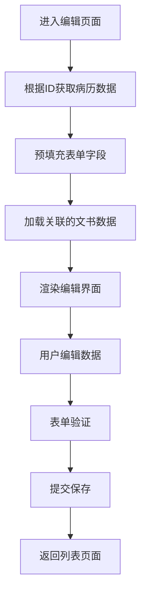
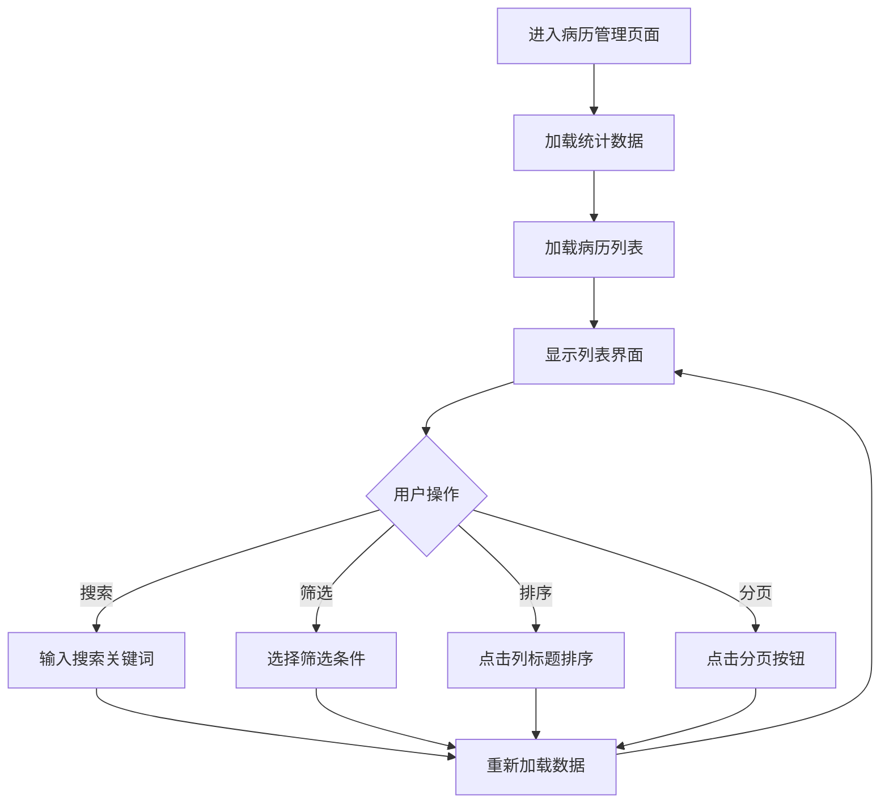
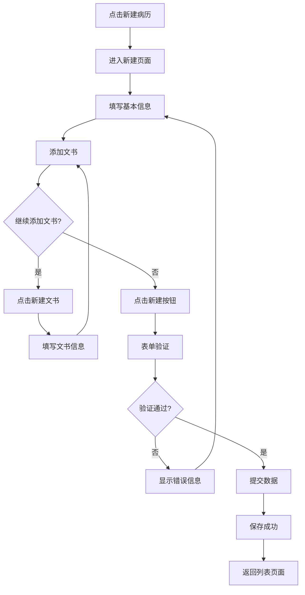
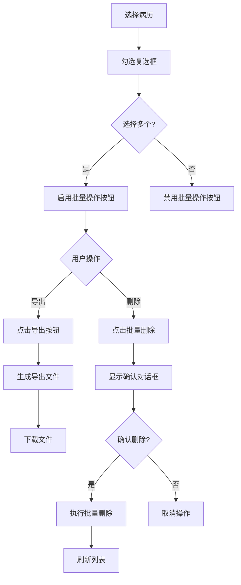

# 测试病历管理功能 - 产品需求文档 (PRD)

## 文档信息
- **产品名称**: 医疗质控系统 - 测试病历管理模块
- **版本**: v1.0
- **创建日期**: 2024-08-27
- **文档类型**: 产品需求文档 (PRD)

---

## 1. 产品概述

### 1.1 功能定位
测试病历管理模块是医疗质控系统的核心功能之一，主要用于管理LLM质控演示所需的测试病历数据。该模块提供完整的病历CRUD操作、批量导入导出、质控点关联等功能，为质控规则的测试和验证提供数据支撑。

### 1.2 目标用户
- **质控管理员**: 负责病历数据的维护和管理
- **医务人员**: 创建和编辑测试病历
- **系统管理员**: 进行批量数据操作和系统维护

### 1.3 核心价值
- 提供标准化的测试病历管理界面
- 支持高效的批量数据操作
- 与质控规则系统无缝集成
- 确保测试数据的完整性和一致性

---

## 2. 功能需求详述

### 2.1 病历列表页面 (`/dashboard/medical-records`)

#### 2.1.1 页面布局结构
```
┌─────────────────────────────────────────────────────────────┐
│ 页面标题: 测试病历管理                    [新建病历] [导入病历] [导出病历] │
├─────────────────────────────────────────────────────────────┤
│ 统计卡片区域                                                    │
│ [总病历数: 156] [本月新增: 23] [待审核: 5] [已关联质控点: 89]        │
├─────────────────────────────────────────────────────────────┤
│ 筛选区域                                                       │
│ [搜索病历名称] [出院科室▼] [主诊断▼] [创建人▼] [重置]              │
├─────────────────────────────────────────────────────────────┤
│ 表格区域                                                       │
│ ☐ 病历编号 ↕ │ 病历名称 │ 出院科室 │ 主诊断名称 │ ... │ 操作      │
│ ☐ MR001     │ 张三病历 │ 内科    │ 高血压   │ ... │ [编辑][删除] │
│ ☐ MR002     │ 李四病历 │ 外科    │ 阑尾炎   │ ... │ [编辑][删除] │
└─────────────────────────────────────────────────────────────┘
```

#### 2.1.2 表格列定义
| 列名 | 宽度 | 类型 | 功能说明 |
|------|------|------|----------|
| 选择框 | 40px | Checkbox | 多选功能，支持全选/反选 |
| 病历编号 | 100px | Text + Sort | 唯一标识，支持排序 |
| 病历名称 | 200px | Text + Search | 支持模糊搜索 |
| 出院科室 | 120px | Text + Filter | 支持筛选 |
| 主诊断名称 | 150px | Text + Filter | 支持筛选 |
| 主要手术及操作 | 180px | Text | 显示主要手术信息 |
| 应用质控点 | 120px | Link | 点击查看质控点详情 |
| 病历创建人 | 100px | Text + Filter | 支持筛选 |
| 最后操作人 | 100px | Text | 显示最后修改人 |
| 创建时间 | 120px | DateTime + Sort | 支持排序 |
| 操作 | 120px | Actions | 编辑、复制、删除按钮 |

#### 2.1.3 统计卡片数据
- **总病历数**: 显示系统中所有测试病历的总数
- **本月新增**: 显示当月新创建的病历数量
- **待审核**: 显示需要审核的病历数量
- **已关联质控点**: 显示已关联质控规则的病历数量

### 2.2 页面操作功能

#### 2.2.1 头部操作按钮
```typescript
interface HeaderActions {
  createRecord: {
    label: "新建病历"
    type: "primary"
    icon: "plus"
    action: () => navigateTo('/dashboard/medical-records/create')
  }
  importRecords: {
    label: "导入病历"
    type: "default"
    icon: "upload"
    action: () => showImportModal()
  }
  exportRecords: {
    label: "导出病历"
    type: "default"
    icon: "download"
    disabled: !hasSelectedRecords
    action: () => exportSelectedRecords()
  }
}
```

#### 2.2.2 行内操作按钮
```typescript
interface RowActions {
  viewQualityPoints: {
    label: "查看质控点"
    type: "link"
    action: (recordId: string) => showQualityPointsModal(recordId)
  }
  editRecord: {
    label: "编辑"
    type: "link"
    action: (recordId: string) => navigateTo(`/dashboard/medical-records/edit/${recordId}`)
  }
  copyRecord: {
    label: "复制"
    type: "link"
    action: (recordId: string) => copyRecord(recordId)
  }
  deleteRecord: {
    label: "删除"
    type: "link"
    danger: true
    action: (recordId: string) => showDeleteConfirm(recordId)
  }
}
```

### 2.3 筛选和搜索功能

#### 2.3.1 搜索功能
- **病历名称搜索**: 支持模糊匹配
- **实时搜索**: 输入后自动触发搜索
- **搜索历史**: 保存最近的搜索记录

#### 2.3.2 筛选功能
```typescript
interface FilterOptions {
  department: {
    label: "出院科室"
    options: ["内科", "外科", "妇产科", "儿科", "急诊科"]
    multiple: true
  }
  diagnosis: {
    label: "主诊断"
    options: ["高血压", "糖尿病", "冠心病", "肺炎", "阑尾炎"]
    multiple: true
  }
  creator: {
    label: "创建人"
    options: ["张医生", "李医生", "王医生"]
    multiple: true
  }
  dateRange: {
    label: "创建时间"
    type: "dateRange"
  }
}
```

---

## 3. 子页面功能设计

### 3.1 新建病历页面 (`/dashboard/medical-records/create`)

#### 3.1.1 页面布局
```
┌─────────────────────────────────────────────────────────────┐
│ 面包屑: 测试病历管理 > 新建病历                                    │
├─────────────────────────────────────────────────────────────┤
│ 病历基本信息                                                    │
│ ┌─────────────────┐ ┌─────────────────┐                      │
│ │ 病历编号: [自动生成] │ │ 病历名称: [____] │                      │
│ └─────────────────┘ └─────────────────┘                      │
│ ┌─────────────────┐ ┌─────────────────┐                      │
│ │ 出院科室: [下拉选择] │ │ 主诊断: [____]  │                      │
│ └─────────────────┘ └─────────────────┘                      │
├─────────────────────────────────────────────────────────────┤
│ 文书信息 (可添加多个文书)                                         │
│ ┌─────────────────────────────────────────────────────────┐   │
│ │ 文书1: 入院记录                                           │   │
│ │ 文书内容: [大文本框]                                       │   │
│ │                                              [删除文书]   │   │
│ └─────────────────────────────────────────────────────────┘   │
├─────────────────────────────────────────────────────────────┤
│ [新建文书]                                        [取消] [新建] │
└─────────────────────────────────────────────────────────────┘
```

#### 3.1.2 表单字段定义
```typescript
interface MedicalRecordForm {
  recordId: string          // 自动生成，不可编辑
  recordName: string        // 必填，病历名称
  department: string        // 必填，出院科室
  primaryDiagnosis: string  // 必填，主诊断
  majorSurgery?: string     // 可选，主要手术及操作
  documents: DocumentForm[] // 文书列表
}

interface DocumentForm {
  id: string
  type: string      // 文书类型：入院记录、病程记录、出院记录等
  content: string   // 文书内容
  createdAt: Date
}
```

### 3.2 编辑病历页面 (`/dashboard/medical-records/edit/:id`)

#### 3.2.1 页面特点
- 预填充现有病历数据
- 支持编辑所有字段（除病历编号外）
- 显示修改历史记录
- 保存按钮替换新建按钮

#### 3.2.2 数据加载流程


### 3.3 质控点详情弹窗

#### 3.3.1 弹窗内容
```typescript
interface QualityPointModal {
  recordId: string
  qualityPoints: {
    id: string
    name: string
    category: string
    severity: string
    description: string
    appliedAt: Date
  }[]
}
```

#### 3.3.2 弹窗布局
```
┌─────────────────────────────────────────┐
│ 质控点详情                    [×]        │
├─────────────────────────────────────────┤
│ 病历编号: MR001                          │
│ 病历名称: 张三病历                        │
├─────────────────────────────────────────┤
│ 应用的质控点:                            │
│ ┌─────────────────────────────────────┐ │
│ │ QC001 - 完整性检查                   │ │
│ │ 分类: 完整性 | 严重程度: 重要         │ │
│ │ 应用时间: 2024-08-27 10:30          │ │
│ └─────────────────────────────────────┘ │
│ ┌─────────────────────────────────────┐ │
│ │ QC002 - 一致性检查                   │ │
│ │ 分类: 一致性 | 严重程度: 严重         │ │
│ │ 应用时间: 2024-08-27 10:35          │ │
│ └─────────────────────────────────────┘ │
├─────────────────────────────────────────┤
│                              [关闭]     │
└─────────────────────────────────────────┘
```

---

## 4. 数据结构设计

### 4.1 病历数据模型
```typescript
interface MedicalRecord {
  id: string                    // 病历ID
  recordNumber: string          // 病历编号
  recordName: string           // 病历名称
  department: string           // 出院科室
  primaryDiagnosis: string     // 主诊断名称
  majorSurgery?: string        // 主要手术及操作
  qualityPointIds: string[]    // 关联的质控点ID列表
  createdBy: string           // 创建人
  lastModifiedBy: string      // 最后操作人
  createdAt: Date             // 创建时间
  updatedAt: Date             // 更新时间
  status: 'draft' | 'active' | 'archived'  // 状态
  documents: Document[]        // 关联的文书
}

interface Document {
  id: string
  recordId: string            // 所属病历ID
  type: DocumentType          // 文书类型
  title: string              // 文书标题
  content: string            // 文书内容
  createdBy: string          // 创建人
  createdAt: Date            // 创建时间
  updatedAt: Date            // 更新时间
}

enum DocumentType {
  ADMISSION_RECORD = 'admission_record',      // 入院记录
  PROGRESS_NOTE = 'progress_note',            // 病程记录
  DISCHARGE_SUMMARY = 'discharge_summary',    // 出院记录
  OPERATION_RECORD = 'operation_record',      // 手术记录
  CONSULTATION = 'consultation'               // 会诊记录
}
```

### 4.2 统计数据模型
```typescript
interface MedicalRecordStats {
  totalRecords: number        // 总病历数
  monthlyNew: number         // 本月新增
  pendingReview: number      // 待审核
  withQualityPoints: number  // 已关联质控点
}
```

---

## 5. API接口规范

### 5.1 病历管理接口
```typescript
// 获取病历列表
GET /api/medical-records
Query Parameters:
- page: number (页码)
- pageSize: number (每页数量)
- search?: string (搜索关键词)
- department?: string[] (科室筛选)
- diagnosis?: string[] (诊断筛选)
- creator?: string[] (创建人筛选)
- dateRange?: [string, string] (时间范围)

Response: {
  data: MedicalRecord[]
  total: number
  page: number
  pageSize: number
}

// 获取单个病历详情
GET /api/medical-records/:id
Response: MedicalRecord

// 创建病历
POST /api/medical-records
Body: Omit<MedicalRecord, 'id' | 'createdAt' | 'updatedAt'>
Response: MedicalRecord

// 更新病历
PUT /api/medical-records/:id
Body: Partial<MedicalRecord>
Response: MedicalRecord

// 删除病历
DELETE /api/medical-records/:id
Response: { success: boolean }

// 批量删除病历
DELETE /api/medical-records/batch
Body: { ids: string[] }
Response: { success: boolean, deletedCount: number }

// 复制病历
POST /api/medical-records/:id/copy
Response: MedicalRecord
```

### 5.2 统计数据接口
```typescript
// 获取统计数据
GET /api/medical-records/stats
Response: MedicalRecordStats
```

### 5.3 导入导出接口
```typescript
// 导入病历
POST /api/medical-records/import
Body: FormData (包含Excel文件)
Response: {
  success: boolean
  importedCount: number
  errors?: string[]
}

// 导出病历
POST /api/medical-records/export
Body: {
  ids?: string[]  // 指定导出的病历ID，为空则导出全部
  format: 'excel' | 'csv'
}
Response: Blob (文件流)
```

### 5.4 质控点关联接口
```typescript
// 获取病历关联的质控点
GET /api/medical-records/:id/quality-points
Response: QualityPoint[]

// 为病历关联质控点
POST /api/medical-records/:id/quality-points
Body: { qualityPointIds: string[] }
Response: { success: boolean }
```

---

## 6. 用户交互流程

### 6.1 病历列表浏览流程


### 6.2 新建病历流程


### 6.3 批量操作流程


---

## 7. 页面原型设计说明

### 7.1 设计原则
- **一致性**: 与质控规则管理页面保持视觉和交互一致性
- **效率性**: 支持快速的数据录入和批量操作
- **可用性**: 界面简洁明了，操作流程清晰
- **响应式**: 适配不同屏幕尺寸的设备

### 7.2 视觉规范
- 严格遵循已制定的UI设计规范
- 表格使用30px行高，保持紧凑性和可读性
- 按钮使用统一的尺寸和样式
- 色彩使用系统定义的色板

### 7.3 交互规范
- 支持键盘快捷键操作
- 提供明确的操作反馈
- 实现渐进式表单验证
- 支持拖拽排序和批量选择

---

## 8. 技术实现要点

### 8.1 性能优化
- 表格虚拟滚动支持大数据量
- 图片懒加载和缓存策略
- API请求防抖和缓存
- 组件按需加载

### 8.2 错误处理
- 网络请求错误处理
- 表单验证错误提示
- 文件上传错误处理
- 用户权限错误处理

### 8.3 安全考虑
- 输入数据验证和过滤
- 文件上传类型和大小限制
- API接口权限控制
- 敏感数据脱敏显示

---

## 9. 测试用例

### 9.1 功能测试
- 病历CRUD操作测试
- 搜索和筛选功能测试
- 批量操作功能测试
- 导入导出功能测试

### 9.2 界面测试
- 响应式布局测试
- 浏览器兼容性测试
- 交互体验测试
- 无障碍访问测试

### 9.3 性能测试
- 大数据量加载测试
- 并发操作测试
- 内存泄漏测试
- 网络异常测试

---

## 10. 发布计划

### 10.1 开发阶段
- **Phase 1**: 基础页面和组件开发 (3天)
- **Phase 2**: 数据交互和API集成 (2天)
- **Phase 3**: 功能完善和优化 (2天)
- **Phase 4**: 测试和修复 (1天)

### 10.2 验收标准
- 所有功能正常运行
- 界面符合设计规范
- 性能满足要求
- 通过全部测试用例

---

**文档版本**: v1.0  
**最后更新**: 2024-08-27  
**审核状态**: 待审核
