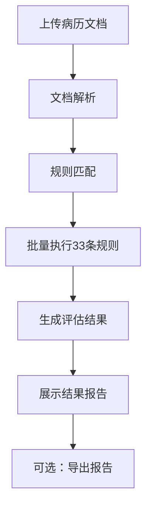
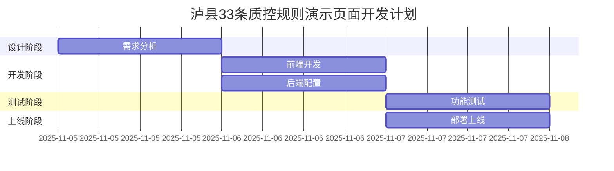

# 产品需求文档 (PRD)
## 泸县33条质控规则演示页面

---

**文档版本**: v1.1
**创建日期**: 2025-11-05
**更新日期**: 2025-11-05
**负责人**: 开发团队
**审核状态**: 待审核

---

## 目录

- [1. 产品背景与目标](#1-产品背景与目标)
- [2. 核心功能需求](#2-核心功能需求)
- [3. 界面设计要求](#3-界面设计要求)
- [4. 技术实现要求](#4-技术实现要求)
- [5. 非功能性需求](#5-非功能性需求)
- [6. 实施计划](#6-实施计划)
- [7. 未来扩展](#7-未来扩展)
- [8. 风险与应对](#8-风险与应对)

---

## 1. 产品背景与目标

### 1.1 背景

为了向客户展示泸县地区特定的33条质控规则的实际效果，需要提供一个独立的、无需登录的演示页面，让客户能够快速体验规则检查和批量质控评估功能。

### 1.2 产品目标

- **简化访问流程**: 客户无需注册登录即可直接访问演示页面
- **聚焦核心功能**: 专注展示 LX33 条规则的质控评估能力
- **提升演示效率**: 快速展示批量质控评估的完整流程和结果

### 1.3 目标用户

- 潜在客户（医疗机构信息科、质控科负责人）
- 产品演示人员
- 合作伙伴

---

## 2. 核心功能需求

### 2.1 页面访问

| 功能项 | 详细说明 | 优先级 |
|--------|---------|--------|
| 独立路由 | `/demo/lx33` 或 `/lx33-demo` | P0 |
| 免登录访问 | 跳过认证中间件，直接访问 | P0 |
| 页面标识 | 顶部显示「演示页面 - 泸县33条质控规则」 | P1 |
| 页面元信息 | 设置合适的页面标题和描述 | P1 |

#### 路由配置
```javascript
{
  path: '/demo/lx33',
  name: 'LX33Demo',
  component: () => import('@/views/demo/LX33DemoView.vue'),
  meta: {
    requiresAuth: false,  // 不需要登录
    title: '泸县33条质控规则演示',
    layout: 'simple'  // 使用简化布局
  }
}
```

### 2.2 规则列表展示

| 功能项 | 详细说明 | 优先级 |
|--------|---------|--------|
| 规则筛选 | 只显示规则代码以 "LX-" 开头的33条规则 | P0 |
| 列表字段 | 规则编号、规则名称、描述、缺陷等级、适用文书 | P0 |
| 隐藏详情按钮 | 不显示"详情"操作按钮 | P0 |
| 保留评估按钮 | 保留"批量质控评估"按钮 | P0 |
| 规则排序 | 按规则编号（LX-001 ~ LX-033）升序排列 | P1 |
| 搜索功能 | 支持按规则名称、编号搜索（可选） | P2 |
| 分页 | 默认显示所有33条，可选分页 | P2 |

#### 显示字段详情

| 字段名称 | 字段说明 | 数据来源 | 是否必填 |
|---------|---------|---------|---------|
| 规则编号 | LX-001 ~ LX-033 | `rule_code` | 是 |
| 规则名称 | 规则的中文名称 | `name` | 是 |
| 规则描述 | 规则的详细说明 | `description` | 是 |
| 缺陷等级 | critical/major/minor | `defect_level` | 是 |
| 适用文书 | 适用的文书类型 | `applicable_documents` | 是 |

### 2.3 批量质控评估功能

| 功能项 | 详细说明 | 优先级 |
|--------|---------|--------|
| 功能保留 | 完整保留现有批量质控评估功能 | P0 |
| 文书上传 | 支持上传病历文档（PDF/DOCX/TXT） | P0 |
| 多文档上传 | 支持同时上传多个病历文档 | P1 |
| 评估流程 | 展示评估进度、实时反馈 | P0 |
| 结果展示 | 显示每条规则的检查结果、问题描述、建议 | P0 |
| 统计汇总 | 显示通过率、问题分布等统计信息 | P1 |
| 结果导出 | 支持导出评估报告（PDF/Excel） | P2 |

#### 批量评估流程



### 2.4 质控结果反馈系统 ⭐ 新增

> **设计目标**: 建立质控结果验证和反馈闭环，收集真实使用数据，用于优化规则准确性

| 功能项 | 详细说明 | 优先级 |
|--------|---------|--------|
| 结果反馈按钮 | 每条质控结果旁显示"反馈"按钮 | P0 |
| 反馈类型选择 | 支持"正确"/"错误"两种反馈类型 | P0 |
| 错误详情填写 | 反馈为"错误"时，必须填写详细错误说明 | P0 |
| 后台数据保存 | 所有反馈记录保存到数据库 | P0 |
| 反馈记录查看 | 提供独立页面查看所有反馈记录 | P0 |
| 反馈数据导出 | 支持导出反馈记录（Excel/CSV） | P0 |
| 反馈统计 | 显示每条规则的反馈统计（正确率、错误率） | P1 |
| 反馈历史 | 支持查看单条规则的反馈历史 | P1 |

#### 反馈流程

```mermaid
graph TD
    A[查看质控结果] --> B{结果是否正确?}
    B -->|正确| C[点击"反馈正确"按钮]
    B -->|错误| D[点击"反馈错误"按钮]
    C --> E[直接提交反馈]
    D --> F[打开错误详情表单]
    F --> G[填写错误类型和详细说明]
    G --> H[提交反馈]
    E --> I[保存到数据库]
    H --> I
    I --> J[更新反馈统计]
    J --> K[显示提交成功提示]
```

#### 反馈数据结构

| 字段名 | 类型 | 说明 | 必填 |
|--------|------|------|------|
| feedback_id | UUID | 反馈记录ID | 是 |
| evaluation_id | UUID | 关联的评估记录ID | 是 |
| rule_id | String | 规则ID | 是 |
| rule_code | String | 规则编号（如 LX-001） | 是 |
| document_name | String | 病历文档名称 | 是 |
| evaluation_result | Boolean | 原始评估结果（通过/不通过） | 是 |
| feedback_type | Enum | 反馈类型：correct/incorrect | 是 |
| error_category | String | 错误类型（仅错误反馈） | 否 |
| error_detail | Text | 详细错误说明（仅错误反馈） | 条件必填 |
| evidence | Text | 证据或补充说明 | 否 |
| feedback_by | String | 反馈人（可匿名） | 否 |
| created_at | Timestamp | 反馈时间 | 是 |

#### 错误类型分类

| 错误类型 | 说明 | 示例 |
|---------|------|------|
| false_positive | 误报（不该报错但报错了） | 规则判定不合规，但实际符合要求 |
| false_negative | 漏报（该报错但没报错） | 存在明显问题但规则未检出 |
| wrong_reasoning | 推理错误 | 结论正确但推理过程有误 |
| incomplete_check | 检查不完整 | 只检查了部分内容 |
| rule_ambiguity | 规则理解歧义 | 规则定义不清导致误判 |
| other | 其他 | 其他类型错误 |

#### 反馈记录页面

**路由**: `/demo/lx33/feedbacks`

**功能要点**:
- 列表展示所有反馈记录
- 支持按规则编号、反馈类型、时间筛选
- 显示字段：时间、规则编号、规则名称、文档名称、反馈类型、错误说明
- 支持导出筛选后的数据
- 显示统计信息：总反馈数、正确率、错误率

#### 反馈统计面板

在规则列表页面顶部添加统计面板：

```
┌────────────────────────────────────────────┐
│  反馈统计 (最近30天)                         │
│  ━━━━━━━━━━━━━━━━━━━━━━━━━━━━━━━━━━━━━━  │
│  📊 总反馈数: 128                           │
│  ✅ 正确反馈: 96 (75%)                      │
│  ❌ 错误反馈: 32 (25%)                      │
│  📈 最高准确率规则: LX-015 (95%)            │
│  📉 最低准确率规则: LX-023 (60%)            │
└────────────────────────────────────────────┘
```

### 2.5 用户体验优化

| 功能项 | 详细说明 | 优先级 |
|--------|---------|--------|
| 加载动画 | 数据加载时显示友好的加载动画 | P1 |
| 空状态提示 | 无数据时显示引导性提示 | P1 |
| 错误处理 | 友好的错误提示和重试机制 | P0 |
| 操作反馈 | 每个操作都有明确的反馈提示 | P1 |

---

## 3. 界面设计要求

### 3.1 页面布局

#### 整体结构
```
┌──────────────────────────────────────────────────────┐
│  [Logo]  演示页面 - 泸县33条质控规则           [演示版] │
├──────────────────────────────────────────────────────┤
│                                                      │
│  泸县33条质控规则列表                                  │
│  ┌────────────────────────────────────────────────┐ │
│  │ 搜索：[          ]  [搜索按钮]                  │ │
│  └────────────────────────────────────────────────┘ │
│                                                      │
│  ┌────────────────────────────────────────────────┐ │
│  │ LX-001 | 主诉与现病史一致性检查                  │ │
│  │ 描述：检查主诉与现病史的一致性                   │ │
│  │ 缺陷等级：minor | 适用：入院记录、病程记录       │ │
│  │                        [批量质控评估]          │ │
│  ├────────────────────────────────────────────────┤ │
│  │ LX-002 | 诊断依据完整性检查                      │ │
│  │ ...                                            │ │
│  │                        [批量质控评估]          │ │
│  └────────────────────────────────────────────────┘ │
│                                                      │
│  共 33 条规则                                         │
│                                                      │
└──────────────────────────────────────────────────────┘
```

### 3.2 UI/UX 要求

#### 设计原则
- **简洁明了**: 去除不必要的导航栏、侧边栏
- **突出主题**: 顶部清晰标注"演示页面"
- **保持一致**: 沿用现有系统的设计风格和 Ant Design Vue 组件库
- **响应式设计**: 支持桌面端和平板端访问
- **专业形象**: 展示医疗级产品的专业性

#### 布局规范
- **页面宽度**: 最大 1400px，居中显示
- **内容间距**: 卡片间距 16px，内边距 24px
- **字体大小**:
  - 标题: 24px (h2)
  - 规则名称: 16px (medium)
  - 描述文字: 14px (regular)
  - 辅助信息: 12px (secondary)

### 3.3 配色与标识

#### 颜色方案
```css
/* 主题色 */
--primary-color: #1890ff;
--success-color: #52c41a;
--warning-color: #faad14;
--error-color: #ff4d4f;

/* 演示页面特殊标识色 */
--demo-badge-bg: #722ed1;
--demo-watermark: rgba(0, 0, 0, 0.03);
```

#### 演示标识
- 右上角添加"演示版本"徽章
- 页面底部添加半透明水印："演示环境"
- 顶部 banner 使用渐变色区分正式系统

#### 缺陷等级颜色
| 等级 | 颜色 | 标签 |
|------|------|------|
| critical | 红色 (#ff4d4f) | 严重缺陷 |
| major | 橙色 (#faad14) | 一般缺陷 |
| minor | 蓝色 (#1890ff) | 轻微缺陷 |

### 3.4 交互设计

#### 规则卡片
- **悬停效果**: 鼠标悬停时显示阴影
- **点击反馈**: 点击评估按钮时显示加载状态
- **展开/收起**: 规则描述过长时支持展开查看

#### 批量评估弹窗
- **模态对话框**: 使用 Ant Design Modal 组件
- **上传区域**: 支持拖拽上传
- **进度条**: 实时显示评估进度
- **结果展示**: 使用表格或卡片形式展示结果

---

## 4. 技术实现要求

### 4.1 前端实现

#### 技术栈
- **框架**: Vue 3 + TypeScript
- **UI 库**: Ant Design Vue 4.x
- **路由**: Vue Router 4.x
- **状态管理**: Pinia（如需要）
- **HTTP 客户端**: Axios / Fetch API

#### 目录结构
```
src/
├── views/
│   └── demo/
│       ├── LX33DemoView.vue          # 主页面
│       └── components/
│           ├── RuleCard.vue          # 规则卡片组件
│           ├── BatchEvaluationModal.vue  # 批量评估弹窗
│           └── ResultDisplay.vue     # 结果展示组件
├── api/
│   └── demo.ts                       # 演示页面 API 接口
├── layouts/
│   └── SimpleLayout.vue              # 简化布局（无侧边栏）
└── router/
    └── demo.ts                       # 演示路由配置
```

#### 关键实现

**1. 路由配置** (`src/router/demo.ts`)
```typescript
export const demoRoutes = [
  {
    path: '/demo/lx33',
    name: 'LX33Demo',
    component: () => import('@/views/demo/LX33DemoView.vue'),
    meta: {
      requiresAuth: false,  // 不需要登录
      title: '泸县33条质控规则演示',
      layout: 'simple'
    }
  }
]
```

**2. 数据筛选** (`LX33DemoView.vue`)
```typescript
// 筛选 LX- 开头的规则
const lxRules = computed(() => {
  return allRules.value.filter(rule =>
    rule.rule_code?.startsWith('LX-')
  ).sort((a, b) =>
    a.rule_code.localeCompare(b.rule_code)
  )
})
```

**3. 组件 Props** (`RuleCard.vue`)
```typescript
interface Props {
  rule: QCRule
  showDetailButton?: boolean  // 控制详情按钮显示，默认 false
  showEvaluationButton?: boolean  // 控制评估按钮显示，默认 true
}
```

### 4.2 后端支持

#### API 接口

**质控规则接口**

| 接口路径 | 方法 | 说明 | 认证 |
|---------|------|------|------|
| `/api/v1/qc_rules` | GET | 获取所有质控规则 | 否 |
| `/api/v1/qc_rules/batch-evaluate` | POST | 批量评估 | 否 |
| `/api/v1/qc_rules/stats` | GET | 获取统计信息 | 否 |

**反馈系统接口** ⭐ 新增

| 接口路径 | 方法 | 说明 | 认证 |
|---------|------|------|------|
| `/api/v1/demo/feedbacks` | POST | 提交反馈 | 否 |
| `/api/v1/demo/feedbacks` | GET | 获取反馈列表 | 否 |
| `/api/v1/demo/feedbacks/{feedback_id}` | GET | 获取单条反馈详情 | 否 |
| `/api/v1/demo/feedbacks/export` | GET | 导出反馈数据 | 否 |
| `/api/v1/demo/feedbacks/stats` | GET | 获取反馈统计 | 否 |
| `/api/v1/demo/feedbacks/by-rule/{rule_code}` | GET | 获取特定规则的反馈 | 否 |

**接口详细说明**:

**1. POST /api/v1/demo/feedbacks - 提交反馈**
```json
// Request Body
{
  "evaluation_id": "uuid",
  "rule_id": "uuid",
  "rule_code": "LX-001",
  "document_name": "入院记录_张三.pdf",
  "evaluation_result": false,
  "feedback_type": "incorrect",  // correct | incorrect
  "error_category": "false_positive",  // 仅错误反馈时必填
  "error_detail": "规则判定患者主诉不完整，但实际主诉已包含所有必要信息...",
  "evidence": "患者主诉：反复咳嗽、咳痰3天，加重1天...",
  "feedback_by": "张医生"  // 可选，可匿名
}

// Response
{
  "success": true,
  "feedback_id": "uuid",
  "message": "反馈提交成功"
}
```

**2. GET /api/v1/demo/feedbacks - 获取反馈列表**
```json
// Query Parameters
{
  "page": 1,
  "page_size": 20,
  "rule_code": "LX-001",  // 可选，筛选特定规则
  "feedback_type": "incorrect",  // 可选，筛选反馈类型
  "start_date": "2025-11-01",  // 可选
  "end_date": "2025-11-05"  // 可选
}

// Response
{
  "success": true,
  "data": [
    {
      "feedback_id": "uuid",
      "rule_code": "LX-001",
      "rule_name": "主诉与现病史一致性检查",
      "document_name": "入院记录_张三.pdf",
      "feedback_type": "incorrect",
      "error_category": "false_positive",
      "error_detail": "...",
      "created_at": "2025-11-05T10:30:00Z"
    }
  ],
  "total": 128,
  "page": 1,
  "page_size": 20
}
```

**3. GET /api/v1/demo/feedbacks/stats - 获取反馈统计**
```json
// Response
{
  "success": true,
  "data": {
    "total_feedbacks": 128,
    "correct_feedbacks": 96,
    "incorrect_feedbacks": 32,
    "accuracy_rate": 0.75,
    "by_rule": [
      {
        "rule_code": "LX-001",
        "rule_name": "主诉与现病史一致性检查",
        "total": 12,
        "correct": 10,
        "incorrect": 2,
        "accuracy": 0.83
      }
    ],
    "error_categories": {
      "false_positive": 15,
      "false_negative": 8,
      "wrong_reasoning": 5,
      "incomplete_check": 3,
      "other": 1
    }
  }
}
```

**4. GET /api/v1/demo/feedbacks/export - 导出反馈数据**
```
Query Parameters: 同获取反馈列表
Response: Excel/CSV 文件流
Headers: Content-Disposition: attachment; filename="lx33_feedbacks_2025-11-05.xlsx"
```

#### 认证豁免配置

**方案1: 路由级别豁免** (推荐)
```python
# backend/app/main.py
PUBLIC_PATHS = [
    "/api/v1/qc_rules",  # 允许匿名访问规则列表
    "/api/v1/qc_rules/batch-evaluate",  # 允许匿名评估
    "/api/v1/demo/feedbacks",  # 允许匿名反馈 ⭐ 新增
]

@app.middleware("http")
async def auth_middleware(request: Request, call_next):
    if request.url.path.startswith("/api/v1/demo/") or request.url.path in PUBLIC_PATHS:
        return await call_next(request)
    # ... 正常认证流程
```

**方案2: 演示 Token**
```python
# 为演示页面生成特殊 token
DEMO_TOKEN = "demo_lx33_access_token"

if token == DEMO_TOKEN:
    # 只允许访问 LX 规则相关接口
    pass
```

### 4.3 数据准备

#### LX33 规则数据

确保 Supabase `qc_rules` 表中存在以下规则：

```sql
-- 检查 LX 规则是否存在
SELECT rule_code, name, defect_level
FROM qc_rules
WHERE rule_code LIKE 'LX-%'
ORDER BY rule_code;
```

**预期结果**: 33条规则，编号从 LX-001 到 LX-033

#### 演示病历数据（可选）

准备 2-3 份典型病历样本，供客户快速测试：
- `demo_admission_record.pdf` - 入院记录
- `demo_progress_note.pdf` - 病程记录
- `demo_discharge_record.pdf` - 出院记录

存放位置：`backend/app/data/demo_documents/`

#### 反馈数据库表结构 ⭐ 新增

创建 `demo_feedbacks` 表用于存储反馈记录：

```sql
-- 创建反馈表
CREATE TABLE IF NOT EXISTS demo_feedbacks (
    feedback_id UUID PRIMARY KEY DEFAULT gen_random_uuid(),
    evaluation_id UUID,  -- 关联的评估记录ID（可选）
    rule_id UUID NOT NULL,
    rule_code VARCHAR(50) NOT NULL,
    rule_name VARCHAR(255) NOT NULL,
    document_name VARCHAR(255) NOT NULL,
    evaluation_result BOOLEAN NOT NULL,  -- 原始评估结果
    feedback_type VARCHAR(20) NOT NULL CHECK (feedback_type IN ('correct', 'incorrect')),
    error_category VARCHAR(50),  -- 错误类型
    error_detail TEXT,  -- 详细错误说明
    evidence TEXT,  -- 证据或补充说明
    feedback_by VARCHAR(100),  -- 反馈人（可匿名）
    created_at TIMESTAMP WITH TIME ZONE DEFAULT NOW(),
    updated_at TIMESTAMP WITH TIME ZONE DEFAULT NOW()
);

-- 创建索引
CREATE INDEX idx_demo_feedbacks_rule_code ON demo_feedbacks(rule_code);
CREATE INDEX idx_demo_feedbacks_feedback_type ON demo_feedbacks(feedback_type);
CREATE INDEX idx_demo_feedbacks_created_at ON demo_feedbacks(created_at DESC);

-- 添加注释
COMMENT ON TABLE demo_feedbacks IS 'LX33演示页面反馈记录表';
COMMENT ON COLUMN demo_feedbacks.feedback_type IS '反馈类型: correct-正确, incorrect-错误';
COMMENT ON COLUMN demo_feedbacks.error_category IS '错误类型: false_positive, false_negative, wrong_reasoning, incomplete_check, rule_ambiguity, other';
```

**字段说明**:
- `feedback_id`: 反馈记录唯一标识
- `evaluation_id`: 关联的评估记录ID（如果有）
- `rule_id`: 规则UUID
- `rule_code`: 规则编号（LX-001 ~ LX-033）
- `rule_name`: 规则名称（冗余字段，便于查询）
- `document_name`: 病历文档名称
- `evaluation_result`: 原始评估结果（true-通过, false-不通过）
- `feedback_type`: 反馈类型（correct-正确, incorrect-错误）
- `error_category`: 错误类型分类（仅错误反馈）
- `error_detail`: 详细错误说明（仅错误反馈）
- `evidence`: 证据或补充说明
- `feedback_by`: 反馈人姓名或标识（可选）
- `created_at`: 创建时间
- `updated_at`: 更新时间

---

## 5. 非功能性需求

### 5.1 性能要求

| 指标 | 目标值 | 测量方法 |
|------|--------|---------|
| 页面首次加载时间 | < 2秒 | Lighthouse |
| 规则列表渲染时间 | < 500ms | Chrome DevTools |
| 批量评估响应时间 | 与正式系统一致 | 接口测试 |
| 首屏内容可见时间 (FCP) | < 1.5秒 | Web Vitals |

### 5.2 安全要求

#### 访问控制
- **选项1**: 完全公开访问（适合公开演示）
- **选项2**: 简单密码保护（如：访问码）
- **选项3**: 临时 Token 访问（带过期时间）

**推荐方案**: 选项1（完全公开）+ 数据隔离

#### 数据安全
- ✅ 演示页面不能访问真实患者数据
- ✅ 只能查看规则，不能修改/删除
- ✅ 上传的病历文档仅用于演示评估，不持久化存储
- ✅ 评估结果不保存到数据库

#### API 限流
```javascript
// 限制演示页面的 API 调用频率
rateLimit: {
  windowMs: 15 * 60 * 1000,  // 15分钟
  max: 100  // 最多100次请求
}
```

### 5.3 兼容性要求

#### 浏览器支持
| 浏览器 | 最低版本 | 测试要求 |
|--------|---------|---------|
| Chrome | 90+ | 必测 |
| Firefox | 88+ | 必测 |
| Safari | 14+ | 可选 |
| Edge | 90+ | 可选 |

#### 屏幕分辨率
- **桌面端**: 1920x1080, 1366x768
- **平板端**: 1024x768（可选）
- **手机端**: 暂不支持

### 5.4 可用性要求

- **系统可用性**: 99%
- **响应时间**: 95% 的请求在 2秒内响应
- **错误率**: < 1%

---

## 6. 实施计划

### 6.1 开发阶段

| 阶段 | 任务 | 交付物 | 预计工时 | 负责人 |
|------|------|--------|---------|--------|
| Phase 1 | 需求分析和技术方案设计 | 技术方案文档 | 1h | 全栈 |
| Phase 2 | 创建演示页面路由和简化布局 | 页面框架 | 2h | 前端 |
| Phase 3 | 实现规则列表展示（隐藏详情按钮） | 规则列表组件 | 2h | 前端 |
| Phase 4 | 集成批量质控评估功能 | 评估功能 | 2h | 全栈 |
| Phase 5 | **⭐ 实现反馈系统前端组件** | 反馈按钮、表单、记录页面 | 3h | 前端 |
| Phase 6 | **⭐ 实现反馈系统后端接口** | 数据库表、API接口 | 3h | 后端 |
| Phase 7 | **⭐ 实现反馈数据导出功能** | 导出Excel功能 | 1h | 后端 |
| Phase 8 | 后端认证豁免配置 | API 接口 | 1h | 后端 |
| Phase 9 | UI 优化和演示标识添加 | 最终界面 | 1h | 前端 |
| Phase 10 | 测试和修复 | 测试报告 | 2h | QA |
| Phase 11 | 部署上线 | 生产环境 | 1h | DevOps |

**总计**: 约 19 小时（2.5 工作日）

**⭐ 新增**: Phase 5-7 为反馈系统开发任务（+7小时）

### 6.2 开发里程碑



### 6.3 测试验收

#### 测试清单

**功能测试**
- [ ] 无需登录可直接访问 `/demo/lx33`
- [ ] 页面显示33条 LX 规则（LX-001 ~ LX-033）
- [ ] 规则按编号升序排列
- [ ] 不显示"详情"按钮
- [ ] 显示"批量质控评估"按钮
- [ ] 批量评估功能完整可用
  - [ ] 文档上传
  - [ ] 评估执行
  - [ ] 结果展示
- [ ] 搜索功能正常（如有）
- [ ] **⭐ 反馈系统功能**
  - [ ] 每条评估结果显示反馈按钮
  - [ ] 点击"正确"可直接提交反馈
  - [ ] 点击"错误"弹出详情表单
  - [ ] 错误反馈必须填写错误类型和详细说明
  - [ ] 反馈提交成功显示提示消息
  - [ ] 反馈记录页面 `/demo/lx33/feedbacks` 可访问
  - [ ] 反馈列表正确显示所有记录
  - [ ] 支持按规则编号、反馈类型筛选
  - [ ] 反馈统计数据正确显示
  - [ ] 导出功能正常（Excel/CSV）
  - [ ] 导出的文件包含所有必要字段

**UI 测试**
- [ ] 页面顶部显示演示标识
- [ ] 水印正确显示
- [ ] 缺陷等级颜色正确
- [ ] 响应式布局正常

**性能测试**
- [ ] 首次加载时间 < 2秒
- [ ] 交互流畅，无卡顿

**安全测试**
- [ ] 无法访问非 LX 规则
- [ ] 无法修改或删除规则
- [ ] 上传的文档不会存储

#### 验收标准

| 测试项 | 验收标准 | 测试方法 |
|--------|---------|---------|
| 访问测试 | 无需登录可访问 | 浏览器测试 |
| 规则展示 | 显示33条规则，无详情按钮 | 手动测试 |
| 评估功能 | 批量评估流程完整 | 功能测试 |
| 性能测试 | 加载时间 < 2s | Lighthouse |
| 兼容性 | 主流浏览器正常 | 跨浏览器测试 |

---

## 7. 未来扩展

### 7.1 V1.1 增强功能

#### 优先级 P1
- [ ] **预置示例病历**: 提供示例病历文档，一键测试
- [ ] **评估结果导出**: 支持导出 PDF/Excel 格式报告
- [ ] **规则详情弹窗**: 点击规则名称查看详细说明（替代详情按钮）

#### 优先级 P2
- [ ] **访问密码保护**: 添加简单访问码保护
- [ ] **分享链接**: 生成带过期时间的分享链接
- [ ] **使用指引**: 添加操作说明和引导动画
- [ ] **实时统计**: 显示规则执行次数、通过率等

#### 优先级 P3
- [ ] **多地区切换**: 支持泸县、成都、绵阳等多个地区规则集
- [ ] **对比功能**: 对比不同版本病历的评估结果
- [ ] **语音讲解**: 自动生成规则说明的语音讲解

### 7.2 数据分析（可选）

#### 埋点统计
- 页面访问次数（PV/UV）
- 规则查看次数
- 批量评估使用频率
- 平均评估时长
- 客户操作路径

#### 分析工具
- Google Analytics / 百度统计
- 自定义埋点系统

---

## 8. 风险与应对

### 8.1 技术风险

| 风险项 | 影响等级 | 概率 | 应对措施 |
|--------|---------|------|---------|
| 规则数据不足 | 高 | 低 | 提前确认数据库中存在33条LX规则 |
| API 性能问题 | 中 | 中 | 添加缓存，限制并发请求 |
| 前端兼容性 | 低 | 低 | 使用成熟的 Polyfill 方案 |

### 8.2 安全风险

| 风险项 | 影响等级 | 概率 | 应对措施 |
|--------|---------|------|---------|
| 数据泄露 | 高 | 低 | 演示环境与生产环境数据隔离 |
| 恶意攻击 | 中 | 中 | 添加 API 限流、输入验证 |
| 非法访问 | 中 | 低 | 可选添加访问密码保护 |

### 8.3 业务风险

| 风险项 | 影响等级 | 概率 | 应对措施 |
|--------|---------|------|---------|
| 客户期望过高 | 中 | 中 | 明确标注"演示版本"，说明功能范围 |
| 演示数据不足 | 中 | 低 | 准备多种典型病历样本 |
| 规则更新不及时 | 低 | 中 | 定期同步最新规则数据 |

---

## 9. 附录

### 9.1 相关文档

- [质控规则管理功能文档](./quality-control-rules.md)
- [批量评估接口文档](./batch-evaluation-api.md)
- [UI 设计规范](./ui-design-guidelines.md)
- [Ant Design Vue 组件文档](https://antdv.com/)

### 9.2 参考页面

- **现有规则列表页面**: `/dashboard/rules/custom`
- **批量评估功能模块**: `/dashboard/rules/batch-evaluation`

### 9.3 数据字典

#### QC Rule 数据结构

```typescript
interface QCRule {
  rule_id: string           // 规则 ID
  rule_code: string         // 规则编号（如：LX-001）
  name: string              // 规则名称
  description: string       // 规则描述
  category: string          // 规则分类
  defect_level: 'critical' | 'major' | 'minor'  // 缺陷等级
  deduction_score: number   // 扣分值
  is_veto_defect: boolean   // 是否一票否决
  complexity: string        // 复杂度
  applicable_documents: string[]  // 适用文书
  is_enabled: boolean       // 是否启用
  version: string           // 版本号
  updated_at: string        // 更新时间
}
```

#### 批量评估请求

```typescript
interface BatchEvaluationRequest {
  document_content: string  // 病历内容
  rule_ids: string[]        // 要评估的规则 ID 列表
  document_type?: string    // 文书类型
}
```

#### 批量评估响应

```typescript
interface BatchEvaluationResponse {
  success: boolean
  results: RuleResult[]
  statistics: {
    total: number           // 总规则数
    passed: number          // 通过数
    failed: number          // 失败数
    pass_rate: number       // 通过率
  }
}

interface RuleResult {
  rule_id: string
  rule_name: string
  compliant: boolean        // 是否合规
  confidence: number        // 置信度
  evidence: string          // 证据
  reasoning: string         // 推理过程
  suggestion?: string       // 改进建议
}
```

### 9.4 联系方式

- **产品负责人**: [产品经理姓名]
- **技术负责人**: [技术负责人姓名]
- **设计负责人**: [UI/UX 设计师姓名]

---

## 变更记录

| 版本 | 日期 | 作者 | 变更说明 |
|------|------|------|---------|
| v1.0 | 2025-11-05 | 开发团队 | 初始版本 |
| v1.1 | 2025-11-05 | 开发团队 | **重大更新**: 新增质控结果反馈系统<br>• 添加 2.4 质控结果反馈系统章节<br>• 新增反馈流程和数据结构设计<br>• 新增 6 个反馈相关 API 接口<br>• 新增数据库表 `demo_feedbacks`<br>• 新增反馈记录页面和导出功能<br>• 更新实施计划（+7小时，共19小时）<br>• 更新测试验收清单 |

---

**文档状态**: 📝 草稿 → 待审核 → 已批准 → 🚀 开发中 → ✅ 已完成

---

## 📊 功能对比

| 功能模块 | v1.0 | v1.1 (当前版本) |
|---------|------|----------------|
| 规则列表展示 | ✅ | ✅ |
| 批量质控评估 | ✅ | ✅ |
| 反馈系统 | ❌ | ✅ ⭐ 新增 |
| 反馈记录查看 | ❌ | ✅ ⭐ 新增 |
| 反馈数据导出 | ❌ | ✅ ⭐ 新增 |
| 反馈统计分析 | ❌ | ✅ ⭐ 新增 |
| 预计开发时间 | 11小时 | 19小时 |
