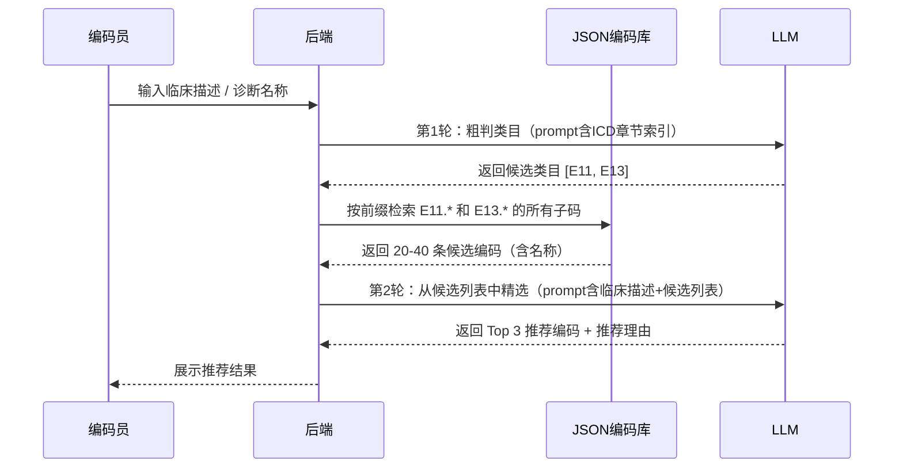

# ICD 智能编码推荐 — 产品需求文档 (PRD)

## 1. 背景与目标

### 问题
编码员面对复杂临床描述时，选择精确的 ICD 编码耗时且易出错。现有 ICD 查询功能只支持"编码员知道关键词 → 搜索 → 浏览"的被动模式。

### 目标
基于 LLM + JSON 层级编码库，实现**主动编码推荐**：输入临床描述 → 自动推荐精准 ICD 编码。

### 对标招标要求
> "根据病案首页信息提供 ICD 编码推荐，辅助编码员快速准确编码"

---

## 2. 核心功能

### 两阶段推荐流程



### 阶段说明

| 阶段 | 输入 | LLM 任务 | 输出 |
|---|---|---|---|
| **第1阶段：粗判** | 临床描述 + ICD 章节索引（22章摘要） | 判断属于哪个类目（3位码） | 1-3 个候选类目码 |
| **层级检索** | 候选类目码 | Python 前缀匹配（不用 LLM） | 该类目下所有子码（10-50条） |
| **第2阶段：精选** | 临床描述 + 候选编码列表 | 从候选中选最精确的编码 | Top 3 推荐 + 理由 |

---

## 3. API 设计

### POST `/api/v1/icd/recommend`

**请求体：**
```json
{
  "description": "2型糖尿病合并糖尿病肾病，肾功能不全",
  "type": "icd10",
  "max_results": 3
}
```

**响应体：**
```json
{
  "recommendations": [
    {
      "rank": 1,
      "code": "E11.200x002",
      "name": "2型糖尿病性肾病",
      "confidence": 0.95,
      "reason": "临床描述明确为2型糖尿病合并肾病，E11.2为糖尿病肾病的合并编码"
    },
    {
      "rank": 2,
      "code": "N18.900",
      "name": "慢性肾脏病（未特指）",
      "confidence": 0.7,
      "reason": "肾功能不全建议作为附加诊断编码"
    }
  ],
  "candidate_categories": ["E11", "N18"],
  "candidates_count": 35,
  "processing_time": 2.1
}
```

---

## 4. 前端交互

### 入口位置
在现有 **ICD 编码查询页** 搜索框下方新增"AI 推荐"模式切换：

```
┌────────────────────────────────────────────┐
│  [🔍 关键词搜索]    [🤖 AI 智能推荐]        │
├────────────────────────────────────────────┤
│  请描述临床情况，AI 将推荐精准编码...         │
│  ┌──────────────────────────────────────┐  │
│  │ 2型糖尿病合并糖尿病肾病，肾功能不全    │  │
│  └──────────────────────────────────────┘  │
│          [✨ 开始推荐]                      │
├────────────────────────────────────────────┤
│  🏆 推荐结果                                │
│  ┌─ #1 ─────────────────────────────────┐  │
│  │ E11.200x002  2型糖尿病性肾病         │  │
│  │ 置信度: 95%                           │  │
│  │ 理由: 糖尿病肾病的合并编码...         │  │
│  │                        [📋 复制] [✅ 采用] │
│  └──────────────────────────────────────┘  │
│  ┌─ #2 ─────────────────────────────────┐  │
│  │ N18.900  慢性肾脏病（未特指）         │  │
│  │ 置信度: 70%  | 建议作为附加诊断         │  │
│  └──────────────────────────────────────┘  │
└────────────────────────────────────────────┘
```

---

## 5. LLM Prompt 设计

### 第1阶段 Prompt（粗判）
```
你是 ICD-10 编码专家。根据以下临床描述，判断最可能的 ICD-10 类目码（3位码）。
返回 1-3 个最相关的类目码。

ICD-10 章节索引：
- A00-B99: 传染病和寄生虫病
- C00-D48: 肿瘤
- E00-E90: 内分泌、营养和代谢疾病
... （22章摘要）

临床描述：{description}
输出格式：["E11", "N18"]
```

### 第2阶段 Prompt（精选）
```
你是 ICD-10 编码专家。从以下候选编码中选择最精确的编码。

临床描述：{description}

候选编码列表：
E11.200x001 - 2型糖尿病性肾病（1期）
E11.200x002 - 2型糖尿病性肾病
E11.201     - 2型糖尿病性肾病综合征
...

请选择 Top 3，并说明理由。
```

---

## 6. 技术实现要点

| 模块 | 技术方案 | 工作量 |
|---|---|---|
| **JSON 层级检索** | `[x for x in data if x['code'].startswith(prefix)]` | 已有 |
| **ICD 章节索引** | 从 `icd10_hierarchical.json` 提取22章摘要 | 0.5天 |
| **LLM 两阶段调用** | 复用现有 `SichuanQCLLMClient` | 1天 |
| **后端 API** | 新增 `/api/v1/icd/recommend` | 0.5天 |
| **前端 UI** | 在 ICDSearchPanel 中新增 AI 推荐模式 | 1天 |
| **总计** | | **~3天** |

---

## 7. 验收标准

- [ ] 输入"2型糖尿病合并肾病" → 推荐 E11.2xx
- [ ] 输入"急性阑尾炎伴腹膜炎" → 推荐 K35.2/K35.8（合并码）
- [ ] 输入"冠心病，行支架植入" → 推荐 I25.1xx + 36.06（同时推荐诊断和手术编码）
- [ ] 单次推荐响应时间 < 5秒
- [ ] 推荐准确率 ≥ 80%（Top 3 命中）
