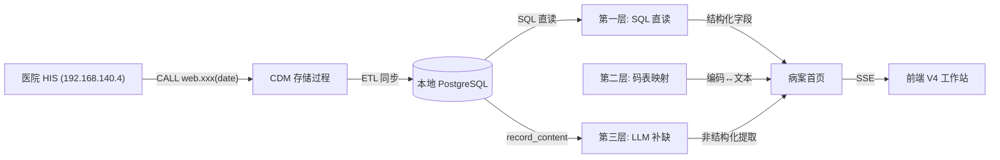
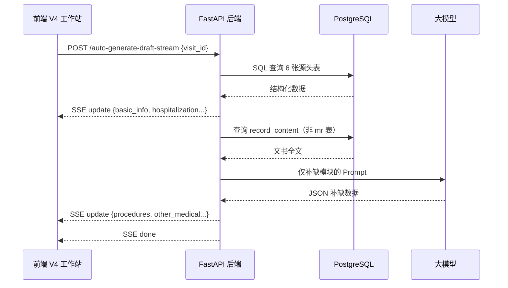

# MedQC 数据对接与数据表文档

> 最后更新: 2026-03-06 | ORM 模型: [cdm.py](file:///d:/大模型项目/lx0222/health-qc-monorepo/apps/medqc-web/backend/app/database/models/cdm.py)

## 数据源

| 项目 | 值 |
|------|-----|
| 数据库地址 | `192.168.140.4` |
| 数据库名 | `dhc-app` |
| 账户/密码 | `Baidu` |
| 接口形式 | PostgreSQL 存储过程（`CALL web.xxx(date)`） |
| 本地数据库 | PostgreSQL（SQLAlchemy ORM） |

---

## 架构概览



**三元主键**贯穿所有表：`institute_id` + `patient_id` + `visit_id`

---

## 医院已开放接口 vs 系统对接状态

> [!IMPORTANT]
> 医院共开放 **57 个接口**（第一批 20 + 第二批 37），系统已建 ORM 模型 **20 张表**，实际有数据的 **8 张**。

### 第一批接口（20 个）

| # | 存储过程 | 中文 | ORM 表名 | 对接状态 | 当前数据量 |
|---|---------|------|----------|---------|-----------|
| 1 | `web.mr` | 病案首页 | `mr` | ✅ 已对接 | 35 |
| 2 | `web.mr_surgery` | 首页手术明细 | `mr_surgery` | ✅ 已对接 | 0 |
| 3 | `web.mr_cost` | 首页费用明细 | `mr_cost` | ✅ 已对接 | 0 |
| 4 | `web.diagnosis` | 诊断表 | `diagnosis` | ✅ 已对接 | 37 |
| 5 | `web.discharge_record` | 出院记录 | `discharge_record` | ✅ 已对接 | 1 |
| 6 | `web.labtest_item_report` | 检验报告 | `labtest_item_report` | ✅ 已对接 | 2 |
| 7 | `web.exam_item_report` | 检查报告 | `exam_item_report` | ✅ 已对接 | 0 |
| 8 | `web.labtest_master` | 检验申请 | ❌ | ⬜ 未对接 | — |
| 9 | `web.labtest_item` | 检验项目 | ❌ | ⬜ 未对接 | — |
| 10 | `web.medical_insurance_settlement_cost` | 医保结算清单费用明细 | ❌ | ⬜ 未对接 | — |
| 11 | `web.mr_bloodtrans` | 首页输血记录明细 | ❌ | ⬜ 未对接 | — |
| 12 | `web.mr_icu` | 首页重症监护明细 | ❌ | ⬜ 未对接 | — |
| 13 | `web.medical_insurance_settlement` | 医保结算清单 | ❌ | ⬜ 未对接 | — |
| 14 | `web.inpat_drug_order` | 住院药品医嘱 | ❌ | ⬜ 未对接 | — |
| 15 | `web.inpat_nondrug_order` | 住院非药品医嘱 | ❌ | ⬜ 未对接 | — |
| 16 | `web.inpat_bill_item` | 住院费用明细 | ❌ | ⬜ 未对接 | — |
| 17 | `web.pathology_exam_master` | 病理检查申请单 | ❌ | ⬜ 未对接 | — |
| 18 | `web.pathology_exam_report` | 病理检查报告 | ❌ | ⬜ 未对接 | — |
| 19 | `web.mr_customize` | 首页医院自定义明细 | ❌ | ⬜ 未对接 | — |
| 20 | `web.epidemic_record` | 传染病报告记录 | ❌ | ⬜ 未对接 | — |

### 第二批接口（37 个）

| # | 存储过程 | 中文 | ORM 表名 | 对接状态 | 当前数据量 |
|---|---------|------|----------|---------|-----------|
| 1 | `web.admission_record` | 入院记录 | `admission_record` | ✅ 已对接 | 36 |
| 2 | `web.first_course_record` | 首次病程记录 | `first_course_record` | ✅ 已对接 | 1 |
| 3 | `web.daily_course_record` | 日常病程记录 | `daily_course_record` | ✅ 已对接 | 2 |
| 4 | `web.senior_course_record` | 上级医师查房记录 | `senior_course_record` | ✅ 已对接 | 0 |
| 5 | `web.consultation_record` | 会诊记录 | `consultation_record` | ✅ 已对接 | 0 |
| 6 | `web.rescue_record` | 抢救记录 | `rescue_record` | ✅ 已对接 | 0 |
| 7 | `web.surgery_record` | 手术记录 | `surgery_record` | ✅ 已对接 | 0 |
| 8 | `web.postsurg_firstcourse_record` | 术后首次病程记录 | `postsurg_firstcourse_record` | ✅ 已对接 | 0 |
| 9 | `web.transfer_in_record` | 转入记录 | `transfer_in_record` | ✅ 已对接 | 0 |
| 10 | `web.transfer_out_record` | 转出记录 | `transfer_out_record` | ✅ 已对接 | 0 |
| 11 | `web.outpat_record` | 门诊病历 | ❌ | ⬜ 未对接 | — |
| 12 | `web.surgery_application` | 手术申请 | ❌ | ⬜ 未对接 | — |
| 13 | `web.surgery_risk_assessment` | 手术风险评估 | ❌ | ⬜ 未对接 | — |
| 14 | `web.docpat_commu_record` | 医患沟通记录 | ❌ | ⬜ 未对接 | — |
| 15 | `web.handoff_record` | 交班记录 | ❌ | ⬜ 未对接 | — |
| 16 | `web.handover_record` | 接班记录 | ❌ | ⬜ 未对接 | — |
| 17 | `web.diffcase_discussion_record` | 疑难病例讨论记录 | ❌ | ⬜ 未对接 | — |
| 18 | `web.death_discussion` | 死亡病例讨论记录 | ❌ | ⬜ 未对接 | — |
| 19 | `web.death_record` | 死亡记录 | ❌ | ⬜ 未对接 | — |
| 20 | `web.daily_admission_record` | 24小时入出院记录 | ❌ | ⬜ 未对接 | — |
| 21 | `web.daily_death_record` | 24小时入院死亡记录 | ❌ | ⬜ 未对接 | — |
| 22 | `web.presurg_discussion` | 术前讨论 | ❌ | ⬜ 未对接 | — |
| 23 | `web.summary_record` | 阶段小结 | ❌ | ⬜ 未对接 | — |
| 24 | `web.presurg_summary` | 术前小结 | ❌ | ⬜ 未对接 | — |
| 25 | `web.preane_surveil_record` | 麻醉术前访视记录 | ❌ | ⬜ 未对接 | — |
| 26 | `web.postane_surveil_record` | 麻醉术后访视记录 | ❌ | ⬜ 未对接 | — |
| 27 | `web.surgery_inform_consent` | 手术知情同意书 | ❌ | ⬜ 未对接 | — |
| 28 | `web.nursing_record` | 护理记录 | ❌ | ⬜ 未对接 | — |
| 29 | `web.crisis_value_record` | 危机值记录 | ❌ | ⬜ 未对接 | — |
| 30 | `web.newborn_record` | 新生儿记录 | ❌ | ⬜ 未对接 | — |
| 31 | `web.blood_application` | 输血申请单 | ❌ | ⬜ 未对接 | — |
| 32 | `web.bloodtrans_record` | 输血记录 | ❌ | ⬜ 未对接 | — |
| 33 | `web.anesthesia_record` | 麻醉记录 | ❌ | ⬜ 未对接 | — |
| 34 | `web.surgery_safecheck_record` | 手术安全核查记录 | ❌ | ⬜ 未对接 | — |
| 35 | `web.surgery_inventory_record` | 手术清点记录 | ❌ | ⬜ 未对接 | — |
| 36 | `web.medical_insurance_settlement` | 医保费用明细 | ❌ | ⬜ 同住院费用明细 |
| 37 | — | 病理会诊申请 | ❌ | ⬜ 同病理检查申请单 |

### 系统自有表（不来自医院接口）

| 表名 | 说明 | 对接状态 |
|------|------|---------|
| `patient_information` | 患者主索引（系统生成） | 🔧 系统内部 |
| `inpat_registration` | 就诊索引（系统生成） | 🔧 系统内部 |
| `qc_result` | 质控结果 | 🔧 系统内部 |

### 对接统计

| 类别 | 数量 |
|------|------|
| 医院已开放接口 | **57** |
| 已建 ORM + 有数据 | **8**（mr, diagnosis, admission_record, discharge_record, first_course_record, daily_course_record, labtest_item_report, exam_item_report） |
| 已建 ORM + 无数据 | **9**（mr_surgery, mr_cost, surgery_record, senior_course_record 等） |
| 未对接接口 | **40** |

---

## 已对接表字段详情

### 1. `mr` 病案首页（~70 字段）

质控系统最核心的表，涵盖卫生部 2011 标准的所有首页字段。

| 字段分组 | 主要字段 | 说明 |
|---------|---------|------|
| **患者基本** | `name`, `sex`, `age_year`, `birthday`, `nationality`, `ethnicity`, `id_number` | 人口学信息 |
| **婚姻/职业** | `marital_status`, `occupation` | 码表字段 |
| **地址联系** | `current_address`, `native_place`, `contact_person_*` | 联系人信息 |
| **入出院** | `admission_datetime`, `discharge_datetime`, `actual_days` | 住院时间 |
| **科室流转** | `admission_dept_name`, `discharge_dept_name`, `transfer_dept_name` | 科室变化 |
| **诊断** | `admission_condition`, `discharge_main_diag_*` | 入出院诊断 |
| **手术** | `main_surgery_*` | 主要手术信息 |
| **过敏/血型** | `allergy`, `blood_type_abo`, `blood_type_rh` | 医疗基础信息 |
| **医师** | `director_physician`, `attending_physician`, `resident_physician` | 医疗人员 |
| **质控** | `qc_physician`, `qc_date`, `qc_nurse` | 质控人员 |

### 2. `admission_record` 入院记录（结构化 + 全文混合）

| 字段 | 类型 | 说明 |
|------|------|------|
| `chief_complaint` | String | 主诉 |
| `present_illness` | Text | 现病史 |
| `past_history` | Text | 既往史 |
| `physical_exam` | Text | 体格检查 |
| `assist_exam` | Text | 辅助检查 |
| `condition_transform` | String | 病情转归 |
| `*_physician_sign` | String | 医师签名×3 |
| `record_content` | **Text** | **非结构化全文**（~500-2000字） |

### 3. `diagnosis` 诊断表

| 字段 | 说明 |
|------|------|
| `diagnosis_name` | 诊断名称 |
| `diagnosis_code` | ICD 编码 |
| `diagnosis_type` | 入院初步/出院主要/出院其他 |
| `diagnosis_order` | 排序号 |
| `diagnosis_datetime` | 诊断时间 |

### 4. 病程记录类（统一结构）

`first_course_record` / `daily_course_record` / `senior_course_record` / `consultation_record` / `rescue_record` / `transfer_in_record` / `transfer_out_record` / `postsurg_firstcourse_record`

```
主键: institute_id + patient_id + visit_id + document_id
核心字段: record_content (Text) — 非结构化全文
继承: AuditMixin, DocumentMixin, PatientBasicMixin
```

---

## 三层取数架构

### 第一层：SQL 直读（不读 `mr` 表）

| 源头表 | 提取字段 |
|-------|---------|
| `inpat_registration` | 科室/床号/入出院时间/医保类型/住院天数 |
| `patient_information` | 姓名/性别/生日/民族/身份证/职业/联系人 |
| `admission_record` | 主诉/体格检查/入院途径/转归/医师签名 |
| `discharge_record` | 出院情况/出院诊断文本/出院医嘱 |
| `diagnosis` | 主诊断/其他诊断/ICD 编码 |
| `mr_cost` | 总费用/各项费用明细 |

> 代码: [_prefill_from_cdm()](file:///d:/大模型项目/lx0222/health-qc-monorepo/apps/medqc-web/backend/app/services/frontpage_extraction_service.py#L848)

### 第二层：码表映射

| 码表 | 映射示例 |
|------|---------|
| `sex` | 男→1, 女→2 |
| `marital_status` | 未婚→1, 已婚→2, 丧偶→3, 离婚→4 |
| `payment_method` | 城镇职工→1, 城镇居民→2, 新农合→3 |
| `admission_route` | 急诊→1, 门诊→2, 其他→3, 转入→4 |
| `blood_abo` | A→1, B→2, O→3, AB→4 |

> 代码: [CODE_MAPS](file:///d:/大模型项目/lx0222/health-qc-monorepo/apps/medqc-web/backend/app/services/frontpage_extraction_service.py#L86)

### 第三层：LLM 补缺

仅对 SQL 层缺失的模块调用 LLM，上下文来自 `_get_llm_context_text()`（拼接非 `mr` 表的 `record_content`）。

---

## API 接口

### 病案数据（`/api/medical-records`）

| 方法 | 路径 | 说明 |
|------|------|------|
| GET | `/list` | 患者列表（分页/筛选/搜索） |
| GET | `/workstation` | V4 工作台数据 |
| GET | `/frontpage/{iid}/{pid}/{vid}` | 获取单条病案首页 |
| GET | `/frontpage-by-mr/{mr_no}` | 通过病案号获取首页 |
| PUT | `/frontpage` | 保存/更新病案首页 |
| GET | `/diagnoses/{iid}/{pid}/{vid}` | 获取全部诊断 |
| GET | `/surgeries/{iid}/{pid}/{vid}` | 获取全部手术 |
| GET | `/cost/{iid}/{pid}/{vid}` | 获取费用明细 |
| GET | `/record-content/{iid}/{pid}/{vid}` | 获取病历原文 |
| GET | `/documents/{visit_id}` | 获取全部文书列表+内容 |
| GET | `/departments` | 科室列表 |
| GET | `/stats` | 统计概览 |
| GET | `/schema` | 表结构元数据 |
| GET | `/table-data/{table_name}` | 指定表数据（分页） |
| POST | `/qc-results` | 保存质控结果 |
| GET | `/qc-results/{iid}/{pid}/{vid}` | 获取质控结果 |

### AI 首页生成（`/api/v1/frontpage`）

| 方法 | 路径 | 说明 |
|------|------|------|
| POST | `/auto-generate-draft-stream` | SSE 流式首页生成（三层架构入口） |
| POST | `/auto-generate-draft` | 一次性首页生成 |

---

## 数据流



---

## 关键文件索引

| 文件 | 说明 |
|------|------|
| [cdm.py](file:///d:/大模型项目/lx0222/health-qc-monorepo/apps/medqc-web/backend/app/database/models/cdm.py) | 20 张表的 ORM 模型 |
| [connection.py](file:///d:/大模型项目/lx0222/health-qc-monorepo/apps/medqc-web/backend/app/database/connection.py) | PG 连接配置 |
| [repository.py](file:///d:/大模型项目/lx0222/health-qc-monorepo/apps/medqc-web/backend/app/database/repository.py) | 数据访问层 |
| [frontpage_extraction_service.py](file:///d:/大模型项目/lx0222/health-qc-monorepo/apps/medqc-web/backend/app/services/frontpage_extraction_service.py) | 三层取数核心逻辑 |
| [medical_records.py](file:///d:/大模型项目/lx0222/health-qc-monorepo/apps/medqc-web/backend/app/routers/medical_records.py) | 病案数据 API |
| [frontpage.py](file:///d:/大模型项目/lx0222/health-qc-monorepo/apps/medqc-web/backend/app/routers/frontpage.py) | AI 首页生成 API |
| [seed_pg_testdata.py](file:///d:/大模型项目/lx0222/health-qc-monorepo/apps/medqc-web/backend/scripts/seed_pg_testdata.py) | 测试数据注入脚本 |
| [dhc_interface_tables.md](file:///d:/大模型项目/lx0222/health-qc-monorepo/apps/medqc-web/backend/docs/dhc_interface_tables.md) | 原始接口说明 |
