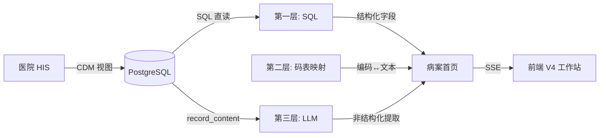
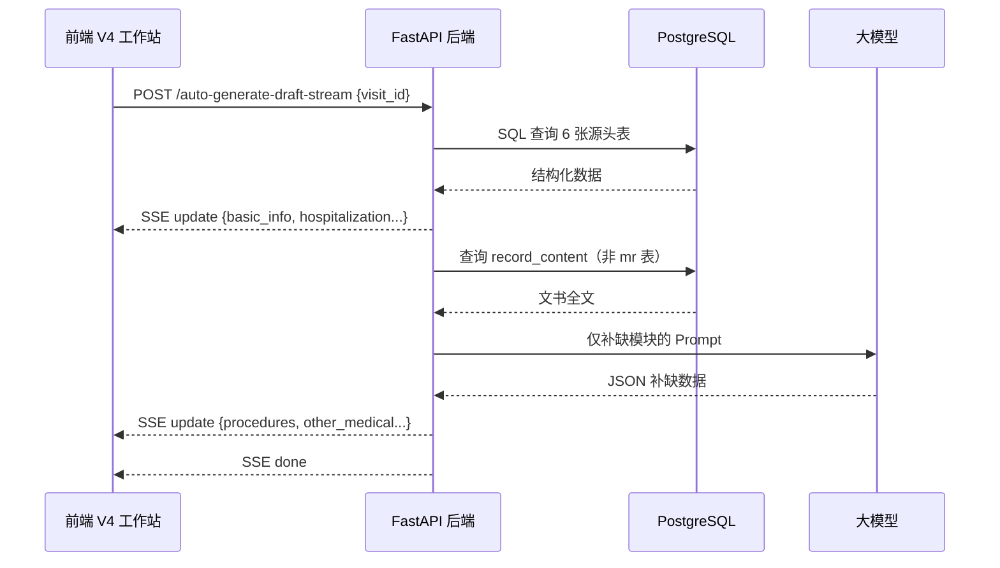

# MedQC 数据对接与数据表文档

> 最后更新: 2026-03-06 | ORM 模型: [cdm.py](file:///d:/大模型项目/lx0222/health-qc-monorepo/apps/medqc-web/backend/app/database/models/cdm.py)

## 架构概览



**三元主键**贯穿所有表：`institute_id` + `patient_id` + `visit_id`

---

## 数据表总览（20 张）

| # | 表名 | 中文 | ORM 类 | 当前数据量 | 用途 |
|---|------|------|--------|-----------|------|
| 1 | `patient_information` | 患者信息 | `PatientInformation` | 0 | 患者主索引（姓名/身份证/联系人等） |
| 2 | `inpat_registration` | 入院登记 | `InpatRegistration` | 0 | 就诊索引（科室/床号/入出院时间等） |
| 3 | `mr` | **病案首页** | `MedicalRecordFrontpage` | 35 | 质控核心表（~70 个字段） |
| 4 | `mr_surgery` | 首页手术明细 | `MrSurgery` | 0 | 手术操作记录 |
| 5 | `mr_cost` | 首页费用明细 | `MrCost` | 0 | 费用分类明细（~30 项） |
| 6 | `diagnosis` | 诊断 | `Diagnosis` | 37 | 每条诊断一行（含 ICD 编码） |
| 7 | `admission_record` | 入院记录 | `AdmissionRecord` | 36 | 结构化列 + `record_content` 全文 |
| 8 | `discharge_record` | 出院记录 | `DischargeRecord` | 1 | 结构化列 + `record_content` 全文 |
| 9 | `surgery_record` | 手术记录 | `SurgeryRecord` | 0 | 手术过程全文 |
| 10 | `first_course_record` | 首次病程 | `FirstCourseRecord` | 1 | 仅 `record_content` |
| 11 | `daily_course_record` | 日常病程 | `DailyCourseRecord` | 2 | 仅 `record_content` |
| 12 | `senior_course_record` | 上级查房 | `SeniorCourseRecord` | 0 | 仅 `record_content` |
| 13 | `consultation_record` | 会诊记录 | `ConsultationRecord` | 0 | 仅 `record_content` |
| 14 | `rescue_record` | 抢救记录 | `RescueRecord` | 0 | 仅 `record_content` |
| 15 | `transfer_in_record` | 转入记录 | `TransferInRecord` | 0 | 仅 `record_content` |
| 16 | `transfer_out_record` | 转出记录 | `TransferOutRecord` | 0 | 仅 `record_content` |
| 17 | `postsurg_firstcourse_record` | 术后首程 | `PostsurgFirstcourseRecord` | 0 | 仅 `record_content` |
| 18 | `exam_item_report` | 检查报告 | `ExamItemReport` | 0 | 影像/超声等检查 |
| 19 | `labtest_item_report` | 检验报告 | `LabtestItemReport` | 2 | 血常规/生化等检验 |
| 20 | `qc_result` | 质控结果 | `QCResult` | 0 | **系统自有表**，非 CDM 标准 |

---

## 核心表字段详情

### 1. `mr` 病案首页（~70 字段）

首页是质控系统最核心的表，涵盖卫生部规定的所有首页字段。

| 字段分组 | 主要字段 | 说明 |
|---------|---------|------|
| **患者基本** | `name`, `sex`, `age_year`, `birthday`, `nationality`, `ethnicity`, `id_number` | 人口学信息 |
| **婚姻/职业** | `marital_status`, `occupation` | 码表字段 |
| **地址联系** | `current_address`, `native_place`, `contact_person_*` | 联系人信息 |
| **入出院** | `admission_datetime`, `discharge_datetime`, `actual_days` | 住院时间 |
| **科室流转** | `admission_dept_name`, `discharge_dept_name`, `transfer_dept_name` | 科室变化 |
| **诊断** | `admission_condition`, `admission_diseases_*`, `discharge_main_diag_*` | 入出院诊断 |
| **手术** | `main_surgery_*` | 主要手术信息 |
| **过敏/血型** | `allergy`, `blood_type_abo`, `blood_type_rh` | 医疗基础信息 |
| **医师** | `director_physician`, `attending_physician`, `resident_physician` | 医疗人员 |
| **质控** | `qc_physician`, `qc_date`, `qc_nurse` | 质控人员 |

### 2. `admission_record` 入院记录（结构化+全文混合）

| 字段 | 类型 | 说明 |
|------|------|------|
| `chief_complaint` | String | 主诉 |
| `present_illness` | Text | 现病史 |
| `past_history` | Text | 既往史 |
| `physical_exam` | Text | 体格检查 |
| `assist_exam` | Text | 辅助检查 |
| `condition_transform` | String | 病情转归 |
| `resident/attending/chief_physician_sign` | String | 医师签名 |
| `record_content` | **Text** | **非结构化全文**（~500-2000字） |

### 3. `diagnosis` 诊断表

| 字段 | 说明 |
|------|------|
| `diagnosis_name` | 诊断名称 |
| `diagnosis_code` | ICD 编码 |
| `diagnosis_type` | 类型：入院初步诊断/出院主要诊断/出院其他诊断 |
| `diagnosis_order` | 排序号 |
| `diagnosis_datetime` | 诊断时间 |
| `diagnosis_description` | 补充描述 |

### 4. 病程记录类（10-17号表）

这些表结构统一，**只有 `record_content` 全文字段有实际价值**：

```
主键: institute_id + patient_id + visit_id + document_id
字段: visit_type, record_content (Text)
继承: AuditMixin, DocumentMixin, PatientBasicMixin
```

---

## 三层取数架构

### 第一层：SQL 直读

从源头表获取结构化字段，**不读 `mr` 表**（因为首页还没填写）。

| 源头表 | 提取字段 |
|-------|---------|
| `inpat_registration` | 科室/床号/入出院时间/医保类型/住院天数 |
| `patient_information` | 姓名/性别/生日/民族/身份证/职业/联系人 |
| `admission_record` | 主诉/体格检查/入院途径/转归/医师签名 |
| `discharge_record` | 出院情况/出院诊断文本/出院医嘱 |
| `diagnosis` | 主诊断/其他诊断/ICD 编码 |
| `mr_cost` | 总费用/各项费用明细 |

> 代码位置: [_prefill_from_cdm()](file:///d:/大模型项目/lx0222/health-qc-monorepo/apps/medqc-web/backend/app/services/frontpage_extraction_service.py#L848)

### 第二层：码表映射

本地字典转换，无需 LLM：

| 码表 | 映射 |
|------|------|
| `sex` | 男→1, 女→2, 未知→0 |
| `marital_status` | 未婚→1, 已婚→2, 丧偶→3, 离婚→4, 未知→9 |
| `payment_method` | 城镇职工→1, 城镇居民→2, 新农合→3 ... |
| `admission_route` | 急诊→1, 门诊→2, 其他→3, 转入→4 |
| `blood_abo` | A→1, B→2, O→3, AB→4, 不详→5, 未查→6 |
| `blood_rh` | 阴性→1, 阳性→2, 不详→3, 未查→4 |
| `allergy` | 无→1, 有→2 |

> 代码位置: [CODE_MAPS](file:///d:/大模型项目/lx0222/health-qc-monorepo/apps/medqc-web/backend/app/services/frontpage_extraction_service.py#L86)

### 第三层：LLM 精准补缺

仅对 SQL 层缺失的模块调用 LLM，上下文文本来自 `_get_llm_context_text()`（拼接非 `mr` 表的 `record_content`）。

---

## API 接口

路由文件: [medical_records.py](file:///d:/大模型项目/lx0222/health-qc-monorepo/apps/medqc-web/backend/app/routers/medical_records.py) | [frontpage.py](file:///d:/大模型项目/lx0222/health-qc-monorepo/apps/medqc-web/backend/app/routers/frontpage.py)

### 病案数据（`/api/medical-records`）

| 方法 | 路径 | 说明 |
|------|------|------|
| GET | `/list` | 患者列表（分页/筛选/搜索） |
| GET | `/workstation` | V4 工作台数据（病案列表+科室统计+主诊断） |
| GET | `/frontpage/{iid}/{pid}/{vid}` | 获取单条病案首页 |
| GET | `/frontpage-by-mr/{mr_no}` | 通过病案号获取首页 |
| PUT | `/frontpage` | 保存/更新病案首页 |
| GET | `/diagnoses/{iid}/{pid}/{vid}` | 获取全部诊断 |
| GET | `/surgeries/{iid}/{pid}/{vid}` | 获取全部手术 |
| GET | `/cost/{iid}/{pid}/{vid}` | 获取费用明细 |
| GET | `/record-content/{iid}/{pid}/{vid}` | 获取病历原文 |
| GET | `/documents/{visit_id}` | **获取全部文书列表+内容** |
| GET | `/departments` | 科室列表 |
| GET | `/stats` | 统计概览 |
| GET | `/schema` | 表结构元数据 |
| GET | `/table-data/{table_name}` | 指定表数据（分页） |
| POST | `/qc-results` | 批量保存质控结果 |
| GET | `/qc-results/{iid}/{pid}/{vid}` | 获取质控结果 |

### AI 首页生成（`/api/v1/frontpage`）

| 方法 | 路径 | 说明 |
|------|------|------|
| POST | `/auto-generate-draft-stream` | **SSE 流式首页生成**（三层架构入口） |
| POST | `/auto-generate-draft` | 一次性首页生成 |

---

## 数据流



---

## 关键文件索引

| 文件 | 说明 |
|------|------|
| [cdm.py](file:///d:/大模型项目/lx0222/health-qc-monorepo/apps/medqc-web/backend/app/database/models/cdm.py) | 所有 20 张表的 ORM 模型定义 |
| [connection.py](file:///d:/大模型项目/lx0222/health-qc-monorepo/apps/medqc-web/backend/app/database/connection.py) | PG 连接配置 |
| [repository.py](file:///d:/大模型项目/lx0222/health-qc-monorepo/apps/medqc-web/backend/app/database/repository.py) | 数据访问层 |
| [frontpage_extraction_service.py](file:///d:/大模型项目/lx0222/health-qc-monorepo/apps/medqc-web/backend/app/services/frontpage_extraction_service.py) | 三层取数核心逻辑 |
| [medical_records.py](file:///d:/大模型项目/lx0222/health-qc-monorepo/apps/medqc-web/backend/app/routers/medical_records.py) | 病案数据 API |
| [frontpage.py](file:///d:/大模型项目/lx0222/health-qc-monorepo/apps/medqc-web/backend/app/routers/frontpage.py) | AI 首页生成 API |
| [seed_pg_testdata.py](file:///d:/大模型项目/lx0222/health-qc-monorepo/apps/medqc-web/backend/scripts/seed_pg_testdata.py) | 测试数据注入脚本 |
