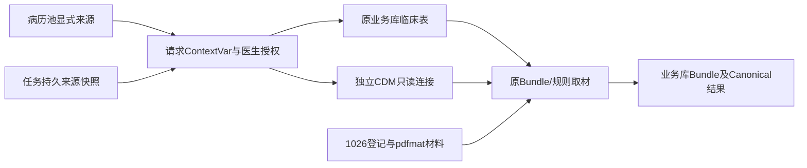

# 双临床数据源配置与选源验收

开发阶段完成独立分支代码和隔离验证；随后按用户授权推送并创建Draft PR #36。未部署、未连接服务器或模型，未读取或修改真实业务库。默认仍启用、选择原有数据源；独立CDM默认停用。

## 基线与依赖

- 工作树：`D:\MedQC-worktrees\dual-clinical-sources-20261104`。
- 分支：`codex/dual-clinical-sources-20261104`。
- 创建时业务线：`d0dd97c73decc1b5f73193aac81cb5e63e76c2aa`；业务分支未移动。
- 为保留服务器当前Linux交付成果，在本独立分支承接`6206eef96`（PR34/35相关前置），没有把它们合入业务线。
- 双抽取链路复用`9a0bce6ac`，本分支等价提交`14cbb2457`；冲突保留P9/P5测试集合、RabbitMQ配置入口和科室后台加载。
- 本轮不新建数据库迁移。读取配置使用业务062已有的`qc.sync_config_registry`；不把业务062迁移应用到同步CDM060库。

## 使用入口及配置

系统配置 → 数据同步 → **病历读取数据源**：配置原有源名称/启用状态，及独立CDM名称、主机、端口、库名、只读用户名、启用状态和默认源。管理员才能读取或修改完整连接配置；普通用户的options接口仅返回名称、标识、启用状态和默认源。

运行／终末病历池筛选栏新增**数据源**。默认仅在页面初始化时使用，随后通过页面URL及请求显式携带`source_id`，不通过localStorage影响其他浏览器页签。切源清空旧行、筛选、勾选及详情，并按源分隔任务进度恢复；不会取消另一源已经启动的任务。

两个配置不能混用：原有“抽取链路”决定从哪里同步；本次“病历读取数据源”决定从哪里看、取材。保存或切默认源不会发起同步、建表或启动质控。只有点击“只读检查CDM”才探测连接、目录和SELECT/无DML权限。

业务`DATABASE_URL`保持原值。CDM密码仅由部署文件提供，例如：

```ini
CDM_PGPASSFILE=/data/medqc/business/config/cdm-reader.pgpass
```

对应文件由业务服务账号持有，Linux权限0600，使用libpq标准passfile格式；允许为历史来源保留多条凭据。文件不进入Git、页面、任务快照或日志。示例库名`medqc_sync_cdm`，实际地址/账号由管理员配置，不硬编码服务器地址。应使用独立SELECT角色，不能直接把同步发布者的写入账号当只读账号。真实账号授权和凭据部署不属于本轮执行。

## 路由与隔离



- 目录复用首页、住院登记、入院、出院的三坐标集合；无首页但有登记的病例可见。候选收集、分页和计数使用同一集合，收集正文仍复用原RecordRepository及显式锚点逻辑。
- 详情、当前文书、首页、Bundle、正式LX0609证据读取及同病种辅助查询使用同一请求/任务来源。独立CDM首页诊断读取正式`diagnosis`，不要求不存在的遗留`mr_diagnosis`。
- 源连接使用只读事务；不会更换全局业务engine或SessionLocal。缺表、缺权限、失联不回退到另一源或伪装成零病例。
- 创建任务服务端冻结来源、无密码端点和绑定身份；子任务、旧任务恢复和重试不依赖当前默认。旧无来源任务解释为旧源。损坏快照仅以原排队快照CAS标为执行失败，不执行临床读取。
- Bundle缓存校验来源绑定；当前文书并发合并及事实冻结目录也按来源分隔。不同源同三坐标的最新结果分别选取。历史文书请求的`job_id`读取已保存来源，校验权限和病例范围；不按新默认重解释。
- PDF副本根据业务库登记读取`pdfmat_*`，1026及已有结果未迁移或覆盖。规则定义、证据ID、临床结果状态、P5-B开关、模型设置和全局并发未修改。

## 验证及复现

全部业务侧测试阻断真实网络，仅使用固定应答、合成材料和内存SQLite。两套PG库验证另有严格连接白名单，只允许新集群的指定端口和库名；Python网络禁止。原62994副本、5432业务库、Docker、服务器和模型均未使用。

```powershell
# backend目录：配置、授权、来源上下文、冻结/缓存、Canonical及旧源回归
python -B scripts/run_qc_scheduler_tests.py --profile offline --suite data-pipelines tests/unit/test_latest_full_record_result.py tests/unit/test_workstation_query_service.py tests/unit/test_doctor_case_scope.py tests/unit/test_current_document_view.py tests/unit/test_current_frontpage_view.py tests/unit/test_sichuan_qc_service.py

# 应用目录：XHR/HTTP/fetch均主动阻断，所有接口使用固定应答
node_modules/.bin/vitest.cmd run --config vitest.clinical-sources.config.mts
node_modules/.bin/vue-tsc.cmd --noEmit

# backend目录：必须指定新的输出目录，不复用已停止的旧集群
python -B scripts/validate_clinical_sources_pg.py --pg-bin "D:/Program Files/PostgreSQL/18/bin" --source-backend "C:/medqc-data-integration-service/apps/medqc-web/backend" --output-dir .tmp/clinical-sources-pg-new --port 62996
```

已完成证据：

- 核心配置/最新结果/医生授权/当前文书/首页/列表定向集合：**107通过**。
- 扩大集合：**882通过、1项旧断言失败**。`test_evaluate_compliance_rate`期望`issues_found == total_rules - compliant_rules`，实际`123 != 144 - 20`。将本轮仅修改的两个SichuanQCService方法恢复为`14cbb2457`原实现，在相同离线入口独立复现了完全相同断言；未修改医学计数或放宽测试使其通过。证据在`backend/.tmp/clinical-baseline-check/`及对应忽略日志。
- 前端六个定向文件：**110通过**；覆盖默认源、切源清空、失联不回退、显式只读检查、旧导航和进度恢复分区。包含工作台结果文书请求的任务来源传递回归。
- 类型检查通过；新增Python模块Ruff通过，相关修改未发现语法或未定义变量；只读ESLint无error，仍有既有组件的格式warning，未运行全库自动修复。
- 原生PG验证：**PG18.3**，由独立同步服务正式`20261104_000060`迁移初始化合成源库，临床schema共**68张表**；另建独立业务库。同键异值、无首页、分页/计数/候选一致、页面与规则取材、PDF路由、只读检查、只读事务及角色拒写、业务Bundle、两源Canonical保存/最新结果、医生范围均通过；临床数据和结构前后指纹相同，退出后停止新集群。
- 不将上述重叠集合相加。未运行整个前端全量或整个LX0609零模型全集；未运行真实质控。

原生验证脚本使用用户提供的双库示例场景，但未执行其旧集群启动代码；正式060初始化代码SHA256：`a59fdfa91ebe2e89d4e05e8d4615d79104e00d269ddc6c85fa377e16f3b319e5`。合成schema完整不表示40个真实接口内容或医院数据质量已验收。

## 明确限制与回滚

- 客户服务器为PG16，本轮开发机只有原生PG18；**PG16及服务器真实CDM联调尚未验收**。不能据本轮结论宣称服务器已接入或升级完成。
- 独立CDM为已发布快照，不提供“今日HIS实时核验”；该选项、旧统计接口、跨病例结果分析及未适配的写入/生成入口明确拒绝，不冒充已支持。运行/终末列表、三坐标读取及选中任务链是本轮范围。每日定时任务的单独选源配置不在本轮。
- 医学内容仅使用合成及已有固定结果；没有验证医学质量等价、完整病历吞吐或医院全量性能。
- 保存默认源可以随时改回原有源；禁用CDM不改变历史任务的持久来源。历史任务需要的旧凭据必须仍可用，否则明确失败。切源使同键Bundle缓存失效后按对应库重建，不改已保存质控结果。
- 回滚应用前应停止/排空新CDM任务，避免旧Worker不识别来源快照。保留062、原材料与结果、配置和原冻结目录，不删库、不删源资料，不把业务连接串改为CDM。
- 本轮不构建新交付包。已按后续授权推送并创建以业务集成分支为目标的Draft PR #36；未合并。打包及DSH只读联调仍需另按用户指令执行。

## PR交付追记

- [Draft PR #36](https://github.com/softjazzz/combined/pull/36)目标`codex/business-agent-integration`，保持Draft。
- #34（`0d3c17c44`）与#35（`6206eef96`）仍为未合并Draft，两个Head均已核实是本分支祖先。#35已经包含#34，后续不能重复合并依赖或把累计差异当成纯双数据源变更。
- 初始推送`1a9de33e9`相对目标为19提交/99文件；相对#35为3提交/70文件。随后补齐CI，不移动目标或依赖分支。
- 检查现有工作流发现：前端没有执行新增六文件110项专用保护集，后端虽已在data-pipelines包含来源配置测试，但未覆盖完整107项集合。因此在原工作流内补专用步骤和对应路径触发；保留OS网络命名空间和固定应答网络阻断，未降低原门禁。
- Linux离线构建工作流仅对#35分支push或手动触发。本轮不手动触发打包；不能把#35原有Linux包/PG16部署验收替代本功能的PG16真实CDM联调。
