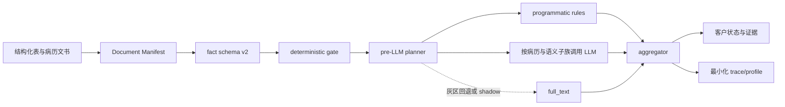

# ADR-LX0609-001：客户专项混合执行包与状态机边界

## Status

Proposed

本 ADR 记录建议架构，不代表当前 checkpoint 已通过业务验收，也不授权直接切换生产执行路径。进入 Accepted 前，必须完成实施计划中的 Golden 人工复核、纵向切片和 shadow 门禁。

## Context

LX0609 是一个包含 49 个客户质控点的专项规则包。现有主链路已经具备客户规则 ID 到执行规则的映射、按选中规则运行、结果聚合和展示能力，但仍以兼容性的 `full_text` 输入为主，事实抽取、门控和后处理散落在多个边界中。当前 20 点严格 A/B 证明事实门控有明显缩短耗时的潜力，同时也暴露出逐规则 B2 token 反增和状态大幅漂移的问题，因此不能把该实验路径直接生产化。

### 业务目标

- 对 49 个客户质控点形成可逐步扩展、可审计、可回退的统一执行包。
- 先以 20 点实验范围验证执行框架，再按纵向切片扩大覆盖；20 点不是独立规则包，也不代表 49 点已验收。
- 将“是否适用”和“适用后是否满足要求”分开，避免缺源、缺文书和真实缺陷互相污染。
- 让每个客户结果可追溯到来源状态、事实、规则版本和最终聚合原因。

### 非功能目标

| 维度     | 目标                                                                                                             |
| -------- | ---------------------------------------------------------------------------------------------------------------- |
| 准确性   | 只以人工 accepted Golden 作为准确率依据；程序化规则在已接受样本上不得因架构迁移新增误报或漏报。                  |
| 速度     | planner 在任何底层 LLM 调用前完成裁剪；被门控或程序化处理的规则不产生底层 LLM 调用。                             |
| 可解释性 | 客户结果至少包含状态、来源类型、短证据引用或缺失来源、规则依据；开发 trace 可重放关键决策。                      |
| 隐私     | trace、日志、缓存键和评估报告不保存患者姓名、完整病历正文或直接身份标识；仅保留最小必要短引用和不可逆/受控标识。 |
| 可运维性 | 所有新路径均支持版本化、shadow、kill switch 和退回当前兼容链路。                                                 |

### 范围关系

- **49 点总规则包**：`luxian_0609_qc_v1` 的客户契约和最终治理边界，所有 customer rule ID、展示计数和状态映射以此为准。
- **20 点试点**：现有 A/B 覆盖的实验子集，用于发现事实门控、token 口径和状态机问题；其结果不可外推为 49 点准确率。
- **首个纵向切片**：`LX0609-029/030/032`，用于先贯通 source manifest、父子依赖、程序化 evaluation、trace 和 scoped 结果，不引入语义子族 LLM。
- **后续切片**：按依赖关系扩展，而不是一次性替换 49 点。

## Decision

### 1. 采用客户专项混合执行包

选定链路为：

各层职责如下：

1. **Document Manifest**：记录每个预期来源的查询状态、文书数量和受控引用，不把“查不到”默认为“不存在”。
2. **fact schema v2**：统一结构化事实及其来源、置信度和版本，不直接产生最终合规状态。
3. **deterministic gate**：根据 manifest 和高置信事实判断规则是否可能适用、是否缺少必要来源。
4. **pre-LLM planner**：在 bundle 分组与底层 LLM 调用之前，生成每病历执行计划，排除不适用、可程序化和不可安全执行的规则。
5. **programmatic rules**：处理存在性、时间窗、父子依赖和可确定计算。
6. **语义子族 LLM**：仅对 planner 留下的高语义灰区，按“每病历 × 语义子族”调用，禁止逐规则默认调用。
7. **aggregator**：唯一拥有最终客户状态归并权，执行父子规则抑制、失败隔离和展示映射。

`full_text` 不再作为目标默认路径，只允许：

- shadow 对照，不影响客户结果；
- 满足明确灰区条件时的受控回退；
- kill switch 生效后临时退回已知兼容路径。

### 2. Document Manifest 与 source query status

每个规则声明必要、可选和互斥来源。每个来源查询必须显式归一为：

| query status  | 严格含义                                 | 可推导结论                                                         |
| ------------- | ---------------------------------------- | ------------------------------------------------------------------ |
| `available`   | 查询成功且返回至少一条可用记录           | 可继续抽取事实；不等于事实满足规则。                               |
| `empty`       | 查询成功且确认返回零条记录               | 只有在规则适用且该来源确为必需时，才能参与缺失文书判定。           |
| `unavailable` | 当前数据源、同步范围或字段能力不支持查询 | 不能判定文书不存在；必要来源时进入 `data_gap`。                    |
| `error`       | 查询本应可执行但发生超时、解析或系统错误 | 进入 `technical_error`，不得降级成 `data_gap` 或 `non_compliant`。 |

Manifest 至少包含 `source_key`、`query_status`、`record_count`、`query_version`、`snapshot_ref`、`error_code`。客户结果不暴露内部错误栈。

### 3. fact schema v2

最小字段：

- `fact_id`：由受控来源引用、事实类型和版本稳定生成，不包含姓名或原文全文。
- `visit_ref`：受控内部引用；禁止将患者姓名写入事实对象。
- `family`、`fact_type`、`normalized_value`。
- `source_key`、`source_document_id`、`source_document_type`、`record_time`。
- `quote`：最小必要短引用，进入持久化或报告前执行脱敏和长度限制。
- `confidence`、`extractor`、`extractor_version`。
- `fact_schema_version`、`source_snapshot_hash`、`created_at`。

事实层只描述“发现了什么、来自哪里、可信度如何”，不输出最终 `compliant`、`non_compliant` 或 `not_applicable`。

### 4. 两层状态机

#### 4.1 Applicability 层

内部状态：

- `applicable`：强触发事实和必要来源足以进入 evaluation。
- `not_applicable`：有可证明的排除事实，或在来源查询可靠的前提下确认触发条件不成立。
- `applicability_unknown`：触发事实不足，且关键来源为 `unavailable` 或信息不完整。
- `applicability_error`：适用性计算遇到 `error` 或内部异常。

#### 4.2 Evaluation 层

仅在 applicability 为 `applicable` 时运行：

- `compliant`：证据充分且满足规则。
- `non_compliant`：证据充分、规则适用且存在确定缺陷。
- `data_gap`：规则适用，但完成评价所需数据为 `unavailable`、缺字段或无法可靠读取。
- `evaluation_unknown`：语义结果低置信或相互矛盾，必须人工复核或受控 fallback。
- `technical_error`：执行、解析、超时或内部异常。

#### 4.3 严格状态边界

- `not_applicable`：必须能够证明“不属于规则场景”；不能用“没查到证据”替代。
- `data_gap`：已经确认规则适用，但系统无法获得完成评价所需的数据；不能用它表达确定缺陷。
- `non_compliant`：适用性成立、必要来源查询可靠、缺陷证据明确；任何关键来源为 `unavailable` 或 `error` 时不得输出。
- `technical_error`：系统失败状态，不能混入质量分母，也不能映射为客户缺陷。

客户展示映射：

| 内部状态                                 | 客户展示     | 是否计入缺陷 |
| ---------------------------------------- | ------------ | ------------ |
| `not_applicable`                         | 不适用       | 否           |
| `compliant`                              | 合规         | 否           |
| `non_compliant`                          | 不合规       | 是           |
| `applicability_unknown`、`data_gap`      | 数据不足     | 否           |
| `evaluation_unknown`                     | 建议人工复核 | 否           |
| `applicability_error`、`technical_error` | 执行异常     | 否           |

### 5. 父子规则抑制

父规则用于证明子规则的评价前提。父规则缺失或不可靠时，子规则不得继续产生重复或伪精细缺陷：

- `030 -> 031/032/033`：若 030 确认“无手术记录”，031 的签名质量不得执行；032/033 可基于各自独立来源继续判断，但若其适用性仅依赖手术记录且无法由手术医嘱/手术事实确认，则必须被抑制。若 030 为 `data_gap` 或 `technical_error`，子规则最多为 `data_gap`/`technical_error`，不得直接不合规。
- `034 -> 035`：若 034 确认“无麻醉知情同意书”，035 的填写规范性被抑制，避免同一缺失同时产生“缺文书”和“填写不规范”。
- `036 -> 037`：若 036 确认“无麻醉访视记录”，037 的填写规范性被抑制。
- 同类关系必须配置化为 `parent_rule_id`、`child_rule_ids`、`suppression_policy` 和 `reason_code`，由 aggregator 统一执行，不散落在 prompt 或前端。

抑制不是把子规则伪装成 `compliant`。被抑制结果保留内部 `suppressed` 原因，客户默认不展示为独立缺陷；统计时不进入合规分母。

### 6. LLM 权限边界

LLM 只能输出：

- 语义事实及事实类型；
- 最小证据引用和来源引用；
- 置信度、矛盾项和“需要人工复核”建议。

LLM 不拥有最终状态机，不得直接决定 `not_applicable`、`data_gap`、`non_compliant`，不得绕过 source manifest，也不得在 prompt 内实现父子规则抑制。最终状态由版本化 deterministic gate、programmatic rule 和 aggregator 计算。

### 7. Planner 的位置与输出

Planner 必须位于 bundle 分组和底层 LLM 调用之前。调用顺序固定为：

`scope contract -> manifest/facts -> applicability -> planner -> bundle/programmatic/LLM -> aggregator`。

Planner 输出至少包含：

- `customer_rule_id` 与映射后的 `execution_rule_ids`；
- `execution_mode`: `skip` / `programmatic` / `semantic_family` / `full_text_fallback`；
- `family_key`、`required_sources`、`reason_code`；
- `input_context_ref`，禁止默认携带完整病历；
- 版本集合和 trace correlation id。

被 planner 标记为 `skip` 或 `programmatic` 的规则不得进入底层 LLM bundle。性能验证必须以实际调用数和 token 为准，不能只看最终状态。

### 8. Scope 兼容契约

现有字段必须保持语义稳定：

- `selected_rule_ids`：调用方选择的客户 `LX0609-*` ID；非空时只允许这些客户点进入本次任务。
- `scoped_customer_rule_ids`：持久化到任务和结果侧的客户展示范围；聚合不得补回未选中的 49 点。
- `record_rule_map`：每个病历映射到允许执行的底层规则 ID；不得因 planner 或 family 分组退化为全量规则。

新增 planner 元数据只能增量扩展，不能改变以上字段类型、空值语义、计数含义或父子任务继承行为。`customer_rule_count` 与 `execution_rule_count` 必须继续分开。

### 9. 版本与缓存维度

任何可复用的 facts、计划或结果缓存键至少包含：

- `source_snapshot_hash` / `visit_snapshot_hash`；
- `source_query_version`；
- `fact_schema_version` 与 `fact_extractor_version`；
- `planner_version`；
- `rule_package_version` 与单规则版本；
- `aggregator_version`；
- `context_mode`；
- `model_id`、`prompt_version`（仅 LLM 路径）；
- 实际 `scoped_customer_rule_ids`。

任一维度变化必须失效相关缓存。缓存不得以患者姓名、完整正文或裸 visit_id 作为跨环境可见键。

### 10. Fallback、shadow、kill switch 与失败模式

- **Shadow**：新路径与当前兼容路径并行计算，但客户只看到基线路径；差异进入脱敏评估报告。
- **Fallback**：仅适用于来源可用、事实矛盾或语义低置信等预先定义灰区；不得用 fallback 掩盖 `unavailable` 或 `error`。
- **Kill switch**：支持包级、规则族级和规则级关闭新 planner/fact/LLM 路径；关闭后恢复已知兼容路径，并在 trace 标记原因。
- **technical_error**：超时、JSON 解析失败、模型不可用、规则异常、source query error 均归为技术失败；隔离到对应病历/规则，不把整个批次转换为不合规。
- **Fail closed for defects**：无法证明缺陷时不输出 `non_compliant`；但必须显式显示数据不足、人工复核或执行异常，不能静默合规。

### 11. Trace 与隐私边界

开发 trace 可记录：规则 ID、版本、query status、事实 ID、短证据引用、planner reason、LLM 调用计数/token/耗时、aggregator reason、fallback/kill-switch 状态。

禁止记录：患者姓名、身份证号、联系方式、住址、完整病历正文、完整 prompt/response、API key、Authorization header、数据库连接串。病历关联使用受控内部引用或加盐哈希；短引用必须长度受限并经过敏感字段脱敏。客户导出不得包含内部模型参数、错误栈或缓存键。

### 12. 建议性能预算与评估门槛

以下为 Proposed 门槛，需在 accepted Golden 和独立性能集上确认：

- 首个 `029/030/032` 程序化切片：底层 LLM 调用数和 token 均为 0；单病历 planner + evaluation 的本地处理 p95 不超过 500 ms（不含 source query）。
- 20 点、10 病历 shadow：相对现有 `full_text` 基线，wall time 至少下降 50%，总 token 至少下降 40%，且不得重现逐规则 B2 的 token 反增。
- 语义路径：每病历每语义子族最多 1 次调用；被 gate 排除或程序化完成的规则调用数必须为 0。
- 准确性：在每规则至少覆盖正例、负例、不适用、数据缺口/边界的 accepted Golden 前，不发布总体准确率；已有 accepted 样本上不得新增确定性误报，状态差异必须逐条完成归因。
- 稳定性：`technical_error` 不高于 shadow 样本的 1%，且不得污染缺陷率与合规分母。
- 隐私：评估产物中患者姓名、完整病历和密钥扫描命中为 0。

## Consequences

### Positive

- 不适用、数据不足和真实缺陷有稳定边界，客户解释更可信。
- 先程序化裁剪再调用 LLM，可避免逐规则 B2 的成本放大。
- 版本化 manifest/facts/planner 使差异可复现、缓存可安全失效。
- 父子规则由 aggregator 统一治理，减少重复缺陷和前端补丁。
- 49 点可按纵向切片演进，不要求一次性重写现有链路。

### Negative

- 需要维护 source manifest、事实 schema、planner、规则包和 aggregator 多个版本，运维与测试矩阵增大。
- 在 Golden 未接受前只能 shadow，短期内会保留新旧两套计算路径。
- 严格区分 `empty`、`unavailable`、`error` 后，初期 `data_gap` 和 `technical_error` 可能更显眼。
- 语义子族聚合会降低调用数，但一次调用的失败影响面大于单规则调用，必须支持子族级隔离和重试。
- 父子抑制配置错误可能隐藏应展示的问题，需要专门 Golden 与 trace 验证。

### Neutral

- 现有 checkpoint 作为可回退实现基线保留，但不被视为业务验收。
- `full_text` 仍存在于系统中，只是角色从默认执行变为 shadow/灰区回退。

## Alternatives Considered

### 继续默认 full_text

拒绝。实现简单且可作为兼容基线，但长上下文容易混淆历史与本次事件，速度、token 和证据归因均不满足目标。

### 直接生产化逐规则 B2

拒绝。现有 20 点 A/B 中，`fact_gate_plus_trimmed_qc` 总 token 高于 full_text，且状态差异为 125/200；逐规则调用没有形成可接受的成本或一致性边界。

### 让 LLM 直接输出最终合规状态

拒绝。模型无法可靠区分数据源不可用、文书确实不存在和系统错误，也会把状态机、父子关系与 prompt 绑定，难以审计和回放。

### 一次性重写全部 49 点

拒绝。Golden 尚无 accepted 样本，规则族的数据源和成熟度差异明显；一次性迁移会扩大回归面并失去可回滚的纵向门禁。

### 只增加 aggregator 后处理

拒绝。后处理可以修正展示状态，却无法阻止无效规则进入底层 LLM，也不能解决 source query 语义和 token 浪费。

## Review and Acceptance

ADR 从 Proposed 变为 Accepted 需要：

1. Golden 资产完成最小 accepted 种子集并由业务质控人员确认。
2. `029/030/032` 纵向切片通过 scope、状态机、父子抑制、隐私和性能门禁。
3. planner 位置由调用计数与 token trace 证明在底层 LLM 之前。
4. shadow 差异逐条归因，回滚和 kill switch 演练通过。
5. 总架构师与业务质控负责人共同评审。

## References

- `docs/0602/泸县0609事实抽取优先质控路线说明.md`
- `docs/0602/泸县0609真实样本GoldenSet建设计划.md`
- `docs/0602/泸县0609质控点-规则分型表.md`
- `tmp-lx0609-ab-test/latest.md`
- `tmp-lx0609-ab-test/ab-summary-20260710-234423.md`
- `docs/plans/2026-07-11-lx0609-hybrid-package-slice-plan.md`
