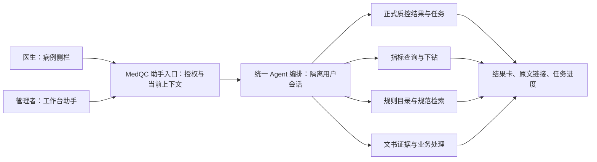

# 医生与管理者智能助手 PRD

版本：v0.2 规划稿｜日期：2026-09-30｜状态：技术候选已收敛为首选验证方案；尚未完成选型、实施验证及客户部署验收

## 1. 原始意图与产品目标

用户要求：智能助手面向医生和管理者两类用户，具备 ChatBI、质控规则查询（RAG）和 Agent 能力。需要先从他们实际要完成的工作规划产品，再决定技术实现。

医生需要快速弄清当前患者有哪些病历问题、问题依据是什么、应该如何处理，并在处理后确认是否解决。管理者需要知道哪里出现质量问题、影响哪些病例、该安排什么工作，以及整改是否有效。

本产品以“提出目标 → 取得可信信息 → 展示依据 → 完成业务操作 → 查看处理结果”为主流程。交付物不能只是聊天框、工具列表或若干统计图。

本稿不把医生查到资料等同于实施诊疗，不把工程验收等同于临床验收。当前打包候选版本与本重构分开推进；本稿不改变现有质控规则、默认发布范围或客户数据。

## 2. 用户和入口

| 用户                 | 工作对象                                 | 常见时机                     | 默认入口与上下文                               | 期望完成的事                                   |
| -------------------- | ---------------------------------------- | ---------------------------- | ---------------------------------------------- | ---------------------------------------------- |
| 经治医生             | 当前患者、一次住院、一份文书、一条缺陷   | 书写病历、收到提醒、准备出院 | 病历详情侧栏；显示患者和本次住院，继承当前文书 | 看懂问题，定位原文，完成补充，申请复检         |
| 科室质控员、科主任   | 本科室病例和待整改问题                   | 日常质控、交班、科室质量会议 | 科室工作台；继承科室、时间和筛选条件           | 找出优先事项，分派整改，查看重复问题和进度     |
| 病案科、质控科管理者 | 授权范围内科室、规则、质控任务和统计指标 | 抽查、专项检查、月度质量分析 | 管理工作台；继承当前列表或统计范围             | 从指标下钻到事实，组织检查，跟踪整改，形成报告 |

一个人可以兼任角色。切换工作视角只改变入口和上下文，不增加数据权限。病例、文书、结果、消息和统计下钻均沿用后端授权范围。

首期暂按现有系统内入口规划；EMR 内嵌浮窗为后续接入形态，待用户确认。两种入口共用助手后端，不在 EMR 侧重复建设质控服务。EMR 接入需另外明确登录、患者上下文传递和返回定位方式。

## 3. 产品形态选择

| 方案                                                  | 收益                                 | 代价                             | 本稿选择       |
| ----------------------------------------------------- | ------------------------------------ | -------------------------------- | -------------- |
| 医生、管理者各建独立 Agent                            | 工作流程分离清楚                     | 工具、规则依据和状态解释容易重复 | 不作为首期方案 |
| 双入口、共用 Agent 与业务工具，按角色和页面提供上下文 | 兼顾两类工作流程，复用现有引擎和数据 | 需要明确上下文及授权范围         | 推荐           |
| 保持现状，只增加聊天快捷按钮                          | 改动少                               | 追问、跨步骤执行和结果跟踪仍断开 | 仅可作为过渡   |

首期使用一个面向用户的业务 Agent 编排入口；它可多次调用工具，再根据返回结果决定下一步。这里的“一个”指统一编排职责，不是所有用户共用一个 Agent 实例或会话；用户、角色、患者和任务上下文须隔离。

技术候选收敛为 **DSH＋WeKnora＋SQLBot＋现有 MedQC**，仅标为“首选验证方案”，不是最终选型或客户部署承诺。先验证 DSH＋WeKnora 与现有业务工具，管理问数先复用正式统计接口，后续按开放式问数需求接入 SQLBot。具体范围、验证条件和替代条件见第14节；模型供应商仍按私有化条件实测确定。

ChatBI、RAG 和任务执行是同一对话里的能力：例如“为什么本月 CT 相关问题增加”可以先问数，再查看病例和规则，最后形成专项检查计划。

## 4. 医生需要助手完成的工作

| 编号 | 医生的说法                             | 助手应做什么                                                             | 交付给医生的结果                                   | 分期             |
| ---- | -------------------------------------- | ------------------------------------------------------------------------ | -------------------------------------------------- | ---------------- |
| D01  | 这份病历还有哪些问题？                 | 读取当前住院最新正式结果，区分确定问题、资料不足、待复核和未执行         | 优先处理列表、结果时间、已检查范围、每项原文入口   | M1               |
| D02  | 第二条为什么不合规？我已经写了啊       | 绑定第二条的稳定结果标识，读取对应文书和判定依据，解释实际缺项及数据范围 | 规则、原文、缺项、建议并列；可发起异议反馈         | M1               |
| D03  | 这条要求从哪里来的？我们医院怎么规定？ | 查询该结果绑定版本的规则及其来源，另列当前版本                           | 带条款定位的回答，区分规范原文、院内口径和系统实现 | M1               |
| D04  | 帮我写一段可参考的补充文字             | 按已有病历事实生成补充草稿，注明来源；无法证实的内容列为待医生补充       | 可复制草稿和未解决事项，复制不算整改完成           | M2               |
| D05  | 我改好了，再检查一下                   | 检查新文书是否已同步；明确本次复检规则和病例，调用正式任务链             | 任务进度、前后结果对比；旧结果仍可查看             | M2               |
| D06  | 我今天有哪些需要处理的质控提醒？       | 读取授权待办，按期限、严重程度和状态整理，支持打开病例                   | 可操作的待办清单；消息已读不等于问题解决           | M1 查询，M2 处理 |
| D07  | 总结本次住院的诊疗过程，给我看原文     | 调用画像或摘要服务，组织时间轴、主要诊疗事件和文书链接                   | 有来源的摘要，缺失材料显式提示                     | M3               |
| D08  | 这个诊断怎么编码？首页有哪些问题？     | 复用编码字典、编码建议及正式首页质控服务                                 | 字典候选、正式问题和参考建议分别呈现               | M3               |
| D09  | 我最近一个月最常见的病历问题是什么？   | 按本人授权范围查询，说明按条数还是按病例统计                             | 趋势、重复问题、病例下钻与改进建议                 | M2               |

### 4.1 医生核心流程：发现问题到确认解决

1. 医生打开病例，助手显示当前患者、本次住院、所查看文书；打开质控消息时同时继承该问题标识。
2. 点击“待处理问题”或提问。先读取已保存结果；有旧结果时告知时间，不为回答问题自动再跑全部质控。
3. 结果卡展示具体问题及判断所依据的材料。点击进入原文对应文书和段落；只有文书级定位时明确其精度，不伪装成准确段落。
4. 医生追问“这一条是否需要补”。助手检索规范和原文，说明既有结论及依据；发现可能矛盾时提出复核线索，不能直接改成合规。
5. 医生可复制补充草稿、打开业务编辑入口或提交异议。首版助手不直接写入 EMR。未证实的检查、诊疗、签名、时间不生成已发生陈述。
6. 医生完成修改后申请复检。若新文书尚未同步，提示当前材料版本及等待/刷新入口，不能把旧材料复检成功说成新记录已验证。
7. 复检返回结果并显示仍需处理的项目。缺陷关闭沿用业务服务规定，不因助手回复“已经处理”或医生点击复制而关闭。

验收时须演示连续追问、证据定位和复检结果，而不只展示第一条回复。

## 5. 管理者需要助手完成的工作

| 编号 | 管理者的说法                             | 助手应做什么                                                               | 交付结果                                               | 分期                     |
| ---- | ---------------------------------------- | -------------------------------------------------------------------------- | ------------------------------------------------------ | ------------------------ |
| M01  | 本月哪些质控问题最多？                   | 明确月份、科室和统计口径，查询正式结果                                     | 排名、分子分母、执行覆盖、病例下钻                     | M1                       |
| M02  | 为什么这个科室 CT 问题比上月多？         | 比较同口径数据，检查病例量、规则版本、执行覆盖与数据到达情况，再定位变化项 | 可核对的变化分解；原因证据不足时仅报告相关性           | M1 描述分析，M2 扩展     |
| M03  | 找出本周未完成整改的严重问题             | 查询整改台账及期限，不从聊天内容推断关闭状态                               | 责任范围、到期状态和病例清单                           | M1 查询                  |
| M04  | 对这些病例做一次 CT 专项质控             | 解析范围，预览病例及正式可执行规则，确认后创建任务                         | 可恢复的任务卡、进度、失败明细和结果                   | M2                       |
| M05  | 把这些问题交给对应科室并催办             | 展示对象、责任方、期限和消息内容，确认后调用现有整改/通知服务              | 成功与失败清单、操作记录、业务处理入口                 | M2，依赖服务具备能力     |
| M06  | 这条规则启用了吗？有哪些依据和验收结果？ | 读取权威目录、发布范围和规则验收记录，检索规范                             | 当前状态、版本、来源、验收记录链接                     | M1                       |
| M07  | 整改后是否真的改善？                     | 对可比病例群体、规则版本和时间窗进行对比，展示样本差异                     | 复检通过率、重复问题、未完成项；不把简单前后差异当因果 | M2                       |
| M08  | 生成本月科室质量分析报告                 | 复用已确认的统计及引用，生成可编辑报告草稿                                 | 指标、图表、异常、数据限制及明细入口；导出走已有权限   | M3                       |
| M09  | 是医生漏写，还是数据没同步？             | 读取来源覆盖、同步状态、结果资料不足原因和现有诊断信息                     | 数据缺口线索及范围，不能仅因本地未查到就认定医生缺陷   | M1 已有信息，M3 完整诊断 |
| M10  | 每周看看本科室重复出现的问题             | 配置用户明确选择的周期、范围及通知方式                                     | 可暂停、可取消的订阅；未配置时不自动后台执行           | M3                       |

### 5.1 管理者核心流程：指标异常到处理结果

1. 从统计页或管理首页提问，助手显示承接的科室、时间、日期字段和指标。
2. 先返回统计结果及口径。用户可以通过条件卡直接更改，无需重新组织整段问题。
3. 点击图表或追问“列出其中未整改的病例”，下钻沿用该次统计条件；显示去重方式和排除项。
4. 打开病例核对事实，询问规则依据；确认数据质量问题时进入数据核查，不进入医生整改队列。
5. 用户选择专项复检、分派或催办。助手先呈现明确范围和操作预览，确认后由已有服务执行。
6. 返回真实任务标识及业务操作结果；刷新或离开对话后仍能继续查看。对话取消不能被解释为后台任务已停止。
7. 查看处理结果和可比指标，生成会议用草稿。没有完成整改或没有复检数据时直接说明。

## 6. ChatBI：面向业务的问数和下钻

### 6.1 首期指标

首期先支持已执行质控病例数、含确定问题的病例数、问题条数、资料不足数量、规则执行覆盖，以及现有整改台账能可靠提供的待整改数量。每个指标必须先对应实际数据所有者；数据未接通时显示不可用，不补造为0。

后续支持问题病例率、规则命中率、整改完成率、复检通过率、时限和趋势等。不同指标分别定义分母；不能用一个通用“总数”计算全部比例。

### 6.2 一次问数的用户流程

自然语言 → 显示解析条件 → 必要时澄清 → 查询 → 图表与摘要 → 查看口径 → 病例/问题下钻 → 继续追问或业务操作。

- 对“本月”按医院时区展开为明确起止日期，并注明按入院、出院、质控执行还是整改时间统计。
- 问“问题最多”默认按问题条数并明确展示；问“哪科最差”不能直接当排名，需要展示问题率、执行覆盖及样本限制。
- 按机构、患者、住院事件以及业务结果版本去重；重跑、重试不能重复记为新增病例。
- `not_applicable`、暂停、未执行、模型失败、资料不足与不合规分别统计；适用率/问题率的分母说明排除哪些状态。
- 跨月对比遇到规则版本或默认范围变化，提示可比性，允许限制到共同规则；不能静默把不同规则范围比较成质量变化。
- 若在院状态仅由延迟的抽取库推算，命名为“源库候选在院”，标注数据时间，不称为HIS实时在院人数。
- 数据范围和结果按权限过滤，下钻不扩大范围。总量与可见明细范围不同必须解释原因。

结果卡至少包含：指标名、统计期间与时间口径、范围、值/分子/分母、数据截至时间、口径链接、明细入口。无数据、查询失败和统计值为0分别展示。

### 6.3 现有 SQLBot 的使用方式

已有 SQLBot iframe 可保留为探索入口，但嵌入成功不代表 ChatBI 主流程完成。首期正式指标通过受控业务查询工具返回；不强制重建 Text-to-SQL 平台。

SQLBot 是后续开放式问数的首选验证服务。接入时须验证 API/MCP 的实际返回合同，并由 MedQC 适配层绑定授权范围、查询口径、结构化数据和下钻条件；不假定 SQLBot 已原生具备所有业务字段。使用只读数据源，不能从 iframe 文本截图推导正式统计，也不向医生提供任意生产SQL执行工具。正式指标继续由原业务统计服务负责。

## 7. 规则查询（RAG）：回答要求，也能解释系统为什么这样判

### 7.1 三类信息并列

1. **规范原文**：文件名称、发布机构、适用地区、版本/生效时间、条款或页码、原文定位。
2. **院内确认口径**：客户确认的适用场景、例外、材料范围和生效版本。
3. **系统执行规则**：四段式rule_id、规则集、判据说明、所需来源、默认启用/暂停/显式验收状态、规则版本。

规则编号、当前状态和执行范围从规则目录读取；RAG检索用于找依据，不凭向量检索片段猜当前启用状态。院内口径与外部规范有差异时并列说明来源与适用性，不把本地实现描述为国家原文。

### 7.2 典型问法与回答

- “术前讨论需要哪些内容？”：返回相关条款摘要与可展开原文，说明适用条件，并链接系统对应规则。
- “这条CT问题有什么依据？”：先绑定具体结果和规则版本，再检索来源；解释临床记录要求与本系统自动核查能力的差别。
- “我们现在是否检查报告单完整性？”：读取当前目录状态，不因规范有要求就宣称已默认启用。
- “旧任务当时按什么规则判的？”：展示执行时版本；如果只能找到当前版本，明确历史依据不完整。

引用须可打开。无法检索到适用依据时说明未找到，并给出目录中的已知实施口径；不能以相似条款冒充准确引用。冲突条款显示版本、范围和待核实点。规范文档作为证据材料，不作为改变助手权限或执行指令的来源。

知识资料新增/更新需有来源与版本记录，替换文档不覆盖历史任务的依据引用。知识库更新不会自动改变医学规则或发布状态；规则变更仍走规则验收和代码发布流程。

## 8. Agent：把查、看、解释与办理串起来

### 8.1 可感知行为

- 能继承当前病例、缺陷、列表筛选和对话上下文。
- 能根据工具返回补充查询。例如先查正式结果，发现某条证据不足，再读取相关来源覆盖与文书。
- 能处理“第二条”“这些病例”“刚才那个月”等指代，引用稳定对象标识，不只记住屏幕顺序。
- 能显示“正在查结果/读取依据/准备复检”，停止时明确哪些操作已完成。
- 无需用户知道工具名称或先选择“ChatBI/RAG/Agent”模式；提供快捷入口但允许自然提问。

### 8.2 工具能力（产品责任，不要求一项一个新接口）

| 类别     | 复用或封装的业务能力                             | 所有者                 |
| -------- | ------------------------------------------------ | ---------------------- |
| 找对象   | 病例搜索、当前住院核对、授权范围查询             | 病历与授权服务         |
| 看结果   | 最新/历史正式结果、任务范围、状态与执行时间      | 正式质控结果服务       |
| 找依据   | 文书定位、证据读取、来源覆盖、规则目录与规范检索 | 文书/规则/知识服务     |
| 问数     | 指标查询、比较、明细下钻                         | 统计服务及统一指标口径 |
| 办任务   | 质控任务创建、进度、复检、失败重试、业务取消     | 既有任务系统           |
| 处理问题 | 反馈、整改分派、催办、复核                       | 既有缺陷与消息服务     |
| 其他辅助 | 编码字典、画像、首页辅助、报告草稿               | 相应业务服务           |

查询已有结果和规则直接执行；缺少必要参数才澄清。复检、批量任务、分派、催办和导出在实际执行前展示具体范围及影响，由用户确认一次；确认内容变化后才重新确认。不同业务的审批仍由原业务服务实施，不新增泛化审批流程。

只读取现有结果不会调用全部规则或重复付费模型。发起正式检查须明确是新任务。技术重试沿用原任务语义，不能偷偷改成当前规则范围的新一轮质控。

### 8.3 最小执行架构

会话记录用户目标、当前对象和工具观察；质控任务状态由现有任务系统提供，整改状态由整改服务提供。助手不生成第二套业务状态机，不在生成解释时重判医学状态、原因码或证据。

首选验证方案中，DSH 负责模型与工具执行事件及运行会话；MedQC 负责会话归属、业务上下文和任务关联，正式业务事实仍由既有服务保存。接入前核对现有 `session_store.py` 的字段职责并确定迁接方式，不在两处重复维护可恢复的执行历史。

### 8.4 运行边界与失败体验

- 首期建议每轮最多8次工具调用、交互编排预算60秒（初始工程目标，实测后调整）。耗时检查转已有后台任务，返回任务卡；不在聊天连接内等待全部完成。
- 只发送完成当前问题所需的摘要、片段和工具结果；可按权限打开原文，不默认把全院数据或全病历送入每轮上下文。
- 工具失败时展示已完成部分和失败步骤；未执行不能写成已完成，无数据不能写成无问题。
- 取消对话停止后续编排；已创建的后台任务是否取消须调用业务取消能力，不能只关闭流式连接。
- 同一会话切换病例后，明确提示新上下文；旧病例对象不自动用于新操作。并发发送或迟到响应绑定各自轮次，不能覆盖当前病例状态。
- 操作请求带幂等标识，刷新和重连不重复创建质控任务或发送催办。
- 读会话、工具查询、下钻及业务操作都校验当前用户权限。模型输出的患者、科室或SQL不能扩大授权。

## 9. 页面与交互要求

### 9.1 医生侧栏/未来EMR浮窗

顶部固定当前患者与住院信息、当前文书、数据时间；中间为对话和可展开结果卡；底部为输入框。默认快捷动作：“待处理问题”“解释当前问题”“查规则依据”“我的提醒”。用户可切换到画像、编码等已有面板，不丢失对话上下文。

缺陷卡要回答：哪里有问题、具体缺什么、依据来自哪里、可做什么。不能只显示“内容不完整”和“请完善”。修改建议保持已有正式内容；另行生成的草稿明确标注参考草稿，不能替换原保存建议。

### 9.2 管理工作台

独立工作区或可展开助手，支持宽屏图表和明细列表。顶部持续显示授权范围、统计时间和当前任务；对话旁显示查询条件及结果，支持修改条件、下钻和返回汇总。入口可从首页、统计页、任务详情、缺陷列表和规则详情打开。

快捷动作：“质量概览”“待整改问题”“专项检查”“查询规则”。输出有可操作的表格、图表、规则引用卡、任务卡；不以长段文字替代明细。后续可收藏已确认的查询条件，不把缓存答案当实时数据。

两端只展示当前可用动作。依赖未完成的分派、提醒或EMR回写能力时，显示明确不可用原因，不放一个点击后静默无效的按钮。

## 10. 现状核对与复用清单

以下为2026-09-30代码只读结论，不代表运行验收。

| 已有内容                                               | 现状                                           | 本次处理方向                                                                      |
| ------------------------------------------------------ | ---------------------------------------------- | --------------------------------------------------------------------------------- |
| `WorkstationV4HomeEntry.vue` / `QCAgentChatDrawer.vue` | 首页有智能助手聊天入口                         | 保留结果卡，接会话、上下文与连续工具执行                                          |
| `WorkstationAssistPanel.vue`                           | 内涵、首页、编码、控费、画像、DRG、消息七入口  | 保留成熟展示组件；与助手共用业务上下文                                            |
| `useQcAgentChat.ts`                                    | 消息保存在前端，但普通chat请求未传回session_id | 接通跨轮会话，不只改聊天外观                                                      |
| `qc_agent/orchestrator.py`                             | LLM识别意图后走固定分支                        | 验证由 DSH 承担工具循环，保留业务适配；不再另建一套循环                           |
| `qc_agent/tool_registry.py`                            | 有注册、参数校验和工具规格                     | 复用业务工具实现，适配 DSH 注册及执行预算/取消；不维护两套工具权威定义            |
| `qc_agent/session_store.py`                            | 有会话和trace存储                              | 核对与 DSH 会话事件的职责，复用业务归属与关联；迁接方式待验证，不重复保存执行事实 |
| `qc_agent/tools/_legacy.py::run_document_qc`           | 走助手内置简化规则                             | 新正式助手改用正式质控服务，不扩充这套医学判据                                    |
| `docs/0602/sqlbot-integration.md`                      | SQLBot目前为独立iframe入口                     | 先使用受控统计工具；API集成另行证明                                               |
| 规则目录、规则验收台、正式结果服务                     | 已有规则状态与发布流程                         | 直接复用，助手不自行启用或发布规则                                                |

现有《qc-agent-poc方案.md》保留为历史设计。本稿作为双角色用户流程的规划入口；后续技术设计须逐项对照真实API能力，不得把POC中的目标写成已实现事实。

## 11. 分期与范围

### M1：能查、能解释、能继续追问

交付三条完整用户路径：

1. 医生：当前病例 → 最新结果 → 第二条问题 → 原文与规则 → 连续追问。
2. 管理者：指定科室/期间问题统计 → 下钻病例 → 查看缺陷与依据 → 返回同一汇总。
3. 两类用户：自然语言查规则 → 规范引用/院内口径/当前启用状态 → 打开规则详情。

包含会话连续性、授权、三类结果卡和已有提醒查询。没有资料时如实解释；不自动重新质控。消息数据未接通不阻碍前两条路径，但不能宣称消息查询完成。

### M2：能办理并跟踪

增加单病例复检、管理者专项任务、现有整改分派与催办、参考修改草稿和本人/科室趋势。每项须完成操作预览、执行、进度、回读及失败恢复；业务后端缺失的能力单列依赖，不用Agent临时代替。

### M3：辅助能力与接入

增加画像、编码辅助、分析报告、主动订阅和EMR嵌入。SQLBot可评估API集成；不以完成自由SQL、多Agent、自动改病历、自动发布规则作为本期验收要求。

阶段按业务闭环验收，不按新增工具数量验收。当前客户测试包不等待本重构。

## 12. 验收场景与成功标准

| 场景                   | 必须看到的行为                                        | 验证方式               |
| ---------------------- | ----------------------------------------------------- | ---------------------- |
| 医生查已有结果         | 显示保存结果的范围和时间，无新增全量质控任务          | 正式API及任务库对照    |
| 追问第二条             | 绑定上一轮具体问题，依据不串用                        | 多轮自动化+浏览器      |
| 切换患者后再追问       | 明确新上下文，不能使用上一患者证据                    | A→B→A及迟到响应测试    |
| 有争议缺陷             | 可读取原文和规则、提交反馈；不静默改原判定            | 保存结果前后对照       |
| 规则引用               | 每条关键要求可打开来源，规则状态来自目录              | 固定知识样本人工标注   |
| 历史规则解释           | 历史版本与当前版本分开；缺历史依据时告知              | 两个规则版本固定用例   |
| 管理者问数与下钻       | 卡片口径、值和明细一致，重跑不重计                    | 已知答案数据集+本地PG  |
| 数据缺口与失败         | 不算成合规或医生缺陷；无数据不伪装0                   | 空表、缺来源、超时反例 |
| 新增/暂停规则跨期比较  | 显示覆盖变化，不能静默直接排名                        | 冻结两个执行范围       |
| 越权请求               | 会话、统计和病例工具都无法扩大范围                    | 多账号后端测试         |
| 复检或批量执行（M2）   | 确认范围→正式任务→实际保存→读取，重复提交不重复建任务 | PG集成+浏览器          |
| 医生材料尚未同步（M2） | 提示结果基于旧材料，不能声称新记录已验证              | 固定两版材料           |

M1工程验收建议冻结医生和管理者各10条代表性任务，覆盖直接问法、追问、歧义、缺数据和失败；答案由业务人员独立确认。结构化查询值、对象绑定和引用目标必须逐项一致；自然语言改写以事实与依据正确为准，不要求逐字一致。样本数量不是临床有效性的证明。

每次验收记录代码版本、规则版本、模型配置、工具调用数、Token、耗时及失败类别。先测当前基线，再决定时延预算；不得仅凭演示录像声称生产可用。客户试用另外记录任务完成率、原文定位成功率、处理耗时及无帮助回复比例。

## 13. 后续实施前需要确认的事项

1. 医生首期采用现有病历侧栏，还是必须首期嵌入EMR（已向用户提问，暂按前者）。
2. 首批管理指标由质控科确认统计口径，尤其时间字段、病例去重、问题率分母与规则版本。
3. 首批规范资料以已有正式规则基线、客户确认口径及可定位原文为起点；知识维护责任人和更新流程待指定。
4. 可调用的整改、催办、复检和通知服务在M2前逐项核查，未完成不能标为助手已支持。
5. 模型按现有私有化部署条件评测连续工具调用、中文规则检索和响应时延后确定；不在本稿预设Max模型依赖。

下一步围绕第14节首选方案写有边界的验证任务，沿用本稿双角色流程和M1三条验收路径。技术方案不得替代用户流程，也不得重新扩张为全平台重构。

## 14. 技术组合：首选验证方案，尚未完成选型

### 14.1 职责与接入顺序

| 组成       | 首选候选与职责                                                        | 验证阶段           |
| ---------- | --------------------------------------------------------------------- | ------------------ |
| 用户界面   | 现有 MedQC Vue 工作台，承载医生侧栏、管理者对话、引用、图表和业务操作 | 第一阶段复用       |
| 业务 Agent | DSH：工具选择、多轮追问、流式执行与会话运行管理；不承担正式医学判定   | 第一阶段验证       |
| 规范知识库 | WeKnora：文档维护、检索、原文读取及引用；通过官方仓库的 DSH 插件接入  | 第一阶段验证       |
| 正式问数   | MedQC 已有统计接口：已定义指标、口径与病例下钻                        | 第一阶段复用       |
| 开放式问数 | SQLBot：现有统计接口未覆盖的探索查询，经 MedQC 适配层返回数据与图表   | 第二阶段按需求验证 |
| 医疗业务   | MedQC 后端：授权、病例、规则目录、正式质控、任务、反馈及整改          | 始终保留现有所有者 |

第一阶段先完成“医生解释一条已保存质控结果→查病历证据→查规范→继续追问”和“管理者查现有指标→下钻病例→查看缺陷”。复检属于 M2，首阶段不因框架具备工具调用就宣称已支持复检。第二阶段再验证 SQLBot 开放式问数，不以三套新服务同时部署作为首阶段目标。

### 14.2 已核查依据与仍待验证事项

- WeKnora 官方仓库的 `packages/dsh-weknora` 提供检索、读取文档和委托问答工具。默认先启用 `weknora_search`、`weknora_read_document`；`weknora_ask` 暂不启用，避免无必要的额外模型生成。检索仍可能调用向量化或重排模型，不能声称零模型成本。
- 插件文档记录的验证组合为 DSH `0.1.0-rc.8` 与 WeKnora `0.8.0`。这只是文档依据，不代表本项目已经验证该组合，也不保证任意最新版兼容。开始验证时固定实际组件版本及模型配置，并核对现有 DSH 环境；不自动升级或降级其他项目。
- 官方插件所述端到端测试使用模拟 WeKnora 后端和确定性模型。MedQC 仍需实际服务验证工具参数、引用定位、错误返回和停止行为。
- 显式限定规范知识库及凭据范围；不沿用“搜索凭据可见全部知识库”的默认范围。检索片段截断时继续读取相关原文；引用通过 MedQC 受控入口打开，不能将文档摘要当作规范原文。
- 规则当前启用状态与执行版本从目录读取；知识库只提供有来源的规范及确认口径。知识更新不自动修改规则。
- WeKnora Lite 可用于本机规范检索试验：单空间、无共享空间、内置解析较简化，不依赖独立数据库和队列。Lite 的插件 API 兼容性与实际资源占用仍需验证；不能据“零外部服务依赖”推断无需模型服务或已满足医院多人使用。

### 14.3 有边界的验证与选型出口

| 验证项             | 通过条件及记录                                                                                                     |
| ------------------ | ------------------------------------------------------------------------------------------------------------------ |
| 医生解释与追问     | 绑定正确患者、住院和保存结果；可打开证据及适用规范；不改变正式结论或保存建议                                       |
| 管理者问数与下钻   | 第一阶段用现有指标接口，数值与人工 SQL/已知答案一致，下钻条件一致；SQLBot 接入后另验同一合同                       |
| 上下文、刷新与停止 | 患者 A→B→A 不串用；刷新可恢复已完成步骤；停止后不继续发起新操作，已建业务任务状态仍由任务服务提供                  |
| 实际插件兼容       | 固定版本下，实际 WeKnora 检索、原文读取、引用打开及失败反馈可用，不以模拟测试代替                                  |
| 部署与调用成本     | 分别记录应用空闲内存、建库峰值、并发对话耗时和模型调用/Token；区分运行时、检索与模型服务，不预设几 GB 即可生产使用 |

验证报告分别给出通过、未通过、未验证项。只有业务闭环、版本兼容和目标环境资源表现满足已确认要求后，才提交最终选型结论；最终选型也不等同于客户部署验收完成。真实病例材料按仓库私有排查文件约定保存，不进入本 PRD。

### 14.4 替代条件与本轮状态

- Pi Agent Core 只作为 DSH 兼容或运行管理成本超过收益时的替代候选，不并行实施两套 Agent。WeKnora、问数服务及 MedQC 业务 API 保持可复用。
- PydanticAI Slim＋组件式检索只在实测资源约束无法满足时再评估，需计入自行开发知识管理、文档版本及引用界面的成本。
- 本轮仅收敛 PRD；尚未安装组件、实施适配或运行该组合。状态始终为“首选验证方案”，不标记已完成选型、已兼容或已具备客户部署条件。

资料依据（2026-09-30核查；链接主分支会变化，实施时须固定实际版本）：

- [WeKnora 官方 DSH 插件说明](https://github.com/Tencent/WeKnora/blob/main/packages/dsh-weknora/README.md)
- [WeKnora Lite 与标准版区别](https://github.com/Tencent/WeKnora/blob/main/docs/LITE.md)
- [DSH 官方仓库与开发者预览说明](https://github.com/deepseek-ai/deepseek-harness)
- [DSH 架构与 SDK 配置](https://github.com/deepseek-ai/deepseek-harness/blob/master/docs/architecture.md)
- [SQLBot 项目与集成能力](https://github.com/dataease/SQLBot)
