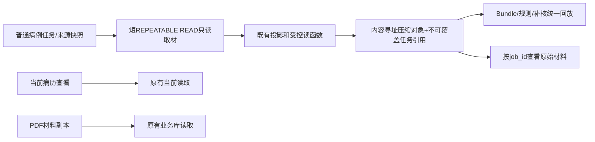

# 病历级质控材料快照：实现与验收

## 基线与边界

基线 `998f7ac94ff6d9bf3a5a52383c0f909a36ad6509`，独立分支 `codex/case-material-snapshots-20261104`。
工作树 `D:/MedQC-worktrees/case-material-snapshots-20261104`。只在此分支开发、本地提交，不推送、合并、部署或打包。

用户补充：**不需要PDF副本快照**。1026等已登记PDF副本在worker入口排除；底层采集器也拒绝此类身份。PDF历史查看不要求新增快照，仍由业务库既有路径提供材料，不宣称其为本次新增的不可变历史快照。

## 材料与读取语义



- 新的普通病例任务重新取材；连接binding仅做来源隔离，正文、文书ID、时间、状态、集合、字段结构及受控查询结果共同构成SHA256内容指纹。不是仅比较连接地址、配置版本或最大修改时间。
- 同一病历多表及主诊断读取在同一短只读事务完成；原有同病种对照若被使用，沿原有有界查询捕获，不在模型执行中另查当前库。保留原选择条件及上限。
- 取材结束后释放源事务，后续模型规则、补核和历史证据消费物化结果。未登记的读取拒绝回源，不回退别的来源。
- 业务Bundle仅在来源和材料指纹均匹配时复用；CDM未绑定材料版本时，不直接采用旧持久Bundle作为新任务材料。
- 重试使用原任务材料引用，不能缺快照后重新取当前材料。新增任务会得到新引用；引用不可覆盖。同一对象内容可以复用，保留已有事实指纹冻结机制。
- 历史材料接口带job_id并沿已有账号/病例权限读取原任务材料。无快照的普通旧任务返回409明确未留存，**不影响历史质控结果本身的读取**，不利用当前材料伪造历史。选择当前查看不携带历史材料job_id。
- 保留任务既有冻结日期、临床观察终点及规则判断合同；材料版本和评价上界是两个独立维度，不把取材时间当成新评价时点。

核心文件：`backend/app/services/case_material_snapshot.py`、`case_material_capture.py`、`bundles/assembly.py`、`luxian_0609/source_evidence_reader.py`、`sichuan_workspace_batch_worker.py`、`clinical_sources.py`、`backend/app/routers/emr_render.py`。

## 文件存储、限制与回滚

`QC_CASE_MATERIAL_DIR` 指定业务专属存储；未设置时使用 `QC_DISPATCH_STATE_DIR` 的同级 `case-materials`，再回退到后端 `data/case-materials`。

- `objects/<SHA256>.json.gz`：带日期/精确时刻/Decimal类型信息的不可变材料。
- `tasks/<任务+三坐标哈希>.json`：首次创建生效的引用，不包含患者正文。
- 原子发布、校验哈希、有界解压，损坏或缺失明确技术失败；不把错误当空材料。大小上限64MiB，单表达到10001行拒绝；取材墙钟60秒检查，单条SQL上限10秒，支持取消。
- 该目录含临床材料，必须与业务结果一起备份、仅业务账号访问。多进程/多主机Worker应使用同一持久存储；没有共享目录时不能宣称跨主机可恢复。
- 不把全文塞进items_json，不新增业务迁移，不清理旧Bundle、原文书、已有结果或冻结文件。
- 回滚应用代码不删除上述目录。旧代码不会解释新快照；保留数据后可恢复本分支读取。旧结果仍保留；无历史快照的材料不能凭空恢复。

## 发布就绪与默认关闭

独立CDM仍默认停用，RabbitMQ、模型、同步/定时任务默认配置不变，本轮未启用它们。

独立CDM初次取材还要求部署侧明确设置 `QC_CDM_CAPTURE_WINDOW_UNTIL`：带时区ISO时间，必须在当前时刻之后且不超过24小时。缺失或过期返回 `cdm_publication_window_unconfirmed`。

**这只是人工确认的受控取材窗口，不是对同步系统的原子发布承诺。** RR保证一个数据库视图一致，不能证明全部接口已经发布。`epoch`、`activation`、`operation`或单表MAX时间均未被冒用为完成标记。本轮没有连接或修改同步服务。正式启用前仍需同步方与DSH确认窗口和完整性。

## 目录与日期

独立CDM没有权威在院登记合同：观察到出院时刻或出院日期则显示已出院，否则显示状态未知；仅有入院记录不能进入确认在院的筛选、计数或运行池选样。

支持 `admission_datetime/admission_date`、`discharge_datetime/discharge_time/discharge_date`。日期级值保持YYYY-MM-DD，并返回精度，不补零点。只有日期的出院信息不生成dischargeDatetime。页面未知状态筛选仅在独立CDM显示，切回旧源清除；预览显示来源与完整性提示。

## 只读依赖与DSH预检

`backend/app/services/clinical_source_contract.py` 为固定依赖清单，覆盖目录、Bundle全部领域、RecordRepository及LX0609物理源。虚拟医嘱源对应物理inpat_nondrug_order；旧诊断子表的缺失只在既有父文书/diagnosis回退成立范围内列为可选，缺失状态仍逐项公开。

API `/api/v1/clinical-sources/check` 与独立脚本共用合同：pg_catalog按名字定位每个依赖，逐表检查SELECT及写权限、关键列、结构/零行，检查账号管理员/DDL能力。无SELECT的表不会因为information_schema不可见而消失。报告区分table_missing、select_denied、columns_missing、write_privilege_forbidden、zero_rows；发布状态始终独立标记unconfirmed。

脚本不启动应用、不授权、不建表、不改设置。未来DSH得到评审通过的代码后，只读步骤如下（本轮未在医院执行）：

```bash
# 专用预检环境文件只有独立CDM连接，不使用业务DATABASE_URL回退；凭据文件权限600。
# CDM_DATABASE_URL=postgresql+psycopg2://<只读账号>@127.0.0.1:5432/<CDM库名>
# CDM_PGPASSFILE=/data/medqc/business/config/cdm.pgpass
/data/medqc/business/venv/bin/python \
  <新版应用>/backend/scripts/cdm_readonly_preflight.py \
  --env-file <已审批的CDM只读预检配置文件> \
  --output /data/medqc/business/state/cdm-readonly-preflight.json
```

报告ok=true只证明结构与只读权限，不证明接口发布完整、患者确实在院或所有规则适用。预检不会设置取材窗口、保存来源配置或创建任务。

## 验证记录

测试使用固定应答、临时目录/内存SQLite与新建原生PG双库。后端通过`run_qc_scheduler_tests.py --profile offline`阻断真实网络；前端通过`vitest.clinical-sources.config.mts`逐用例重装网络保护。

- 后端定向集：**297通过、1跳过**。正文/时间/状态/集合指纹、并发首次发布、损坏拒读、旧任务不补造、Native→Binding→Finalizer→Canonical状态/原因/证据、未知状态/纯日期、任务取材失败保留其他病例有效结果、PDF不新增快照。
- 前端：118项通过；包含选源、未知筛选、日期精度、预检缺权限提示、当前/历史查看互斥、现有结果与文书定位。保留旧FrontpageSheet HTML及Browserslist告警，没有为此重构界面。
- 原生PG：18.3，临床源按正式060初始化，共68张表；另建合成业务库，端口63017，校验cluster_name/data_directory。没有连接5432或现存业务库。
- 同键不同内容不串读，读取期间并发提交仍保持v1，新任务取v2，重试仍取v1；取消、隐藏规则表权限、日期级出院、普通旧源及PDF原有业务库归属验证；结束停止自建集群。
- 真实模型调用0，真实患者0，医院/Strata连接0，业务库修改0。只有一次性合成库进行了建表/写入。

- 全量Vue/TS类型检查通过；新增Python模块Ruff通过、改动核心文件F821检查通过；相关前端只读ESLint零错误；暂存区UTF8编码检查通过。
- 跳过项是需要显式指定私有原始录制材料的回放入口。本轮没有读取它，也没有用患者材料补足该项。跨进程重启probe未执行，保留offline runner默认禁止子进程，不为通过测试放宽隔离。
- 最终PG验收产物：`backend/.tmp/case-material-pg-v9/result.json`，自建集群已停止。原始合成产物留在忽略目录，不提交Git。
- 未执行医院PG16、真实发布协议、跨主机共享存储或真实模型验收，不据合成数据宣称服务器性能合格。

可复现命令（从backend目录运行，前端命令从应用目录运行）：

```powershell
python -B scripts/run_qc_scheduler_tests.py --profile offline tests/unit/test_case_material_snapshot.py tests/unit/test_clinical_sources.py tests/unit/test_luxian_0609_source_evidence_reader.py tests/unit/test_bundle_scene_cache_fallback.py tests/unit/test_domain_bundle_assembly.py tests/unit/test_luxian_0609_evidence_snapshot_provider.py tests/unit/test_running_final_bundle_adapter.py tests/unit/test_exam_poc_acceptance.py tests/unit/test_luxian_0609_live_family_results.py tests/unit/test_bundle_emr_view.py
python -B scripts/validate_clinical_sources_pg.py --pg-bin 'D:\Program Files\PostgreSQL\18\bin' --source-backend C:\medqc-data-integration-service\apps\medqc-web\backend --output-dir .tmp\case-material-pg-fresh --port 63017
# 后两项从apps/medqc-web运行
npx vitest run --config vitest.clinical-sources.config.mts
npm run type-check
npm run check:encoding
```

新保护集已加入既有data-pipelines测试集合，避免未来CI漏跑；本轮未推送或触发GitHub CI。
