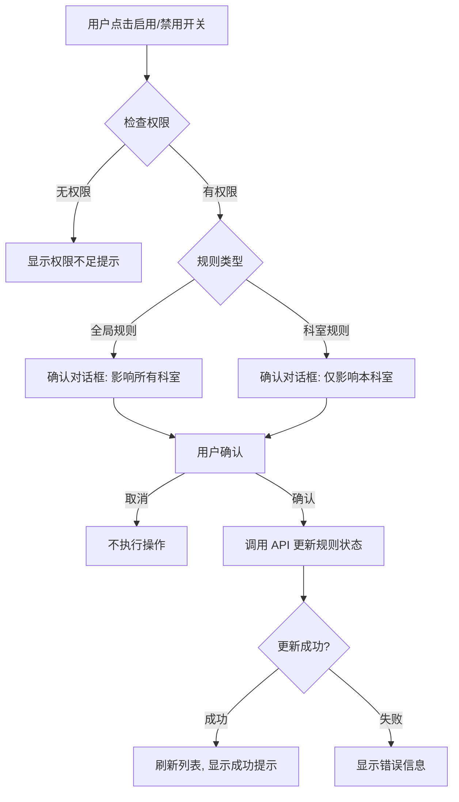

# 科室级质控规则配置功能 PRD

> **文档版本**: 1.0  
> **创建日期**: 2025-10-12  
> **产品**: MedQC 医疗质控系统  
> **功能模块**: 质控规则管理

---

## 📋 目录

1. [功能概述](#1-功能概述)
2. [用户角色和权限](#2-用户角色和权限)
3. [功能详细设计](#3-功能详细设计)
4. [数据模型设计](#4-数据模型设计)
5. [业务规则](#5-业务规则)
6. [界面原型](#6-界面原型)
7. [技术实现要点](#7-技术实现要点)
8. [测试用例](#8-测试用例)
9. [实施计划](#9-实施计划)

---

## 1. 功能概述

### 1.1 功能目标

**核心价值**:
- 支持不同科室的个性化质控需求
- 在统一质控标准的基础上，允许科室级别的灵活配置
- 提高质控规则的适用性和准确性
- 减少误报和漏报，提升质控效率

**解决的问题**:
1. **当前痛点**: 所有科室共用统一的 68 个质控点，无法满足不同科室的特殊需求
2. **业务需求**: 
   - 外科需要更严格的手术记录检查
   - 内科需要更详细的病程记录检查
   - 急诊科需要更快速的时效性检查
   - 儿科需要特殊的用药剂量检查

### 1.2 适用场景

| 场景 | 描述 | 示例 |
|------|------|------|
| **科室特有规则** | 某些规则仅对特定科室生效 | 骨科的"手术部位标记检查" |
| **规则参数调整** | 调整全局规则的阈值或权重 | 急诊科的"记录时效性"从 24 小时调整为 6 小时 |
| **规则启用/禁用** | 科室选择性禁用某些不适用的规则 | 儿科禁用"成人用药剂量检查" |
| **规则优先级调整** | 调整规则的重要性和扣分权重 | ICU 提高"生命体征记录完整性"的权重 |

---

## 2. 用户角色和权限

### 2.1 角色定义

| 角色 | 角色名称 | 权限范围 |
|------|---------|---------|
| **Admin** | 系统管理员 | 全局规则管理 + 所有科室规则管理 |
| **QC Manager** | 质控管理员 | 全局规则管理 + 所有科室规则管理 |
| **Department Admin** | 科室管理员 | 仅本科室规则管理（未来扩展） |
| **QC Staff** | 质控专员 | 查看规则，无编辑权限 |
| **Doctor** | 医生 | 查看规则，无编辑权限 |

### 2.2 权限矩阵

| 操作 | Admin | QC Manager | Dept Admin | QC Staff | Doctor |
|------|-------|------------|------------|----------|--------|
| 查看全局规则 | ✅ | ✅ | ✅ | ✅ | ✅ |
| 编辑全局规则 | ✅ | ✅ | ❌ | ❌ | ❌ |
| 查看科室规则 | ✅ | ✅ | ✅ (本科室) | ✅ | ✅ |
| 创建科室规则 | ✅ | ✅ | ✅ (本科室) | ❌ | ❌ |
| 编辑科室规则 | ✅ | ✅ | ✅ (本科室) | ❌ | ❌ |
| 删除科室规则 | ✅ | ✅ | ✅ (本科室) | ❌ | ❌ |
| 启用/禁用规则 | ✅ | ✅ | ✅ (本科室) | ❌ | ❌ |

---

## 3. 功能详细设计

### 3.1 科室质控规则配置界面

#### 3.1.1 页面结构

```
┌─────────────────────────────────────────────────────────────┐
│  质控规则管理                                                │
├─────────────────────────────────────────────────────────────┤
│  [全局规则] [科室规则]                                       │
│                                                              │
│  科室选择: [全部科室 ▼]  规则类型: [全部 ▼]  状态: [全部 ▼] │
│  搜索: [_______________] [搜索]                              │
│                                                              │
│  ┌────────────────────────────────────────────────────┐    │
│  │ 规则列表                                            │    │
│  ├────┬──────┬──────┬──────┬──────┬──────┬──────┬────┤    │
│  │ 编号│ 规则名称 │ 类型 │ 严重性│ 适用科室│ 状态 │ 操作│    │
│  ├────┼──────┼──────┼──────┼──────┼──────┼──────┼────┤    │
│  │R001│主诉完整性│全局  │ 重要  │ 全部   │ 启用 │编辑│    │
│  │R001│主诉完整性│科室  │ 重要  │ 外科   │ 启用 │编辑│    │
│  │    │-外科定制 │      │       │        │      │删除│    │
│  └────┴──────┴──────┴──────┴──────┴──────┴──────┴────┘    │
│                                                              │
│  [+ 新增科室规则]                                            │
└─────────────────────────────────────────────────────────────┘
```

#### 3.1.2 规则列表展示

**列表字段**:
- **规则编号**: 显示规则代码（如 R001）
- **规则名称**: 显示规则名称，科室规则显示"[科室名]-规则名"
- **规则类型**: 
  - 🌐 全局规则（灰色标签）
  - 🏥 科室规则（蓝色标签）
  - 🔄 覆盖规则（橙色标签，表示科室规则覆盖了全局规则）
- **严重性**: critical / major / minor
- **适用科室**: 显示科室名称或"全部"
- **状态**: 启用 / 禁用
- **操作**: 编辑 / 删除 / 启用/禁用

**规则分组显示**:
- 同一规则编号的全局规则和科室规则显示在一起
- 科室规则缩进显示，表示继承关系
- 使用不同颜色区分规则类型

### 3.2 规则启用/禁用操作流程



### 3.3 规则编辑/新增操作流程

#### 3.3.1 新增科室规则

**步骤**:
1. 用户点击"新增科室规则"按钮
2. 弹出规则编辑对话框
3. 用户选择:
   - **基于全局规则创建**: 选择一个全局规则作为模板
   - **创建全新规则**: 从零开始创建
4. 填写规则信息:
   - 规则名称
   - 规则描述
   - 适用科室（必选）
   - 规则类型（logical / semantic / hybrid）
   - 严重性（critical / major / minor）
   - 检查逻辑（JSON 配置）
   - 评分配置（扣分规则）
5. 保存规则

#### 3.3.2 编辑科室规则

**可编辑字段**:
- ✅ 规则名称
- ✅ 规则描述
- ✅ 严重性
- ✅ 检查逻辑参数
- ✅ 评分配置
- ❌ 规则编号（不可修改）
- ❌ 适用科室（不可修改，需删除重建）

---

## 4. 数据模型设计

### 4.1 数据库表结构设计

#### 4.1.1 方案一：扩展现有 qc_rules 表（推荐）

**优点**: 
- 简单直接，无需新建表
- 查询性能好
- 易于维护

**缺点**:
- 表结构略复杂
- 需要迁移现有数据

```sql
-- 扩展 qc_rules 表
ALTER TABLE qc_rules
-- 规则范围和科室
ADD COLUMN scope VARCHAR(20) DEFAULT 'global'
    CHECK (scope IN ('global', 'department')),
ADD COLUMN department_id UUID REFERENCES departments(id),
ADD COLUMN parent_rule_id UUID REFERENCES qc_rules(id),

-- 覆盖配置
ADD COLUMN override_action VARCHAR(20) DEFAULT 'override'
    CHECK (override_action IN ('override', 'disable')),
ADD COLUMN override_config JSONB DEFAULT '{}',
ADD COLUMN priority INTEGER DEFAULT 0,

-- 版本和生效期
ADD COLUMN status VARCHAR(20) DEFAULT 'published'
    CHECK (status IN ('draft', 'published', 'archived')),
ADD COLUMN version VARCHAR(20) DEFAULT '1.0',
ADD COLUMN effective_from TIMESTAMPTZ,
ADD COLUMN effective_to TIMESTAMPTZ,

-- 审核信息
ADD COLUMN approved_by UUID,
ADD COLUMN approved_at TIMESTAMPTZ;

-- 添加索引
CREATE INDEX idx_qc_rules_scope ON qc_rules(scope);
CREATE INDEX idx_qc_rules_department ON qc_rules(department_id);
CREATE INDEX idx_qc_rules_parent ON qc_rules(parent_rule_id);
CREATE INDEX idx_qc_rules_status ON qc_rules(status);
CREATE INDEX idx_qc_rules_effective ON qc_rules(effective_from, effective_to);

-- 添加约束
ALTER TABLE qc_rules
ADD CONSTRAINT chk_department_scope
CHECK (
    (scope = 'global' AND department_id IS NULL) OR
    (scope = 'department' AND department_id IS NOT NULL)
);

-- 唯一约束：同科室同规则编号的已发布规则唯一
CREATE UNIQUE INDEX uk_dept_rule_code_published
ON qc_rules(department_id, rule_code)
WHERE scope = 'department' AND status = 'published';
```

**字段说明**:

| 字段 | 类型 | 说明 | 示例 |
|------|------|------|------|
| `scope` | VARCHAR(20) | 规则范围: global / department | 'department' |
| `department_id` | UUID | 科室 ID（仅科室规则） | 'uuid-123' |
| `parent_rule_id` | UUID | 父规则 ID（覆盖规则时使用） | 'uuid-456' |
| `override_action` | VARCHAR(20) | 覆盖行为: override（覆盖配置）/ disable（禁用全局规则） | 'override' |
| `override_config` | JSONB | 覆盖配置（记录哪些字段被覆盖） | `{"severity": true, "scoring_config": true}` |
| `priority` | INTEGER | 优先级（数字越大优先级越高） | 10 |
| `status` | VARCHAR(20) | 规则状态: draft / published / archived | 'published' |
| `version` | VARCHAR(20) | 规则版本号 | '1.0' |
| `effective_from` | TIMESTAMPTZ | 生效开始时间（可选） | '2025-01-01 00:00:00+08' |
| `effective_to` | TIMESTAMPTZ | 生效结束时间（可选） | '2025-12-31 23:59:59+08' |
| `approved_by` | UUID | 审核人 ID | 'uuid-789' |
| `approved_at` | TIMESTAMPTZ | 审核时间 | '2025-01-01 10:00:00+08' |

#### 4.1.2 方案二：新建 department_qc_rules 表

**优点**:
- 职责分离，清晰
- 不影响现有表结构

**缺点**:
- 需要 JOIN 查询
- 维护两张表

```sql
-- 新建科室质控规则表
CREATE TABLE department_qc_rules (
    id UUID PRIMARY KEY DEFAULT gen_random_uuid(),
    department_id UUID NOT NULL REFERENCES departments(id),
    base_rule_id UUID REFERENCES qc_rules(id),  -- 基于哪个全局规则
    rule_code VARCHAR(50) NOT NULL,
    name VARCHAR(200) NOT NULL,
    description TEXT,
    
    -- 规则配置（可覆盖全局规则）
    severity VARCHAR(20) CHECK (severity IN ('critical', 'major', 'minor')),
    check_logic JSONB,
    scoring_config JSONB,
    
    -- 覆盖标记
    overrides JSONB DEFAULT '{}',  -- 记录哪些字段被覆盖
    
    -- 状态
    is_active BOOLEAN DEFAULT true,
    priority INTEGER DEFAULT 0,
    
    -- 审计字段
    created_by UUID,
    created_at TIMESTAMP WITH TIME ZONE DEFAULT NOW(),
    updated_at TIMESTAMP WITH TIME ZONE DEFAULT NOW(),
    
    -- 唯一约束：同一科室不能有重复的规则代码
    CONSTRAINT uk_dept_rule_code UNIQUE (department_id, rule_code)
);
```

### 4.2 departments 表（如果不存在需要创建）

```sql
CREATE TABLE IF NOT EXISTS departments (
    id UUID PRIMARY KEY DEFAULT gen_random_uuid(),
    code VARCHAR(50) UNIQUE NOT NULL,
    name VARCHAR(200) NOT NULL,
    description TEXT,
    parent_id UUID REFERENCES departments(id),
    level INTEGER DEFAULT 1,
    is_active BOOLEAN DEFAULT true,
    created_at TIMESTAMP WITH TIME ZONE DEFAULT NOW(),
    updated_at TIMESTAMP WITH TIME ZONE DEFAULT NOW()
);

-- 插入示例科室数据
INSERT INTO departments (code, name, description) VALUES
('DEPT_001', '内科', '内科科室'),
('DEPT_002', '外科', '外科科室'),
('DEPT_003', '儿科', '儿科科室'),
('DEPT_004', '急诊科', '急诊科室'),
('DEPT_005', 'ICU', '重症监护室'),
('DEPT_006', '骨科', '骨科科室'),
('DEPT_007', '神经内科', '神经内科科室'),
('DEPT_008', '心内科', '心内科科室');
```

### 4.3 规则变更审计日志表

```sql
CREATE TABLE IF NOT EXISTS qc_rule_change_logs (
    id UUID PRIMARY KEY DEFAULT gen_random_uuid(),
    rule_id UUID NOT NULL REFERENCES qc_rules(id) ON DELETE CASCADE,
    department_id UUID REFERENCES departments(id),
    action VARCHAR(20) NOT NULL CHECK (action IN ('create', 'update', 'delete', 'enable', 'disable', 'publish', 'archive')),

    -- 变更内容
    old_values JSONB,  -- 变更前的值
    new_values JSONB,  -- 变更后的值
    diff JSONB,        -- 差异对比

    -- 操作人信息
    actor_id UUID NOT NULL,
    actor_name VARCHAR(200),
    actor_role VARCHAR(50),

    -- 变更原因
    reason TEXT,

    -- 审计信息
    ip_address VARCHAR(50),
    user_agent TEXT,
    created_at TIMESTAMP WITH TIME ZONE DEFAULT NOW()
);

-- 创建索引
CREATE INDEX idx_rule_change_logs_rule ON qc_rule_change_logs(rule_id);
CREATE INDEX idx_rule_change_logs_department ON qc_rule_change_logs(department_id);
CREATE INDEX idx_rule_change_logs_actor ON qc_rule_change_logs(actor_id);
CREATE INDEX idx_rule_change_logs_action ON qc_rule_change_logs(action);
CREATE INDEX idx_rule_change_logs_created ON qc_rule_change_logs(created_at DESC);

-- 创建触发器：自动记录规则变更
CREATE OR REPLACE FUNCTION log_qc_rule_changes()
RETURNS TRIGGER AS $$
BEGIN
    IF TG_OP = 'INSERT' THEN
        INSERT INTO qc_rule_change_logs (rule_id, department_id, action, new_values, actor_id)
        VALUES (NEW.id, NEW.department_id, 'create', to_jsonb(NEW), NEW.created_by);
    ELSIF TG_OP = 'UPDATE' THEN
        INSERT INTO qc_rule_change_logs (rule_id, department_id, action, old_values, new_values, actor_id)
        VALUES (NEW.id, NEW.department_id, 'update', to_jsonb(OLD), to_jsonb(NEW), NEW.updated_by);
    ELSIF TG_OP = 'DELETE' THEN
        INSERT INTO qc_rule_change_logs (rule_id, department_id, action, old_values, actor_id)
        VALUES (OLD.id, OLD.department_id, 'delete', to_jsonb(OLD), OLD.updated_by);
    END IF;
    RETURN NEW;
END;
$$ LANGUAGE plpgsql;

CREATE TRIGGER trigger_log_qc_rule_changes
AFTER INSERT OR UPDATE OR DELETE ON qc_rules
FOR EACH ROW EXECUTE FUNCTION log_qc_rule_changes();
```

### 4.3 数据示例

#### 4.3.1 全局规则示例

```json
{
  "id": "rule-001",
  "rule_code": "R001",
  "name": "主诉完整性检查",
  "scope": "global",
  "department_id": null,
  "parent_rule_id": null,
  "severity": "major",
  "check_logic": {
    "type": "content_check",
    "required_sections": ["主诉"],
    "min_length": 5
  },
  "scoring_config": {
    "default_deduction": 5,
    "max_deduction": 10,
    "weight_factor": 1.0
  },
  "is_active": true,
  "priority": 0
}
```

#### 4.3.2 科室规则示例（覆盖全局规则）

```json
{
  "id": "rule-002",
  "rule_code": "R001",
  "name": "主诉完整性检查-外科定制",
  "scope": "department",
  "department_id": "dept-002",  // 外科
  "parent_rule_id": "rule-001",  // 基于全局规则 R001
  "severity": "critical",  // 覆盖：从 major 提升到 critical
  "check_logic": {
    "type": "content_check",
    "required_sections": ["主诉", "手术部位"],  // 覆盖：增加手术部位检查
    "min_length": 10  // 覆盖：从 5 提升到 10
  },
  "scoring_config": {
    "default_deduction": 10,  // 覆盖：从 5 提升到 10
    "max_deduction": 20,  // 覆盖：从 10 提升到 20
    "weight_factor": 1.5  // 覆盖：从 1.0 提升到 1.5
  },
  "override_config": {
    "severity": true,
    "check_logic": true,
    "scoring_config": true
  },
  "is_active": true,
  "priority": 10  // 优先级高于全局规则
}
```

#### 4.3.3 科室特有规则示例

```json
{
  "id": "rule-003",
  "rule_code": "R069",  // 新规则编号
  "name": "手术部位标记检查",
  "scope": "department",
  "department_id": "dept-006",  // 骨科
  "parent_rule_id": null,  // 无父规则，全新规则
  "severity": "critical",
  "check_logic": {
    "type": "content_check",
    "required_sections": ["手术记录"],
    "keywords": ["手术部位标记", "标记确认"]
  },
  "scoring_config": {
    "default_deduction": 15,
    "max_deduction": 30,
    "weight_factor": 2.0
  },
  "is_active": true,
  "priority": 20
}
```

---

## 5. 业务规则

### 5.1 规则匹配逻辑

执行质控时，系统按以下优先级选择规则：

```
优先级（从高到低）:
1. 科室特有规则（priority 高）
2. 科室覆盖规则（有 parent_rule_id）
3. 全局规则（scope = 'global'）
```

**匹配算法**:

```python
from datetime import datetime

def get_applicable_rules(record_id, department_id, now=None):
    """
    获取适用的质控规则

    Args:
        record_id: 病历 ID
        department_id: 科室 ID
        now: 当前时间（用于生效期判断，默认为当前时间）

    Returns:
        List[Rule]: 适用的规则列表
    """
    if now is None:
        now = datetime.now()

    # 1. 获取所有激活且已发布的全局规则
    global_rules = db.query(QCRule).filter(
        QCRule.scope == 'global',
        QCRule.is_active == True,
        QCRule.status == 'published',
        # 生效期判断
        or_(
            QCRule.effective_from == None,
            QCRule.effective_from <= now
        ),
        or_(
            QCRule.effective_to == None,
            QCRule.effective_to >= now
        )
    ).all()

    # 2. 获取该科室的所有激活且已发布的规则
    dept_rules = db.query(QCRule).filter(
        QCRule.scope == 'department',
        QCRule.department_id == department_id,
        QCRule.is_active == True,
        QCRule.status == 'published',
        # 生效期判断
        or_(
            QCRule.effective_from == None,
            QCRule.effective_from <= now
        ),
        or_(
            QCRule.effective_to == None,
            QCRule.effective_to >= now
        )
    ).all()

    # 3. 构建规则字典（按 rule_code 分组）
    rule_map = {}
    disabled_rules = set()  # 被禁用的规则编号

    # 先添加全局规则
    for rule in global_rules:
        rule_map[rule.rule_code] = rule

    # 处理科室规则
    for rule in dept_rules:
        if rule.override_action == 'disable':
            # 禁用规则：标记该 rule_code 不生效
            disabled_rules.add(rule.rule_code)
            if rule.rule_code in rule_map:
                del rule_map[rule.rule_code]
        elif rule.override_action == 'override':
            # 覆盖规则：替换全局规则
            rule_map[rule.rule_code] = rule
        else:
            # 新规则：直接添加
            rule_map[rule.rule_code] = rule

    # 4. 移除被禁用的规则
    for rule_code in disabled_rules:
        rule_map.pop(rule_code, None)

    # 5. 按优先级排序
    rules = sorted(rule_map.values(), key=lambda x: x.priority, reverse=True)

    return rules
```

### 5.2 规则冲突处理

**冲突场景**:
1. 同一科室有多个相同 rule_code 的规则
2. 科室规则和全局规则同时存在
3. 科室明确禁用某个全局规则

**处理策略**:

| 场景 | 处理方式 |
|------|---------|
| 科室覆盖规则 vs 全局规则 | 科室规则优先（override_action='override'） |
| 科室禁用规则 vs 全局规则 | 全局规则不生效（override_action='disable'） |
| 多个科室规则（同 rule_code） | 按 priority 排序，取最高优先级 |
| 规则被禁用（is_active=false） | 跳过该规则，不执行检查 |
| 规则未发布（status≠'published'） | 跳过该规则，不执行检查 |
| 规则不在生效期内 | 跳过该规则，不执行检查 |

**禁用全局规则的实现**:

当科室需要禁用某个全局规则时，创建一条科室规则记录：
- `scope` = 'department'
- `department_id` = 目标科室 ID
- `rule_code` = 要禁用的全局规则编号
- `override_action` = 'disable'
- `is_active` = true
- `status` = 'published'

示例：
```json
{
  "id": "rule-004",
  "rule_code": "R010",
  "name": "禁用：成人用药剂量检查",
  "scope": "department",
  "department_id": "dept-003",  // 儿科
  "override_action": "disable",  // 禁用
  "is_active": true,
  "status": "published",
  "reason": "儿科使用儿童用药剂量标准，不适用成人标准"
}
```

### 5.3 规则生效范围

| 规则类型 | 生效范围 | 示例 |
|---------|---------|------|
| 全局规则 | 所有科室 | R001 主诉完整性检查 |
| 科室覆盖规则 | 仅指定科室 | R001-外科定制 |
| 科室特有规则 | 仅指定科室 | R069 手术部位标记检查（仅骨科） |

### 5.4 规则继承机制

**继承规则**:
1. 科室规则可以继承全局规则的所有配置
2. 科室规则可以选择性覆盖部分配置
3. 未覆盖的配置使用全局规则的值

**覆盖字段**:
- ✅ `severity`: 严重性
- ✅ `check_logic`: 检查逻辑
- ✅ `scoring_config`: 评分配置
- ✅ `prompt_template`: 提示模板
- ❌ `rule_code`: 规则编号（不可覆盖）
- ❌ `category`: 规则分类（不可覆盖）

---

## 6. 界面原型

### 6.1 科室质控规则配置页面

```
┌──────────────────────────────────────────────────────────────────┐
│  质控规则管理                                    [+ 新增科室规则]  │
├──────────────────────────────────────────────────────────────────┤
│                                                                   │
│  [全局规则] [科室规则]                                            │
│                                                                   │
│  ┌─────────────────────────────────────────────────────────┐    │
│  │ 筛选条件                                                 │    │
│  │ 科室: [全部科室 ▼]  类型: [全部 ▼]  严重性: [全部 ▼]    │    │
│  │ 状态: [全部 ▼]  搜索: [_______________] [搜索]          │    │
│  └─────────────────────────────────────────────────────────┘    │
│                                                                   │
│  ┌─────────────────────────────────────────────────────────┐    │
│  │ 规则列表 (共 72 条)                                      │    │
│  ├──────┬────────────┬──────┬──────┬──────┬──────┬────────┤    │
│  │ 编号 │ 规则名称    │ 类型 │ 严重性│ 科室 │ 状态 │ 操作   │    │
│  ├──────┼────────────┼──────┼──────┼──────┼──────┼────────┤    │
│  │ R001 │ 主诉完整性  │ 🌐全局│ 重要 │ 全部 │ ✅启用│ 编辑   │    │
│  │      │ ├─ 外科定制 │ 🔄覆盖│ 严重 │ 外科 │ ✅启用│ 编辑删除│    │
│  │      │ ├─ 儿科定制 │ 🔄覆盖│ 重要 │ 儿科 │ ✅启用│ 编辑删除│    │
│  ├──────┼────────────┼──────┼──────┼──────┼──────┼────────┤    │
│  │ R002 │ 现病史完整性│ 🌐全局│ 重要 │ 全部 │ ✅启用│ 编辑   │    │
│  ├──────┼────────────┼──────┼──────┼──────┼──────┼────────┤    │
│  │ R069 │ 手术部位标记│ 🏥科室│ 严重 │ 骨科 │ ✅启用│ 编辑删除│    │
│  └──────┴────────────┴──────┴──────┴──────┴──────┴────────┘    │
│                                                                   │
│  [上一页] 1 / 4 [下一页]                                          │
└──────────────────────────────────────────────────────────────────┘
```

### 6.2 规则编辑对话框

```
┌──────────────────────────────────────────────────────────┐
│  编辑科室规则                                    [X 关闭] │
├──────────────────────────────────────────────────────────┤
│                                                           │
│  基本信息                                                 │
│  ┌─────────────────────────────────────────────────┐    │
│  │ 规则编号: R001 (继承自全局规则)                 │    │
│  │ 规则名称: [主诉完整性检查-外科定制___________]  │    │
│  │ 适用科室: [外科 ▼]                              │    │
│  │ 规则描述: [_________________________________]  │    │
│  │           [_________________________________]  │    │
│  └─────────────────────────────────────────────────┘    │
│                                                           │
│  规则配置                                                 │
│  ┌─────────────────────────────────────────────────┐    │
│  │ 严重性: ○ 严重 ● 重要 ○ 轻微                    │    │
│  │ 规则类型: ○ 逻辑规则 ● 语义规则 ○ 混合规则      │    │
│  │                                                  │    │
│  │ 检查逻辑 (JSON):                                 │    │
│  │ ┌──────────────────────────────────────────┐   │    │
│  │ │ {                                         │   │    │
│  │ │   "type": "content_check",                │   │    │
│  │ │   "required_sections": ["主诉", "手术部位"],│   │    │
│  │ │   "min_length": 10                        │   │    │
│  │ │ }                                         │   │    │
│  │ └──────────────────────────────────────────┘   │    │
│  │                                                  │    │
│  │ 评分配置:                                        │    │
│  │ 默认扣分: [10___] 最大扣分: [20___]             │    │
│  │ 权重系数: [1.5__]                               │    │
│  └─────────────────────────────────────────────────┘    │
│                                                           │
│  覆盖配置                                                 │
│  ┌─────────────────────────────────────────────────┐    │
│  │ ☑ 覆盖严重性  ☑ 覆盖检查逻辑  ☑ 覆盖评分配置    │    │
│  └─────────────────────────────────────────────────┘    │
│                                                           │
│  [取消]                                      [保存]       │
└──────────────────────────────────────────────────────────┘
```

---

## 7. 技术实现要点

### 7.1 API 接口设计

#### 7.1.1 获取规则列表

```typescript
GET /api/v1/qc/rules?scope={scope}&department_id={dept_id}&is_active={status}

// 响应
{
  "data": [
    {
      "id": "rule-001",
      "rule_code": "R001",
      "name": "主诉完整性检查",
      "scope": "global",
      "department_id": null,
      "severity": "major",
      "is_active": true,
      "children": [  // 科室规则
        {
          "id": "rule-002",
          "rule_code": "R001",
          "name": "主诉完整性检查-外科定制",
          "scope": "department",
          "department_id": "dept-002",
          "severity": "critical",
          "is_active": true
        }
      ]
    }
  ],
  "total": 72
}
```

#### 7.1.2 创建科室规则

```typescript
POST /api/v1/qc/rules/department

// 请求体
{
  "department_id": "dept-002",
  "base_rule_id": "rule-001",  // 可选，基于哪个全局规则
  "rule_code": "R001",
  "name": "主诉完整性检查-外科定制",
  "severity": "critical",
  "check_logic": {...},
  "scoring_config": {...},
  "override_config": {
    "severity": true,
    "check_logic": true,
    "scoring_config": true
  }
}

// 响应
{
  "id": "rule-002",
  "message": "科室规则创建成功"
}
```

#### 7.1.3 更新科室规则

```typescript
PUT /api/v1/qc/rules/department/{rule_id}

// 请求体
{
  "name": "主诉完整性检查-外科定制（更新）",
  "severity": "critical",
  "check_logic": {...},
  "scoring_config": {...}
}
```

#### 7.1.4 删除科室规则

```typescript
DELETE /api/v1/qc/rules/department/{rule_id}

// 响应
{
  "message": "科室规则删除成功"
}
```

#### 7.1.5 获取适用规则（执行质控时调用）

```typescript
GET /api/v1/qc/rules/applicable?department_id={dept_id}&record_type={type}

// 响应
{
  "data": [
    {
      "id": "rule-002",
      "rule_code": "R001",
      "name": "主诉完整性检查-外科定制",
      "severity": "critical",
      "check_logic": {...},
      "scoring_config": {...},
      "priority": 10,
      "source": "department"  // global / department
    }
  ]
}
```

### 7.2 前端组件设计

#### 7.2.1 组件结构

```
src/views/qc-rules/
├── DepartmentRulesManagement.vue    # 主页面
├── components/
│   ├── RuleList.vue                 # 规则列表组件
│   ├── RuleFilter.vue               # 筛选组件
│   ├── RuleEditDialog.vue           # 规则编辑对话框
│   ├── RuleTreeView.vue             # 规则树形视图（显示继承关系）
│   └── RuleCompareDialog.vue        # 规则对比对话框（对比全局和科室规则）
└── composables/
    ├── useRuleManagement.ts         # 规则管理逻辑
    └── useRuleInheritance.ts        # 规则继承逻辑
```

#### 7.2.2 核心 Composable

```typescript
// useRuleManagement.ts
export function useRuleManagement() {
  const rules = ref<Rule[]>([])
  const loading = ref(false)
  
  // 获取规则列表
  const fetchRules = async (filters: RuleFilter) => {
    loading.value = true
    try {
      const response = await api.get('/qc/rules', { params: filters })
      rules.value = response.data
    } finally {
      loading.value = false
    }
  }
  
  // 创建科室规则
  const createDepartmentRule = async (rule: DepartmentRule) => {
    await api.post('/qc/rules/department', rule)
    await fetchRules({})
  }
  
  // 更新科室规则
  const updateDepartmentRule = async (id: string, rule: Partial<DepartmentRule>) => {
    await api.put(`/qc/rules/department/${id}`, rule)
    await fetchRules({})
  }
  
  // 删除科室规则
  const deleteDepartmentRule = async (id: string) => {
    await api.delete(`/qc/rules/department/${id}`)
    await fetchRules({})
  }
  
  return {
    rules,
    loading,
    fetchRules,
    createDepartmentRule,
    updateDepartmentRule,
    deleteDepartmentRule
  }
}
```

### 7.3 后端逻辑调整

#### 7.3.1 数据库 RPC 函数（推荐）

为了确保规则匹配逻辑的一致性和性能，建议在数据库层实现 RPC 函数：

```sql
-- 创建获取适用规则的 RPC 函数
CREATE OR REPLACE FUNCTION get_applicable_qc_rules(
    p_department_id UUID,
    p_document_type TEXT DEFAULT NULL,
    p_at TIMESTAMPTZ DEFAULT NOW()
)
RETURNS TABLE (
    id UUID,
    rule_code VARCHAR(50),
    name VARCHAR(200),
    description TEXT,
    category VARCHAR(50),
    rule_type VARCHAR(20),
    severity VARCHAR(20),
    check_logic JSONB,
    scoring_config JSONB,
    priority INTEGER,
    source VARCHAR(20)  -- 'global' or 'department'
) AS $$
BEGIN
    RETURN QUERY
    WITH
    -- 1. 获取有效的全局规则
    global_rules AS (
        SELECT
            r.*,
            'global'::VARCHAR(20) AS source
        FROM qc_rules r
        WHERE r.scope = 'global'
        AND r.is_active = true
        AND r.status = 'published'
        AND (r.effective_from IS NULL OR r.effective_from <= p_at)
        AND (r.effective_to IS NULL OR r.effective_to >= p_at)
        AND (p_document_type IS NULL OR r.applicable_documents @> ARRAY[p_document_type]::TEXT[])
    ),
    -- 2. 获取有效的科室规则
    dept_rules AS (
        SELECT
            r.*,
            'department'::VARCHAR(20) AS source
        FROM qc_rules r
        WHERE r.scope = 'department'
        AND r.department_id = p_department_id
        AND r.is_active = true
        AND r.status = 'published'
        AND (r.effective_from IS NULL OR r.effective_from <= p_at)
        AND (r.effective_to IS NULL OR r.effective_to >= p_at)
        AND (p_document_type IS NULL OR r.applicable_documents @> ARRAY[p_document_type]::TEXT[])
    ),
    -- 3. 找出被禁用的规则
    disabled_rules AS (
        SELECT rule_code
        FROM dept_rules
        WHERE override_action = 'disable'
    ),
    -- 4. 合并规则（科室规则覆盖全局规则）
    merged_rules AS (
        -- 科室规则（覆盖类型）
        SELECT * FROM dept_rules WHERE override_action = 'override'
        UNION ALL
        -- 全局规则（排除被科室规则覆盖或禁用的）
        SELECT * FROM global_rules
        WHERE rule_code NOT IN (
            SELECT rule_code FROM dept_rules WHERE override_action IN ('override', 'disable')
        )
    )
    -- 5. 返回结果，按优先级排序
    SELECT
        m.id,
        m.rule_code,
        m.name,
        m.description,
        m.category,
        m.rule_type,
        m.severity,
        m.check_logic,
        m.scoring_config,
        m.priority,
        m.source
    FROM merged_rules m
    ORDER BY m.priority DESC, m.rule_code ASC;
END;
$$ LANGUAGE plpgsql STABLE;

-- 创建索引以优化 RPC 函数性能
CREATE INDEX IF NOT EXISTS idx_qc_rules_applicable_documents
ON qc_rules USING GIN (applicable_documents);

CREATE INDEX IF NOT EXISTS idx_qc_rules_composite
ON qc_rules(scope, department_id, is_active, status, effective_from, effective_to);
```

#### 7.3.2 质控执行服务调整

```python
# app/services/qc_service.py

class QCService:
    async def analyze_record(self, record_id: str, department_id: str, document_type: str = None):
        """
        执行质控分析
        """
        # 1. 获取适用的规则（使用数据库 RPC 函数）
        rules = await self.get_applicable_rules(department_id, document_type)

        # 2. 执行规则检查
        results = []
        for rule in rules:
            result = await self.execute_rule(record_id, rule)
            results.append(result)

        # 3. 汇总结果
        return self.aggregate_results(results)

    async def get_applicable_rules(
        self,
        department_id: str,
        document_type: str = None
    ) -> List[Rule]:
        """
        获取适用的规则（调用数据库 RPC 函数）
        """
        from datetime import datetime

        # 调用数据库 RPC 函数
        result = await supabase.rpc(
            'get_applicable_qc_rules',
            {
                'p_department_id': department_id,
                'p_document_type': document_type,
                'p_at': datetime.now().isoformat()
            }
        )

        if result.data:
            return [Rule(**rule) for rule in result.data]
        return []
```

---

## 8. 测试用例

### 8.1 功能测试场景

| 测试场景 | 测试步骤 | 预期结果 |
|---------|---------|---------|
| **创建科室规则** | 1. 选择科室<br>2. 选择基础规则<br>3. 修改配置<br>4. 保存 | 规则创建成功，列表中显示新规则 |
| **编辑科室规则** | 1. 点击编辑<br>2. 修改配置<br>3. 保存 | 规则更新成功，配置生效 |
| **删除科室规则** | 1. 点击删除<br>2. 确认删除 | 规则删除成功，列表中移除 |
| **启用/禁用规则** | 1. 点击开关<br>2. 确认操作 | 规则状态更新，质控时生效/不生效 |
| **规则继承** | 1. 创建科室规则<br>2. 仅覆盖部分配置 | 未覆盖的配置使用全局规则的值 |
| **规则优先级** | 1. 创建科室规则<br>2. 执行质控 | 科室规则优先于全局规则执行 |

### 8.2 边界条件测试

| 测试场景 | 测试数据 | 预期结果 |
|---------|---------|---------|
| **重复规则编号** | 同一科室创建相同 rule_code 的已发布规则 | 提示错误，不允许创建 |
| **无权限操作** | 非管理员尝试创建规则 | 返回 403 权限不足 |
| **删除被引用的规则** | 删除有子规则的全局规则 | 提示错误或级联删除 |
| **科室不存在** | 为不存在的科室创建规则 | 提示错误，科室不存在 |
| **配置格式错误** | check_logic JSON 格式错误 | 提示错误，配置格式不正确 |
| **禁用不存在的规则** | 禁用一个不存在的全局规则 | 提示错误，规则不存在 |
| **生效期冲突** | effective_from > effective_to | 提示错误，生效期不合法 |
| **草稿规则执行** | 执行质控时包含草稿规则 | 草稿规则不生效 |
| **过期规则执行** | 执行质控时包含已过期规则 | 过期规则不生效 |

### 8.3 规则匹配逻辑测试

| 测试场景 | 测试数据 | 预期结果 |
|---------|---------|---------|
| **禁用全局规则** | 科室禁用规则 R001 | 该科室执行质控时不使用 R001 |
| **覆盖全局规则** | 科室覆盖规则 R001 的严重性 | 使用科室规则的严重性配置 |
| **多层覆盖** | 全局规则 → 科室覆盖 → 再次覆盖 | 使用最后一次覆盖的配置 |
| **优先级排序** | 多个规则不同优先级 | 按 priority DESC 排序 |
| **生效期过滤** | 规则在生效期外 | 该规则不生效 |
| **文书类别匹配** | 规则仅适用于"手术记录" | 其他文书类型不使用该规则 |

### 8.4 审计日志测试

| 测试场景 | 测试数据 | 预期结果 |
|---------|---------|---------|
| **创建规则审计** | 创建新规则 | 记录 create 日志 |
| **更新规则审计** | 修改规则配置 | 记录 update 日志和差异 |
| **删除规则审计** | 删除规则 | 记录 delete 日志 |
| **启用/禁用审计** | 切换规则状态 | 记录 enable/disable 日志 |
| **发布规则审计** | 发布草稿规则 | 记录 publish 日志 |
| **查看变更历史** | 查询规则的所有变更 | 返回完整变更历史 |

### 8.3 性能测试

| 测试场景 | 测试数据 | 性能指标 |
|---------|---------|---------|
| **规则列表加载** | 100 条规则 | < 500ms |
| **规则匹配** | 10 个科室，每个 20 条规则 | < 100ms |
| **质控执行** | 1 条病历，50 条规则 | < 5s |

---

## 9. 实施计划

### 9.1 开发阶段

| 阶段 | 任务 | 工作量 | 负责人 |
|------|------|--------|--------|
| **Phase 1: 数据库设计** | 1. 设计表结构<br>2. 编写迁移脚本<br>3. 创建测试数据 | 2 天 | 后端开发 |
| **Phase 2: 后端 API** | 1. 实现 CRUD API<br>2. 实现规则匹配逻辑<br>3. 编写单元测试 | 3 天 | 后端开发 |
| **Phase 3: 前端界面** | 1. 实现规则列表页面<br>2. 实现规则编辑对话框<br>3. 实现筛选和搜索 | 3 天 | 前端开发 |
| **Phase 4: 集成测试** | 1. 端到端测试<br>2. 性能测试<br>3. Bug 修复 | 2 天 | 全栈开发 |
| **Phase 5: 部署上线** | 1. 数据迁移<br>2. 生产环境部署<br>3. 用户培训 | 1 天 | DevOps |

**总工作量**: 11 天

### 9.2 里程碑

| 里程碑 | 日期 | 交付物 |
|--------|------|--------|
| M1: 数据库设计完成 | D+2 | 迁移脚本、测试数据 |
| M2: 后端 API 完成 | D+5 | API 文档、单元测试 |
| M3: 前端界面完成 | D+8 | 功能页面、交互逻辑 |
| M4: 测试完成 | D+10 | 测试报告、Bug 列表 |
| M5: 上线部署 | D+11 | 生产环境、用户手册 |

### 9.3 风险和缓解措施

| 风险 | 影响 | 概率 | 缓解措施 |
|------|------|------|---------|
| 数据迁移失败 | 高 | 低 | 1. 充分测试迁移脚本<br>2. 备份现有数据<br>3. 准备回滚方案 |
| 性能问题 | 中 | 中 | 1. 添加数据库索引<br>2. 优化查询逻辑<br>3. 使用缓存 |
| 用户接受度低 | 中 | 低 | 1. 提供用户培训<br>2. 编写详细文档<br>3. 收集用户反馈 |
| 规则冲突 | 低 | 中 | 1. 明确优先级规则<br>2. 提供冲突检测<br>3. 显示警告提示 |

---

## 附录

### A. 设计决策与改进说明

本 PRD 在初版基础上，根据技术评审意见进行了以下关键改进：

#### A.1 禁用全局规则的明确建模

**问题**: 初版中"科室禁用某些全局规则"的语义不够明确
**解决方案**:
- 新增 `override_action` 字段，区分"覆盖"（override）和"禁用"（disable）
- 当 `override_action='disable'` 时，全局规则对该科室不生效
- 提供明确的数据示例和匹配逻辑

#### A.2 规则版本与生效期管理

**问题**: 缺少草稿、审核、发布流程和生效期控制
**解决方案**:
- 新增 `status` 字段（draft / published / archived）
- 新增 `effective_from` 和 `effective_to` 字段控制生效期
- 新增 `approved_by` 和 `approved_at` 字段记录审核信息
- 规则匹配时仅选取已发布且在生效期内的规则

#### A.3 规则变更审计

**问题**: 缺少规则变更的审计追踪
**解决方案**:
- 新增 `qc_rule_change_logs` 表记录所有变更
- 使用数据库触发器自动记录变更
- 记录变更前后的值和差异对比
- 支持查看规则的完整变更历史

#### A.4 数据库 RPC 函数

**问题**: 规则匹配逻辑在应用层实现，可能导致不一致
**解决方案**:
- 在数据库层实现 `get_applicable_qc_rules` RPC 函数
- 统一规则匹配逻辑（覆盖、禁用、优先级、生效期）
- 提升查询性能（减少网络往返）
- 确保所有客户端使用一致的匹配逻辑

#### A.5 文书类别维度保留

**问题**: 匹配逻辑主要围绕科室，未充分考虑文书类别
**解决方案**:
- 保留现有的 `applicable_documents` 字段
- RPC 函数支持按文书类别过滤
- 支持"科室 + 文书类别"的组合匹配

#### A.6 唯一约束优化

**问题**: 可能存在同科室同规则编号的重复记录
**解决方案**:
- 添加唯一索引：`uk_dept_rule_code_published`
- 确保同科室同规则编号的已发布规则唯一
- 允许草稿和已归档规则共存

### B. 未来扩展方向（可选）

以下功能在当前版本中未实现，可作为后续迭代方向：

#### B.1 科室层级继承

支持部门树的向上继承：
- 子科室未定义规则时，继承父科室规则
- 提供"禁止向上继承"的开关
- 实现层级回退策略

#### B.2 规则标签与诊断维度

支持更细粒度的规则适配：
- 增加 `tags` JSONB 字段（诊断、手术、人群特征）
- 支持"科室 + 文书类别 + 诊断"的组合匹配
- 使用 GIN 索引优化标签查询

#### B.3 规则实验与灰度发布

支持规则的 A/B 测试：
- 规则灰度发布（按比例生效）
- 规则实验组与对照组
- 实验结果分析与对比

#### B.4 规则推荐与智能优化

基于历史数据的规则优化：
- 分析规则的误报率和漏报率
- 推荐规则参数调整
- 自动优化规则阈值

### C. 术语表

| 术语 | 定义 |
|------|------|
| **全局规则** | 适用于所有科室的质控规则 |
| **科室规则** | 仅适用于特定科室的质控规则 |
| **覆盖规则** | 基于全局规则创建，覆盖部分配置的科室规则（override_action='override'） |
| **禁用规则** | 明确禁用某个全局规则的科室规则（override_action='disable'） |
| **规则继承** | 科室规则继承全局规则的配置 |
| **规则优先级** | 规则执行的先后顺序，数字越大优先级越高 |
| **规则状态** | draft（草稿）/ published（已发布）/ archived（已归档） |
| **生效期** | 规则的有效时间范围（effective_from ~ effective_to） |

### D. 参考文档

- [RBAC 权限系统实施指南](./RBAC_IMPLEMENTATION_GUIDE.md)
- [数据库迁移指南](../infra/supabase/medqc/migrations/README_006.md)
- [质控规则引擎设计](./TDD_病案质控系统技术设计文档.md)
- [PRD 设计总结](./PRD_DEPARTMENT_QC_RULES_SUMMARY.md)

---

**文档版本**: 2.0
**最后更新**: 2025-10-12
**维护者**: Product Team
**审核者**: Tech Lead
**变更说明**: 根据技术评审意见进行了重大改进（禁用语义、版本管理、审计日志、RPC 函数）

