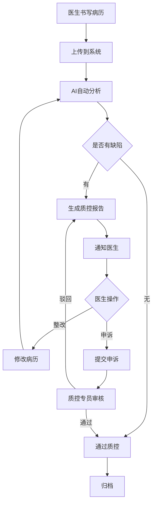
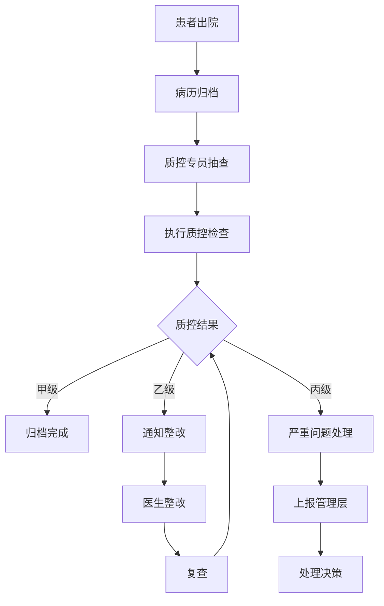
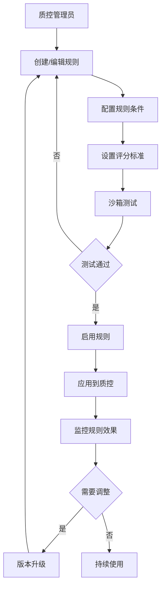

# 病案质控系统产品需求文档 (PRD)

**文档版本**: v2.0  
**创建日期**: 2025-10-08  
**项目名称**: Health-QC-Monorepo 病案质控系统  
**文档状态**: 基于现有代码梳理

---

## 📋 目录

- [1. 产品概述](#1-产品概述)
- [2. 产品定位与目标用户](#2-产品定位与目标用户)
- [3. 核心功能列表](#3-核心功能列表)
- [4. 用户角色与权限](#4-用户角色与权限)
- [5. 功能优先级](#5-功能优先级)
- [6. 业务流程](#6-业务流程)
- [7. 功能详细说明](#7-功能详细说明)
- [8. 非功能性需求](#8-非功能性需求)
- [9. 未来规划](#9-未来规划)

---

## 1. 产品概述

### 1.1 产品背景

病案质控系统是一个基于 AI 技术的智能医疗质量控制平台，旨在解决医疗机构在病案管理中面临的质量控制难题。系统通过结合大语言模型（LLM）智能分析和规则引擎双重验证，为医疗机构提供高效、准确的病案质量评估服务。

### 1.2 产品愿景

**让医疗质控更智能，让医疗服务更安全**

通过 AI 技术赋能医疗质控，实现：
- 病案质量的自动化、智能化评估
- 质控流程的标准化、规范化管理
- 医疗风险的早期识别和预警
- 医疗质量的持续改进和提升

### 1.3 产品价值

**对医疗机构**:
- 提升病案质量管理效率 70%+
- 降低人工质控成本 50%+
- 减少医疗纠纷风险
- 符合监管合规要求

**对质控人员**:
- 减少重复性工作
- 提供智能辅助决策
- 提升工作专业性
- 优化工作流程

**对医务人员**:
- 实时质控反馈
- 规范病历书写
- 提升医疗质量
- 降低执业风险

---

## 2. 产品定位与目标用户

### 2.1 产品定位

**智能化、全流程、多维度的医疗病案质量控制平台**

- **智能化**: 基于 AI 大模型的智能分析引擎
- **全流程**: 覆盖运行病历和终末病历全生命周期
- **多维度**: 完整性、准确性、及时性、一致性、合规性五维评估
- **可扩展**: 支持多种质控标准和规则体系

### 2.2 目标用户

#### 主要用户角色

1. **质控管理员** (P0)
   - 负责质控规则配置和管理
   - 监控质控系统运行状态
   - 生成质控统计报告
   - 管理用户权限

2. **质控专员** (P0)
   - 执行日常质控检查
   - 审核质控结果
   - 处理申诉和整改
   - 跟踪问题闭环

3. **医务人员** (P1)
   - 查看质控反馈
   - 提交申诉
   - 完成整改
   - 学习质控标准

4. **科室主任** (P1)
   - 查看科室质控统计
   - 监督整改进度
   - 分析质量趋势

5. **系统管理员** (P2)
   - 系统配置和维护
   - 用户管理
   - 数据备份
   - 系统监控

---

## 3. 核心功能列表

### 3.1 病案管理模块 ✅

**状态**: 已实现

**核心功能**:
- ✅ 病案上传（单个/批量）
- ✅ 病案信息管理（CRUD）
- ✅ 文档分类管理
- ✅ 病案检索和筛选
- ✅ 病案详情查看
- ✅ 文档版本控制

**支持格式**:
- PDF 文档
- Word 文档
- 文本内容
- 图片（OCR识别）

### 3.2 质控规则管理 ✅

**状态**: 已实现

**核心功能**:
- ✅ 规则配置和编辑
- ✅ 规则分类管理
- ✅ 规则启用/停用
- ✅ 规则版本管理
- ✅ 规则测试沙箱
- ✅ 规则导入/导出

**规则类型**:
- 四川省住院病历评定标准（68条规则）
- 语义质控规则
- 自定义质控规则

### 3.3 AI 智能质控 ✅

**状态**: 已实现

**核心功能**:
- ✅ LLM 智能分析
- ✅ 多文档类型识别
- ✅ 质控点自动检测
- ✅ 缺陷智能识别
- ✅ 改进建议生成
- ✅ 批量质控分析

**AI 能力**:
- 支持多种 LLM 模型（OpenAI、DeepSeek、阿里云等）
- 文档类型自动分类
- 语义理解和推理
- 上下文关联分析

### 3.4 质控结果管理 ✅

**状态**: 已实现

**核心功能**:
- ✅ 质控结果展示
- ✅ 缺陷分类统计
- ✅ 质控报告生成
- ✅ 结果导出
- ✅ 历史记录查询

**评分维度**:
- 完整性评分
- 准确性评分
- 及时性评分
- 一致性评分
- 合规性评分

### 3.5 统计分析模块 ✅

**状态**: 已实现

**核心功能**:
- ✅ 实时数据统计
- ✅ 多维度分析
- ✅ 趋势分析
- ✅ 可视化图表
- ✅ 自定义报表

**统计维度**:
- 按科室统计
- 按医生统计
- 按时间统计
- 按质控标准统计
- 按缺陷类型统计

### 3.6 通知与申诉 ⚠️

**状态**: 部分实现

**已实现**:
- ✅ 通知服务框架
- ✅ WebSocket 实时通知
- ✅ 通知消息管理

**待完善**:
- ⏳ 申诉流程管理
- ⏳ 整改跟踪
- ⏳ 问题闭环管理

### 3.7 系统配置 ✅

**状态**: 已实现

**核心功能**:
- ✅ LLM 模型配置
- ✅ 质控标准配置
- ✅ 用户权限管理
- ✅ 科室配置
- ✅ 系统参数设置

---

## 4. 用户角色与权限

### 4.1 角色定义

| 角色 | 权限范围 | 主要职责 |
|------|---------|---------|
| **系统管理员** | 全部权限 | 系统配置、用户管理、数据维护 |
| **质控管理员** | 质控管理权限 | 规则配置、质控监督、报告生成 |
| **质控专员** | 质控执行权限 | 质控检查、结果审核、问题跟踪 |
| **科室主任** | 科室查看权限 | 查看科室数据、监督整改 |
| **医务人员** | 基础查看权限 | 查看个人质控结果、提交申诉 |

### 4.2 权限矩阵

| 功能模块 | 系统管理员 | 质控管理员 | 质控专员 | 科室主任 | 医务人员 |
|---------|-----------|-----------|---------|---------|---------|
| 病案上传 | ✅ | ✅ | ✅ | ✅ | ✅ |
| 病案查看 | ✅ | ✅ | ✅ | 🔒科室 | 🔒个人 |
| 质控规则配置 | ✅ | ✅ | ❌ | ❌ | ❌ |
| 质控执行 | ✅ | ✅ | ✅ | ❌ | ❌ |
| 质控结果查看 | ✅ | ✅ | ✅ | 🔒科室 | 🔒个人 |
| 统计报表 | ✅ | ✅ | ✅ | 🔒科室 | ❌ |
| 申诉管理 | ✅ | ✅ | ✅ | ❌ | 🔒提交 |
| 用户管理 | ✅ | ❌ | ❌ | ❌ | ❌ |
| 系统配置 | ✅ | 🔒部分 | ❌ | ❌ | ❌ |

---

## 5. 功能优先级

### 5.1 P0 核心功能（已实现）

**必须具备，系统核心价值**

- ✅ 病案上传和管理
- ✅ 质控规则配置
- ✅ AI 智能质控分析
- ✅ 质控结果展示
- ✅ 基础统计报表
- ✅ 用户认证和权限

### 5.2 P1 重要功能（部分实现）

**显著提升用户体验**

- ✅ 批量质控处理
- ✅ 高级统计分析
- ✅ 质控报告导出
- ⏳ 申诉流程管理
- ⏳ 整改跟踪
- ⏳ 移动端适配

### 5.3 P2 增强功能（待规划）

**锦上添花，未来扩展**

- ⏳ 智能推荐
- ⏳ 知识库管理
- ⏳ 培训考核
- ⏳ 第三方系统集成
- ⏳ 多语言支持
- ⏳ 高级数据分析

---

## 6. 业务流程

### 6.1 运行病历质控流程



### 6.2 终末病历质控流程



### 6.3 质控规则配置流程



---

## 7. 功能详细说明

### 7.1 病案管理

#### 7.1.1 病案上传

**功能描述**: 支持单个和批量上传病案文档

**输入**:
- 患者基本信息（姓名、性别、年龄、住院号等）
- 科室信息
- 诊断信息
- 病案文档（PDF/Word/文本）

**处理流程**:
1. 文件格式验证
2. 文档内容提取
3. 患者信息关联
4. 文档分类识别
5. 存储到数据库

**输出**:
- 病案记录ID
- 上传状态
- 文档分类结果

#### 7.1.2 文档分类管理

**功能描述**: 自动识别和管理病案文档类型

**支持的文档类型**:
- 入院记录
- 病程记录
- 手术记录
- 出院记录
- 检查报告
- 化验单
- 其他医疗文书

**分类方式**:
- AI 自动分类
- 手动指定分类
- 批量分类调整

### 7.2 质控规则管理

#### 7.2.1 四川省质控规则

**规则来源**: 四川省住院病历评定标准

**规则分类**:
- 病程记录规则（SC-001 ~ SC-020，20条）
- 手术记录规则（SC-021 ~ SC-035，15条）
- 入院记录规则（SC-036 ~ SC-050，15条）
- 出院记录规则（SC-051 ~ SC-068，18条）

**规则结构**:
```json
{
  "code": "SC-001",
  "name": "病程记录书写规范",
  "category": "病程记录",
  "severity": "warn",
  "description": "病程记录应当客观、真实、准确、及时、完整、规范",
  "check_points": [
    "记录时间准确性",
    "内容完整性",
    "签名规范性"
  ],
  "score_deduction": 2
}
```

#### 7.2.2 语义质控规则

**功能描述**: 基于 LLM 的语义理解质控

**规则类型**:
- 逻辑一致性检查
- 诊疗合理性检查
- 用药合理性检查
- 时间顺序检查
- 因果关系检查

**配置方式**:
- 自然语言描述
- 示例病历
- 预期结果

### 7.3 AI 智能质控

#### 7.3.1 LLM 模型配置

**支持的模型**:
- OpenAI GPT-4/GPT-3.5
- DeepSeek
- 阿里云通义千问
- 其他兼容 OpenAI API 的模型

**配置参数**:
- API 端点
- API 密钥
- 模型名称
- 温度参数
- 最大 Token 数
- 超时设置

#### 7.3.2 质控分析流程

**单文档质控**:
1. 文档内容提取
2. 文档类型识别
3. 规则匹配
4. LLM 分析
5. 结果汇总
6. 报告生成

**多文档质控**:
1. 文档关联分析
2. 跨文档一致性检查
3. 时间线分析
4. 综合评分

#### 7.3.3 质控结果结构

```json
{
  "record_id": "uuid",
  "analysis_time": "2025-10-08T10:00:00Z",
  "overall_score": 85,
  "grade": "乙级",
  "dimensions": {
    "completeness": 90,
    "accuracy": 85,
    "timeliness": 80,
    "consistency": 85,
    "compliance": 85
  },
  "defects": [
    {
      "rule_code": "SC-001",
      "severity": "warn",
      "description": "病程记录时间不准确",
      "location": "第3页",
      "suggestion": "请核对记录时间"
    }
  ],
  "ai_analysis": {
    "model": "gpt-4",
    "confidence": 0.92,
    "summary": "整体质量良好，存在少量时间记录问题"
  }
}
```

### 7.4 统计分析

#### 7.4.1 实时统计

**统计指标**:
- 病案总数
- 质控完成数
- 平均质控分数
- 缺陷分布
- 质控效率

**更新频率**: 实时更新

#### 7.4.2 趋势分析

**分析维度**:
- 时间趋势（日/周/月/季/年）
- 科室对比
- 医生对比
- 缺陷类型趋势

**可视化方式**:
- 折线图
- 柱状图
- 饼图
- 热力图

---

## 8. 非功能性需求

### 8.1 性能要求

| 指标 | 要求 | 当前状态 |
|------|------|---------|
| 单病案质控响应时间 | < 30秒 | ✅ 满足 |
| 批量质控（100份） | < 5分钟 | ✅ 满足 |
| 系统并发用户 | 100+ | ✅ 满足 |
| 数据库查询响应 | < 1秒 | ✅ 满足 |
| 页面加载时间 | < 3秒 | ✅ 满足 |

### 8.2 可用性要求

- 系统可用性: 99.5%
- 数据备份: 每日自动备份
- 灾难恢复: RTO < 4小时, RPO < 1小时

### 8.3 安全性要求

- 用户认证: JWT Token
- 数据传输: HTTPS
- 数据存储: 加密存储
- 权限控制: 基于角色的访问控制（RBAC）
- 审计日志: 完整的操作日志

### 8.4 兼容性要求

**浏览器支持**:
- Chrome 90+
- Firefox 88+
- Safari 14+
- Edge 90+

**移动端**:
- iOS 13+
- Android 8+

---

## 9. 未来规划

### 9.1 短期规划（3-6个月）

**功能完善**:
- ⏳ 完善申诉流程管理
- ⏳ 增强整改跟踪功能
- ⏳ 优化移动端体验
- ⏳ 增加更多质控标准

**性能优化**:
- ⏳ 批量处理性能优化
- ⏳ 缓存机制优化
- ⏳ 数据库查询优化

### 9.2 中期规划（6-12个月）

**智能化升级**:
- ⏳ 智能推荐系统
- ⏳ 知识图谱构建
- ⏳ 预测性分析
- ⏳ 自动化整改建议

**集成扩展**:
- ⏳ HIS 系统集成
- ⏳ EMR 系统集成
- ⏳ 第三方质控平台对接

### 9.3 长期规划（1-2年）

**平台化**:
- ⏳ 多租户支持
- ⏳ SaaS 化部署
- ⏳ 开放 API 平台
- ⏳ 插件生态系统

**智能化**:
- ⏳ 深度学习模型训练
- ⏳ 个性化质控策略
- ⏳ 自适应规则优化
- ⏳ 智能培训系统

---

## 附录

### A. 术语表

| 术语 | 说明 |
|------|------|
| 运行病历 | 从患者入院到病历归档前的病历 |
| 终末病历 | 患者出院后归档的完整病历 |
| 环节质控 | 对运行病历进行的质量控制 |
| 终末质控 | 对终末病历进行的质量控制 |
| 甲级病历 | 质控评分 ≥ 90分 |
| 乙级病历 | 质控评分 75-89分 |
| 丙级病历 | 质控评分 < 75分 |
| LLM | Large Language Model，大语言模型 |

### B. 参考文档

- 四川省住院病历评定标准
- 医疗质量管理办法
- 电子病历系统功能规范
- 医院信息系统基本功能规范

---

**文档维护**: 本文档基于实际代码分析生成，随系统迭代持续更新
**最后更新**: 2025-10-08

