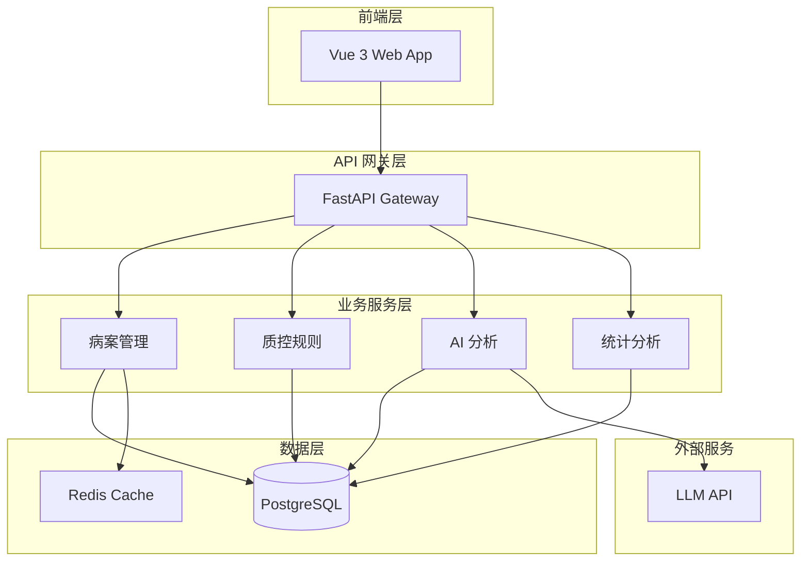

# 病案质控系统文档中心

**项目名称**: Health-QC-Monorepo 病案质控系统  
**文档版本**: v2.0  
**最后更新**: 2025-10-08

---

## 📚 文档导航

### 核心文档

| 文档 | 说明 | 适用人员 | 状态 |
|------|------|---------|------|
| [PRD - 产品需求文档](./PRD_病案质控系统产品需求文档.md) | 产品功能、用户角色、业务流程 | 产品经理、开发团队 | ✅ 完成 |
| [TDD - 技术设计文档](./TDD_病案质控系统技术设计文档.md) | 系统架构、技术栈、核心模块设计 | 技术团队 | ✅ 完成 |
| [API 接口清单](./API接口清单.md) | 所有API接口的详细说明 | 前后端开发 | ✅ 完成 |
| [开发计划 2025Q1](./开发计划_2025Q1.md) | 季度开发计划、里程碑、风险管理 | 项目经理、开发团队 | ✅ 完成 |
| [任务清单 2025Q1](./任务清单_2025Q1.md) | 详细任务分解、进度跟踪 | 全体开发人员 | ✅ 完成 |
| [快速启动指南](./快速启动指南.md) | 环境搭建、快速上手 | 新加入开发者 | ✅ 完成 |

### 专项文档

| 文档 | 说明 | 状态 |
|------|------|------|
| [系统概览](./system-overview.md) | 系统背景、架构、技术栈 | ✅ 已有 |
| [数据库设计](./database-schema.md) | 数据库表结构、关系图 | ✅ 已有 |
| [质控引擎开发指南](./qc-engine-dev-guide.md) | 质控引擎DSL、规则开发 | ✅ 已有 |

---

## 🎯 快速开始

### 新加入团队？

1. **阅读顺序**:
   ```
   快速启动指南 → PRD → TDD → API接口清单 → 开发计划
   ```

2. **环境搭建**:
   - 参考 [快速启动指南](./快速启动指南.md) 第2-3节
   - 预计时间: 1-2小时

3. **熟悉代码**:
   - 阅读 [TDD](./TDD_病案质控系统技术设计文档.md) 了解架构
   - 查看 [API接口清单](./API接口清单.md) 了解接口

4. **开始开发**:
   - 查看 [任务清单](./任务清单_2025Q1.md) 认领任务
   - 遵循 [快速启动指南](./快速启动指南.md) 第4节的开发工作流

### 产品经理？

1. **了解产品**:
   - 阅读 [PRD](./PRD_病案质控系统产品需求文档.md)
   - 查看业务流程图和功能优先级

2. **跟踪进度**:
   - 查看 [开发计划](./开发计划_2025Q1.md) 了解里程碑
   - 使用 [任务清单](./任务清单_2025Q1.md) 跟踪进度

### 技术负责人？

1. **技术决策**:
   - 参考 [TDD](./TDD_病案质控系统技术设计文档.md) 的技术选型
   - 查看技术债务和改进建议

2. **架构设计**:
   - 查看系统架构图和数据库设计
   - 参考核心模块的技术实现方案

---

## 📊 项目概览

### 系统架构



### 核心功能

| 功能模块 | 状态 | 优先级 | 说明 |
|---------|------|--------|------|
| 病案管理 | ✅ 已实现 | P0 | 病案CRUD、文档分类 |
| 质控规则管理 | ✅ 已实现 | P0 | 四川省68条规则、语义规则 |
| AI 智能质控 | ✅ 已实现 | P0 | LLM分析、批量质控 |
| 质控结果管理 | ✅ 已实现 | P0 | 结果展示、报告生成 |
| 统计分析 | ✅ 已实现 | P0 | 实时统计、趋势分析 |
| 申诉与整改 | ⏳ 部分实现 | P0 | 前端UI完成，后端待开发 |
| 通知系统 | ⏳ 部分实现 | P1 | 框架完成，功能待完善 |
| 移动端适配 | ⏳ 待实现 | P1 | 计划第三阶段 |
| 知识库管理 | ⏳ 待实现 | P2 | 计划第四阶段 |

### 技术栈

**前端**:
- Vue 3.5.13 + TypeScript 5.7.2
- Vite 6.0.5 + Ant Design Vue 4.2.6
- Pinia 2.3.0 + Vue Router 4.5.0

**后端**:
- FastAPI 0.104.1 + Python 3.10+
- PostgreSQL 15 + Supabase
- Redis 7 + OpenAI GPT / DeepSeek

---

## 📈 开发进度

### 2025 Q1 里程碑

| 里程碑 | 时间 | 目标 | 状态 |
|--------|------|------|------|
| **M1: 系统稳定** | 第2周末 (1/17) | 代码质量、测试覆盖率>50% | ⏳ 未开始 |
| **M2: 核心功能** | 第6周末 (2/14) | 申诉流程、批量质控、报告生成 | ⏳ 未开始 |
| **M3: 体验优化** | 第9周末 (3/7) | 移动端适配、智能推荐 | ⏳ 未开始 |
| **M4: 扩展功能** | 第12周末 (3/31) | 知识库、培训考核 | ⏳ 未开始 |

### 当前进度

- **总任务数**: 53
- **已完成**: 0
- **进行中**: 0
- **未开始**: 53
- **完成率**: 0%

---

## 🛠️ 开发规范

### 代码规范

**前端**:
```bash
# ESLint + Prettier
pnpm run lint
pnpm run format
```

**后端**:
```bash
# Black + Flake8
black .
flake8 .
```

### 提交规范

使用 Conventional Commits:
```bash
feat(llm): 统一LLM客户端接口
fix(api): 修复申诉API响应格式错误
refactor(qc): 重构质控引擎代码
docs(readme): 更新快速启动指南
test(unit): 添加LLM客户端单元测试
```

### 分支策略

- `main`: 生产环境
- `develop`: 开发环境
- `feature/*`: 功能分支
- `hotfix/*`: 紧急修复

### Code Review

- 所有代码必须经过 Review
- 至少 1 人 Approve 才能合并
- 关键功能需要 2 人 Approve

---

## 📝 文档维护

### 更新频率

| 文档 | 更新频率 | 负责人 |
|------|---------|--------|
| PRD | 需求变更时 | 产品经理 |
| TDD | 架构变更时 | 技术负责人 |
| API接口清单 | 接口变更时 | 后端开发 |
| 开发计划 | 每两周 | 项目经理 |
| 任务清单 | 每日 | 全体开发人员 |
| 快速启动指南 | 环境变更时 | 技术负责人 |

### 文档规范

1. **Markdown 格式**: 所有文档使用 Markdown
2. **版本控制**: 文档头部标注版本号和更新日期
3. **目录结构**: 使用清晰的目录结构
4. **代码示例**: 提供完整的代码示例
5. **图表说明**: 使用 Mermaid 绘制流程图和架构图

---

## 🔗 相关链接

### 项目资源

- **代码仓库**: [GitHub](https://github.com/your-org/health-qc-monorepo)
- **项目管理**: [Jira](https://your-org.atlassian.net)
- **文档协作**: [Notion](https://notion.so/your-workspace)
- **API 文档**: http://localhost:8001/docs

### 技术文档

- [Vue 3 官方文档](https://vuejs.org/)
- [FastAPI 文档](https://fastapi.tiangolo.com/)
- [Supabase 文档](https://supabase.com/docs)
- [OpenAI API 文档](https://platform.openai.com/docs)

### 团队协作

- **即时通讯**: Slack / 钉钉
- **代码审查**: GitHub Pull Requests
- **错误监控**: Sentry
- **性能监控**: New Relic

---

## 📞 联系方式

### 团队成员

| 角色 | 姓名 | 邮箱 | 职责 |
|------|------|------|------|
| 项目经理 | 待定 | - | 项目管理、进度跟踪 |
| 技术负责人 | 待定 | - | 技术决策、架构设计 |
| 产品经理 | 待定 | - | 需求管理、产品规划 |
| 后端开发 | 待定 | - | 后端开发、API设计 |
| 前端开发 | 待定 | - | 前端开发、UI实现 |
| 测试工程师 | 待定 | - | 测试、质量保证 |

### 获取帮助

1. **查看文档**: 先查看相关文档
2. **搜索 Issues**: 在 GitHub Issues 中搜索
3. **询问团队**: 在团队群组中提问
4. **创建 Issue**: 创建详细的 Issue

---

## 📄 许可证

本项目采用 [MIT License](../LICENSE)

---

## 🎉 致谢

感谢所有为本项目做出贡献的开发者！

---

**文档维护**: 技术负责人  
**最后更新**: 2025-10-08  
**文档版本**: v2.0

