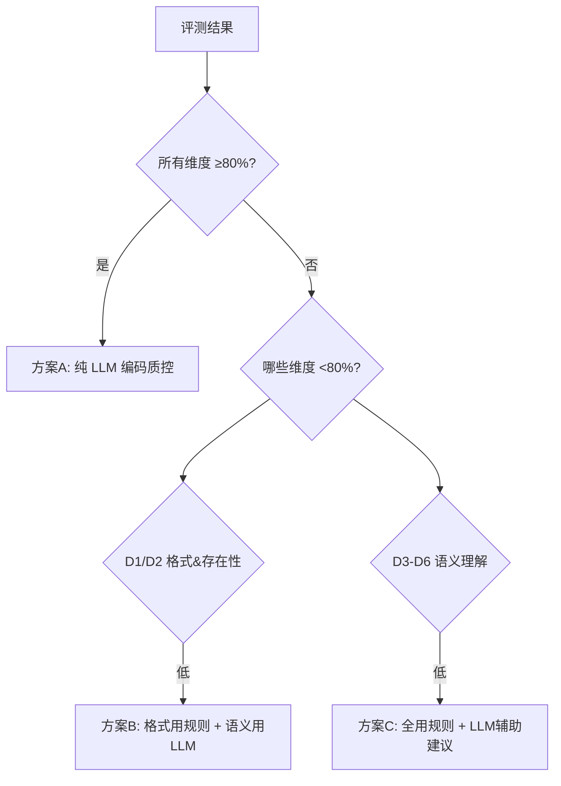

# LLM 编码质控能力验证方案

## 背景与目标

用 LLM 替代传统规则引擎实现编码质控（ICD-10/ICD-9-CM-3），优势：
- 不需维护庞大的编码规则库
- 能理解编码语义和临床上下文
- 直接输出自然语言质控建议

**验证目标**：量化 Qwen 系列模型在 6 个编码质控维度的准确率，确定哪些维度可以信赖 LLM、哪些需要规则兜底。

---

## 评测维度与测试用例

### D1：编码格式校验（5 例）

> LLM 能否识别编码格式错误？

| # | 输入 | 期望判定 | 考察点 |
|---|------|----------|--------|
| 1 | 主诊断：`I21.001` 急性心肌梗死 | ✅ 格式正确 | ICD-10 标准格式 |
| 2 | 主诊断：`I21` 急性心肌梗死 | ⚠️ 编码不完整 | 缺少亚目 |
| 3 | 主诊断：`21.001` 急性心肌梗死 | ❌ 格式错误 | 缺少字母前缀 |
| 4 | 手术操作：`36.0701` PCI | ✅ 格式正确 | ICD-9-CM-3 格式 |
| 5 | 手术操作：`360701` PCI | ❌ 格式错误 | 缺少分隔点 |

### D2：编码真实性验证（5 例）

> LLM 能否判断一个编码是否真实存在？

| # | 输入 | 期望判定 | 考察点 |
|---|------|----------|--------|
| 1 | `I21.001` 急性前壁ST段抬高型心肌梗死 | ✅ 编码存在，名称匹配 | 真实编码 |
| 2 | `I21.999` 心肌梗死NOS | ❌ 编码不存在 | 虚构亚目 |
| 3 | `Z99.999` 未指定 | ❌ 编码不存在 | 虚构编码 |
| 4 | `E11.900` 2型糖尿病 → 但标注为 `I10` | ⚠️ 编码与名称不匹配 | 编码名称交叉验证 |
| 5 | `J18.900` 社区获得性肺炎 | ✅ 编码存在 | 真实编码 |

### D3：编码合并规则（5 例）

> LLM 能否识别应该使用合并编码的情况？

| # | 场景 | 当前编码 | 期望建议 |
|---|------|----------|----------|
| 1 | 2型糖尿病+糖尿病肾病 | `E11.900` + `N08.3` 分别编 | ⚠️ 应使用合并码 `E11.200` |
| 2 | 高血压+高血压性心脏病 | `I10` + `I11.900` 分别编 | ⚠️ 应使用 `I11.900` 含高血压 |
| 3 | 胆囊结石+急性胆囊炎 | `K80.000` + `K81.000` | ⚠️ 应使用 `K80.100` 含胆囊炎 |
| 4 | 急性阑尾炎+穿孔 | `K35.900` + `K35.001` | ⚠️ `K35.001` 已包含穿孔 |
| 5 | 脑梗死+偏瘫 | `I63.900` + `G81.900` | ✅ 正确分编（后遗症另编） |

### D4：编码互斥规则（5 例）

> LLM 能否识别不能同时出现的编码？

| # | 编码组合 | 期望判定 |
|---|----------|----------|
| 1 | `O80.000`(自然分娩) + `O82.000`(剖宫产) | ❌ 互斥：不能同时自然分娩和剖宫产 |
| 2 | `I21.001`(急性心梗) + `I25.100`(陈旧性心梗) | ⚠️ 需确认：同次住院急性转陈旧需时间依据 |
| 3 | `N18.500`(慢性肾衰竭5期) + `N18.300`(3期) | ❌ 互斥：分期不能并存 |
| 4 | `E11.900`(2型糖尿病) + `E10.900`(1型糖尿病) | ❌ 互斥：1型和2型不能并存 |
| 5 | `J44.100`(COPD急性加重) + `J18.900`(肺炎) | ✅ 可并存（COPD合并肺炎常见） |

### D5：主诊断选择合理性（5 例）

> LLM 能否判断主诊断选择是否合理？

| # | 主诊断 | 其他诊断 | 手术 | 期望 |
|---|--------|----------|------|------|
| 1 | `Z51.100`(化疗) | `C34.901`(肺癌) | 无 | ⚠️ Z码做主诊断需有化疗操作支撑 |
| 2 | `R10.400`(腹痛) | `K35.900`(急性阑尾炎) | 阑尾切除 | ❌ 症状码不应做主诊断 |
| 3 | `I10`(高血压) | `I21.001`(急性心梗) | PCI | ⚠️ 心梗+PCI应做主诊断 |
| 4 | `I21.001`(急性心梗) | `E11.900`(糖尿病) | PCI | ✅ 主诊断选择合理 |
| 5 | `Z03.800`(观察) | 无其他诊断 | 无 | ⚠️ 观察编码不宜做最终主诊断 |

### D6：编码与临床信息一致性（5 例）

> 给出病历摘要，LLM 能否发现编码遗漏或不一致？

| # | 病历摘要 | 当前编码 | 期望 |
|---|----------|----------|------|
| 1 | "患者因急性心梗入院，行PCI，**术后出现心力衰竭**" | 仅编 `I21.001` + PCI | ⚠️ 缺少心衰编码 `I50.900` |
| 2 | "**女性**患者，诊断前列腺增生" | `N40` | ❌ 性别与诊断冲突 |
| 3 | "患者65岁，诊断**新生儿**黄疸" | `P59.900` | ❌ 年龄与P码冲突 |
| 4 | "行全膝关节置换术" | 仅编诊断，无手术编码 | ⚠️ 手术操作编码缺失 |
| 5 | "2型糖尿病，病历记录有糖尿病肾病" | 仅编 `E11.900` | ⚠️ 应加编 `E11.200` 或 `N08.3` |

---

## 评测脚本设计

```python
# scripts/eval_llm_coding_qc.py
"""
LLM 编码质控能力评测脚本

用法：
  python scripts/eval_llm_coding_qc.py --model qwen2.5-14b-instruct
  python scripts/eval_llm_coding_qc.py --model qwen3-30b-a3b-instruct-2507
  python scripts/eval_llm_coding_qc.py --all  # 测试所有模型
"""

# 对每个测试用例：
# 1. 构造结构化 Prompt（系统角色 + 编码数据 + 质控问题）
# 2. 调用 LLM API
# 3. 解析 LLM 输出（JSON 格式）
# 4. 与标准答案对比，计算 TP/FP/TN/FN
# 5. 输出评测报告
```

### Prompt 模板

```
你是医院病案编码质控专家，精通 ICD-10（国临版2.0）和 ICD-9-CM-3 编码规范。

请对以下病案首页编码进行质控审查：

【患者信息】
{patient_info}

【诊断编码】
{diagnosis_codes}

【手术操作编码】
{procedure_codes}

【病历摘要】（如有）
{clinical_summary}

请从以下维度逐一检查，输出 JSON：
{
  "issues": [
    {
      "dimension": "format|existence|merge|exclusion|primary|consistency",
      "severity": "error|warning|info",
      "code": "涉及的编码",
      "description": "问题描述",
      "suggestion": "修改建议"
    }
  ],
  "summary": {
    "total_issues": 0,
    "errors": 0,
    "warnings": 0,
    "overall_assessment": "通过/需修改/严重问题"
  }
}
```

---

## 评分标准

| 指标 | 计算方式 | 及格线 |
|------|----------|--------|
| **准确率** | 正确判定 / 总测试数 | ≥ 80% |
| **召回率** | 发现的真实问题 / 总真实问题数 | ≥ 70% |
| **误报率** | 错误报告的问题 / 总报告问题数 | ≤ 20% |
| **格式合规** | 返回合法 JSON 的比例 | ≥ 95% |

### 维度级评分矩阵（示例）

| 维度 | Qwen2.5-14B | Qwen3-30B | 决策 |
|------|-------------|-----------|------|
| D1 格式校验 | ?% | ?% | LLM / 规则兜底 |
| D2 真实性验证 | ?% | ?% | LLM / 规则兜底 |
| D3 合并规则 | ?% | ?% | LLM / 规则兜底 |
| D4 互斥规则 | ?% | ?% | LLM / 规则兜底 |
| D5 主诊断选择 | ?% | ?% | LLM / 规则兜底 |
| D6 临床一致性 | ?% | ?% | LLM / 规则兜底 |

---

## 预期结论与决策框架

根据评测结果，三种可能的架构决策：



- **方案 A**：纯 LLM — 所有维度 ≥80%，直接用
- **方案 B**：混合 — D1/D2 用正则规则兜底，D3-D6 用 LLM（最可能的结果）
- **方案 C**：规则为主 — LLM 仅做辅助建议

---

## 实施步骤

| 步骤 | 内容 | 预估 |
|------|------|------|
| 1 | 编写评测脚本 `scripts/eval_llm_coding_qc.py` | 2h |
| 2 | 对 `qwen2.5-14b-instruct` 运行 30 个用例 | 30min |
| 3 | 对 `qwen3-30b-a3b-instruct-2507` 运行 30 个用例 | 30min |
| 4 | 分析结果，生成评测报告 | 1h |
| 5 | 基于报告决定架构方案 | 讨论 |

> [!TIP]
> 建议先用云端 `qwen-max` 跑一遍作为能力上限基准，再对比私有化小模型的差距。
