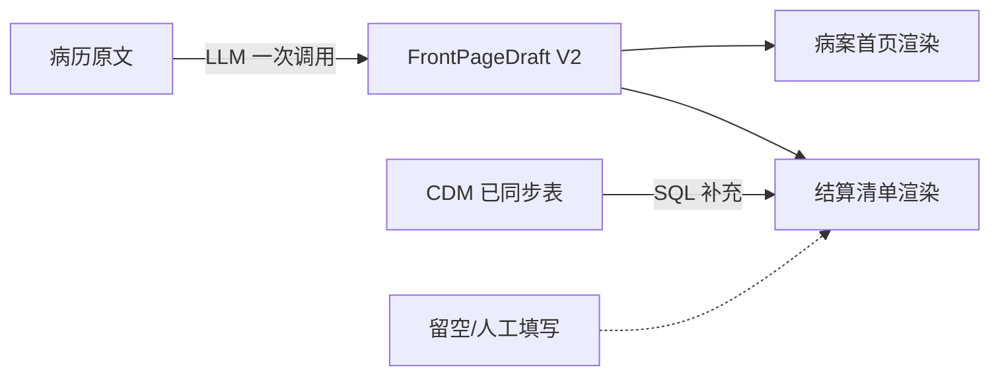
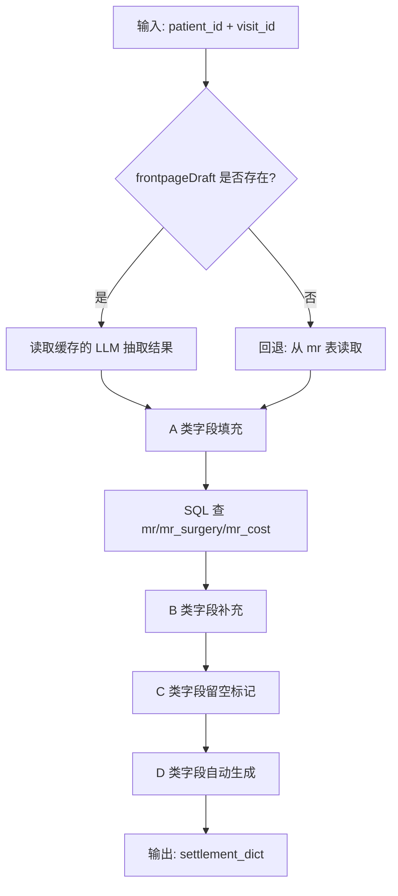

# 病案首页 & 医保结算清单 — LLM 统一抽取实施方案

## 一、核心设计理念

> **LLM 从病历文本一次抽取，病案首页和结算清单共享同一份结构化数据。**



### 为什么不分开抽取

- 结算清单 **67% 的字段**与病案首页完全重叠
- 分开抽取会导致同一患者同一次住院的姓名/诊断等出现不一致
- 合并抽取只增加约 9 个字段，LLM 调用次数不变

---

## 二、字段来源分类（四类）

基于 CDM 实际同步状态的修正版分类：

| 类别 | 含义 | 字段数 | 占比 |
|---|---|---|---|
| 🟢 A | LLM 从病历抽取（首页+清单共用）| **~49** | **63%** |
| 🔵 B | SQL 从已同步 CDM 表读取 | **~14** | **18%** |
| 🟡 C | 留空（需对接结算清单 ETL 或人工填写）| **~16** | **21%** |
| ⚪ D | 系统自动生成/固定配置 | **~3** | 4% |

---

## 三、各类字段清单

### 🟢 A 类：LLM 抽取（~49 个）

#### A1. 首页已有（无需改动）— 40 个

| 字段域 | 字段 |
|---|---|
| 患者身份 | 姓名、性别、出生日期、年龄、国籍、民族、证件号码、职业 |
| 地址 | 现住址、邮编 |
| 工作单位 | 名称、地址、电话 |
| 联系人 | 姓名、关系、地址、电话 |
| 住院信息 | 入院时间、入院科别、出院时间、出院科别、住院天数、入院途径、病案号、机构名称/代码 |
| 诊断 | 门急诊诊断名称/代码、出院主诊断名称/代码、其他诊断列表/代码、入院病情 |
| 手术 | 主要手术名称/代码/日期、术者、麻醉方式/医师、切口等级、其他手术列表 |
| 离院 | 离院方式、再住院标志/目的 |
| 医师 | 主诊医师、责任护士 |
| 医保 | 医保类型（付费方式） |
| 其他 | 呼吸机时间、ICU 类型/进出时间 |

#### A2. 需新增抽取 — 9 个

在 [FrontPageDraft](file:///d:/%E5%A4%A7%E6%A8%A1%E5%9E%8B%E9%A1%B9%E7%9B%AE/lx0222/health-qc-monorepo/apps/medqc-web/backend/app/schemas/frontpage.py#301-318) schema 中**新增或细化**以下字段：

| 新字段 | 归属模块 | LLM Prompt 要点 |
|---|---|---|
| `inpat_type` 住院医疗类型 | `hospitalization` | "住院" or "日间手术"，从入院记录判断 |
| `therapy_type` 治疗类别 | `hospitalization` | "西医/中医/中西医"，从诊疗方案判断 |
| `receiving_institution_name` 拟接收机构 | `hospitalization` | 从出院医嘱/记录中抽取转院目标 |
| `coma_before_d/h/min` 入院前昏迷 | `other_medical_info` | 细化 `brain_injury_coma_in` 为 6 个子字段 |
| `coma_after_d/h/min` 入院后昏迷 | `other_medical_info` | 从病程记录中汇总昏迷时段 |

---

### 🔵 B 类：SQL 读取已同步 CDM 表（~14 个）

| 字段 | CDM 表.列 | 说明 |
|---|---|---|
| 转科科别 | `mr.transfer_dept_name` | 首页也有，双保险 |
| 输血（红细胞/血浆/全血/自体血）| `mr.rbc/plasma_volume/whole_blood_volume/autoblood_trans` | 4 个字段 |
| 拟接收机构名称 | `mr.planned_transder_to` | CDM 有此字段，LLM 也抽取做校验 |
| 术者医师代码 | `mr_surgery.surgeon_physician_code` | |
| 麻醉医师代码 | `mr_surgery.anesthesiologist_code` | |
| 手术起止时间 | `mr_surgery.surgery_begin/end_datetime` | |
| 身份证件类别 | `mr.id_card_type` | |
| 有/无过敏标志 | `mr.allergy_sign` | |
| ABO/Rh 血型 | `mr.abo_blood_code/rh_blood_code` | |

---

### 🟡 C 类：当前无数据源（~16 个）

> [!WARNING]
> 这些字段在 `medical_insurance_settlement` 表中已定义，但该表**尚未对接 ETL 同步**。

| 字段 | 说明 | 解决方案 |
|---|---|---|
| 清单流水号 `medinsur_serial_no` | 医保系统生成 | 留空 / 后续对接 |
| 医保编号 `insurance_no` | 医保系统 | 留空 / 后续对接 |
| 医保结算等级 | 机构等级 | 可配置为固定值 |
| 特殊人员类型 | 医保系统 | 留空 |
| 参保地 | 医保系统 | 留空 |
| 新生儿入院类型/出生体重/入院体重 | HIS 新生儿模块 | 留空（3 字段）|
| 护理天数（特级/一/二/三级）| HIS 护理模块 | 留空（4 字段）|
| 费用甲/乙/自费分类明细 | `settlement_cost` 表 | 留空（用 `mr_cost` 总额替代展示）|
| 基金支付/个人支付明细 | 医保结算核心 | 留空（5+ 字段）|

> [!TIP]
> **阶段性策略**：先用 A+B 类数据填充清单主体（80%），C 类字段留空显示横线。待医院对接 `medical_insurance_settlement` ETL 后自动填充。

---

### ⚪ D 类：自动生成/固定配置（~3 个）

| 字段 | 生成方式 |
|---|---|
| 申报时间 | `datetime.now()` |
| 定点医疗机构名称/代码 | 系统配置表固定值 |

---

## 四、后端实施方案

### 4.1 Schema 改造（[schemas/frontpage.py](file:///d:/%E5%A4%A7%E6%A8%A1%E5%9E%8B%E9%A1%B9%E7%9B%AE/lx0222/health-qc-monorepo/apps/medqc-web/backend/app/schemas/frontpage.py)）

```python
# FrontPageHospitalization 新增 3 字段
inpat_type: Optional[str] = Field(None, description="住院医疗类型：住院/日间手术")
therapy_type: Optional[str] = Field(None, description="治疗类别：1西医/2中医/3中西医")
receiving_institution: Optional[str] = Field(None, description="拟接收机构名称（转院时）")

# FrontPageOtherMedicalInfo 细化昏迷字段
coma_before_admission: Optional[Dict[str, int]] = Field(
    None, description="入院前昏迷时间 {days, hours, minutes}"
)
coma_after_admission: Optional[Dict[str, int]] = Field(
    None, description="入院后昏迷时间 {days, hours, minutes}"
)
```

### 4.2 LLM Prompt 增量

在 [frontpage_extraction_service.py](file:///d:/%E5%A4%A7%E6%A8%A1%E5%9E%8B%E9%A1%B9%E7%9B%AE/lx0222/health-qc-monorepo/apps/medqc-web/backend/app/services/frontpage_extraction_service.py) 的 `hospitalization` 和 `other_medical_info` 抽取模块的 prompt 中，增加以下指令：

```
住院医疗类型(inpat_type): 判断是"住院"还是"日间手术"
治疗类别(therapy_type): 判断主要治疗方法是"西医""中医"还是"中西医"
拟接收机构(receiving_institution): 如果离院方式为转院，从出院医嘱中提取目标机构名称

颅脑损伤昏迷时间: 如果患者有颅脑损伤，从入院记录和病程记录中提取：
  - 入院前昏迷: {days: X, hours: X, minutes: X}
  - 入院后昏迷: {days: X, hours: X, minutes: X}
  如果无颅脑损伤，返回 null
```

### 4.3 结算清单数据组装服务（新建）

```
新建: services/settlement_assembly_service.py

功能: 从 frontpageDraft + CDM SQL 组装结算清单数据字典
```

**数据组装流程：**



### 4.4 API 层改造

```python
# routers/settlement.py — 新增端点
@router.post("/settlement/{patient_id}/{visit_id}/generate")
async def generate_settlement_from_frontpage(patient_id, visit_id):
    """从病案首页 AI 抽取结果生成结算清单（不依赖 medical_insurance_settlement 表）"""
    # 1. 获取 frontpageDraft（缓存 or 现场抽取）
    # 2. SQL 补充 B 类字段
    # 3. 组装 settlement_dict
    # 4. 返回给前端渲染
```

---

## 五、前端实施方案

### 5.1 WorkstationV4View.vue

```diff
  // 结算清单 tab 数据加载逻辑修改
- loadSettlement(patientId, visitId)  // 只从 settlement 表查
+ loadSettlement(patientId, visitId)  // 优先 settlement 表
+   ↓ 404 时 fallback
+ generateSettlementFromFrontpage()   // 从首页抽取组装
```

**渲染优先级：**
1. 数据库有结算数据 → 直接渲染
2. 数据库无结算数据 + 有首页 AI 结果 → 从首页组装并渲染（标注"AI 生成"）
3. 均无 → 渲染空白样表

### 5.2 SettlementSheet.vue

无需改动模板结构，[v()](file:///d:/%E5%A4%A7%E6%A8%A1%E5%9E%8B%E9%A1%B9%E7%9B%AE/lx0222/health-qc-monorepo/apps/medqc-web/src/views/workstation-v2/components/SettlementSheet.vue#335-339) 函数已经能兼容空字段。

---

## 六、分阶段实施计划

### Phase 1：基础通路（当前可做）

1. ✏️ 修改 [FrontPageDraft](file:///d:/%E5%A4%A7%E6%A8%A1%E5%9E%8B%E9%A1%B9%E7%9B%AE/lx0222/health-qc-monorepo/apps/medqc-web/backend/app/schemas/frontpage.py#301-318) schema — 新增 9 个字段
2. ✏️ 修改 LLM prompt — 增加 9 个字段的抽取指令
3. 🆕 新建 `settlement_assembly_service.py` — 从 frontpageDraft + SQL 组装数据
4. ✏️ 新增 API 端点 — `POST /settlement/.../generate`
5. ✏️ 前端 fallback 逻辑 — 404 时调用组装 API

**预期效果：** 结算清单 ~63 个字段有数据（A+B 类），C 类留空

### Phase 2：ETL 对接（医院配合时做）

1. 在 `SYNC_TABLES` 中添加 `medical_insurance_settlement` 和 `settlement_cost`
2. 对接 DHC 存储过程（需要医院 DBA 开放 `web.medical_insurance_settlement`）
3. C 类字段自动填充

**预期效果：** 护理天数、医保编号、费用甲乙分类等全部补齐

### Phase 3：质控闭环

1. 结算清单 136 条形式质控规则已有（[settlement_formal_qc.py](file:///d:/%E5%A4%A7%E6%A8%A1%E5%9E%8B%E9%A1%B9%E7%9B%AE/lx0222/health-qc-monorepo/apps/medqc-web/backend/app/services/settlement_formal_qc.py)）
2. AI 生成 → 人工审核 → 执行质控 → 修正 → 归档

---

## 七、风险与注意事项

> [!CAUTION]
> **费用甲乙分类** 不等于 **病案首页费用分类**。`mr_cost` 表存的是卫健委 24 类费用，而结算清单要的是医保甲/乙/自费分类。两者无法互相推导，必须等 `settlement_cost` 表对接后才能填充。

> [!IMPORTANT]
> AI 生成的结算清单应明确标注为"草稿"，**不可直接上传医保系统**。需要人工审核确认后才能作为正式数据使用。
